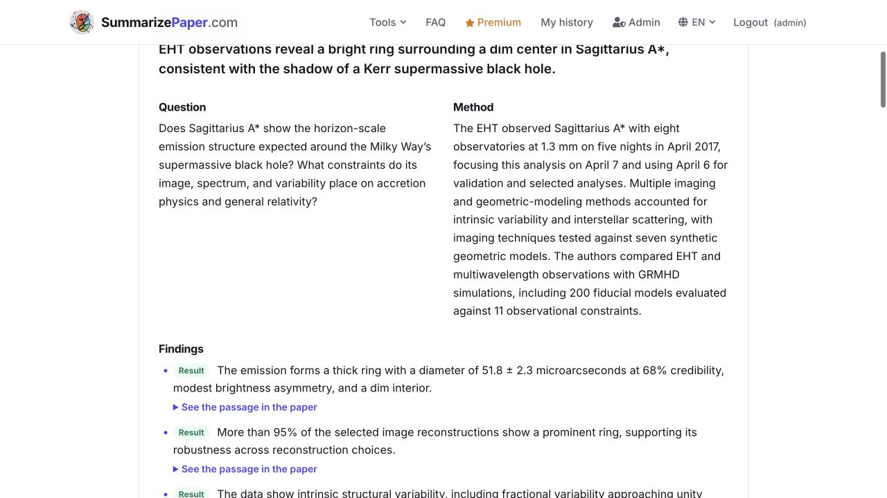
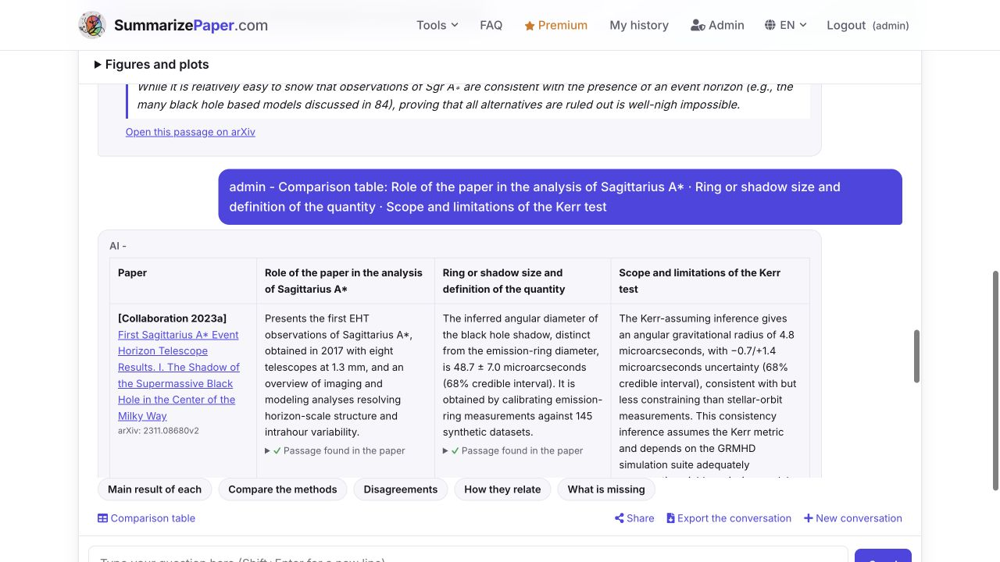

# SummarizePaper :books::robot:

**AI tools for researchers, from reading a paper to presenting it.** Summaries and a chat that answer
from the full text of a paper, collections compared cell by cell, alerts that follow a field, and tools
to write, submit and present research. Papers from arXiv, bioRxiv, medRxiv, journals and other preprint
servers, in English and French.

Live at **[www.summarizepaper.com](https://www.summarizepaper.com)** · [All tools](https://www.summarizepaper.com/en/tools/) · [Guides](https://www.summarizepaper.com/en/guides/)

<p align="center">
  
  
</p>

## What it does :sparkles:

Every answer rests on the paper itself: the full text is read when its license allows it (CC BY, BY-SA,
BY-NC, BY-NC-SA, CC0), the abstract otherwise, and claims are checked against the passages they come
from, with a link to each passage.

Free tools are open to every account; :star: marks Premium and :star::star: Premium+.

### Read papers faster

| Tool | What it does | Guide |
| --- | --- | --- |
| [Summaries](https://www.summarizepaper.com/en/) | Essentials, detailed summary, key points, lay summary and blog article of any paper (arXiv ID, DOI, bioRxiv, medRxiv, HAL, OSF, PubMed, Europe PMC link), with its figures; rewritten for another reader or in 16 languages | [guide](https://www.summarizepaper.com/en/guides/how-to-summarize-a-research-paper/) |
| [Chat with papers](https://www.summarizepaper.com/en/chat/) | Questions to one paper or several at once, answered from the full text with the passage behind each claim, figures read too; comparison tables with a source per cell; conversations kept and shared | [guide](https://www.summarizepaper.com/en/guides/how-to-chat-with-research-papers/) |
| [Collections](https://www.summarizepaper.com/en/collections/) | Papers kept together with notes and tags, edited with others, chatted with as a whole; preprints matched with their published versions, an email when a paper is published or retracted; :star: comparison table and open questions | [guide](https://www.summarizepaper.com/en/guides/organize-research-paper-collections/) |

### Follow your field

| Tool | What it does | Guide |
| --- | --- | --- |
| [Daily digest](https://www.summarizepaper.com/en/digest/) | New arXiv, bioRxiv, medRxiv and journal papers of your fields every morning, ranked by your research profile and votes, with a line for researchers and a web page per email | [guide](https://www.summarizepaper.com/en/guides/daily-digest-research-papers/) |
| [Saved searches](https://www.summarizepaper.com/en/saved-searches/) | Every new paper of the daily announcements matching a search (plurals, `"quotes"`, `-word`, `OR`, `prefix*`), ranked, by email, in the digest or by RSS. One watch free, five with Premium | [guide](https://www.summarizepaper.com/en/guides/saved-searches-research-alerts/) |
| [Rising topics](https://www.summarizepaper.com/en/trends/) | Topics rising each week, field by field, from several teams, with their history; "Is my topic rising?" for your own words | [guide](https://www.summarizepaper.com/en/guides/rising-research-topics/) |
| [Weekly letters](https://www.summarizepaper.com/en/letters/) | An article per field each week on the papers that matter beyond it, every number checked against the abstracts; web, RSS, email | [guide](https://www.summarizepaper.com/en/guides/weekly-science-letters/) |
| [Scoop watch](https://www.summarizepaper.com/en/scoops/) :star: | Describe a project in progress: prior art, competitors, and an email the day a new paper comes close to it | [guide](https://www.summarizepaper.com/en/guides/scoop-watch-research-project/) |
| [Citation alerts](https://www.summarizepaper.com/en/citations/) :star: | Who cites your papers and what they do with them, citing sentence included, self-citations apart | [guide](https://www.summarizepaper.com/en/guides/track-research-paper-citations/) |
| [Who works on it?](https://www.summarizepaper.com/en/teams/) :star: | People and institutions signing recent papers on a topic (first, last, corresponding author), their approaches, referees without your co-authors, new names monthly | [guide](https://www.summarizepaper.com/en/guides/find-research-teams-by-topic/) |
| [Research placements](https://www.summarizepaper.com/en/students/) :star::star: | For students: who signs recent papers on a topic, their team and funding, readings, a first email and reminders | [guide](https://www.summarizepaper.com/en/guides/find-research-placement-contacts/) |

### Write and submit

| Tool | What it does | Guide |
| --- | --- | --- |
| [Press kit](https://www.summarizepaper.com/en/press-kit/) :star::star: | By role: a draft release and the questions journalists will ask (authors), strengths and weaknesses (commentators), angles and wording (journalists), every quote checked against the paper, outside commentators suggested, PDF and Markdown | [guide](https://www.summarizepaper.com/en/guides/research-paper-press-kit/) |
| [Literature review](https://www.summarizepaper.com/en/literature-review/) :star::star: | From a research question: 15 to 30 founding and recent papers grouped by approach, with a referenced synthesis | |
| [What did I miss?](https://www.summarizepaper.com/en/missed/) :star: | Papers close to your draft that it does not cite | |
| [Bibliography check](https://www.summarizepaper.com/en/refcheck/) :star: | Retracted papers, preprints published since, outdated versions, citations the cited abstract does not support (.bib and .tex) | |
| [Zotero, Notion, Obsidian](https://www.summarizepaper.com/en/integrations/) | BibTeX, RIS and Markdown exports; papers sent to Zotero with their summary | |

### Present and meet

| Tool | What it does |
| --- | --- |
| [Journal club](https://www.summarizepaper.com/en/journal-club/) :star::star: | Slides with the paper's open-licensed figures, strengths, limitations and discussion questions; edited in the browser, exported to PDF or PowerPoint |
| [Conference companion](https://www.summarizepaper.com/en/conference/) :star::star: | The talks of a conference program that matter for your research, and the people to meet |

Literature reviews, bibliography checks, uncited-paper searches, topic maps and conference programs can be
shared with a supervisor or co-authors through a read-only link (90 days, stopped by the owner).

## Stack

Django 5.2 served by Daphne (ASGI), Channels websockets over Redis, PostgreSQL, on Heroku. Python 3.12.
OpenAI models for text, embeddings and speech; paper metadata and search from arXiv, OpenAlex, Crossref,
Semantic Scholar, NASA ADS, OpenReview, ORCID, bioRxiv and medRxiv. Stripe for Premium and Premium+.

### Code map

| Area | Modules (`summarizer/`) |
| --- | --- |
| Pages, search | `views.py`, `homepage.py`, `unified_search.py` (arXiv and journals at once), `search_filters.py`, `sitemaps.py`, `guides.py`, `tool_list.py` (the tools page and menu) |
| Paper text and sources | `paper_source.py` (arXiv HTML, then PDF), `sources.py` (DOI, bioRxiv, medRxiv, OSF, HAL, Europe PMC, OpenAlex), `publication_status.py`, `bibliography.py` |
| Summaries | `consumers.py` (websocket), `assistant.py`, `keypoints.py`, `summary_text.py`, `reading.py` (other reader or language), `evidence.py` (claims found in the text), `generated.py` (background results polled by the page) |
| Chat | `chat_page.py`, `chat_table.py` (comparison tables), `chat_figures.py`, `chat_vision.py`, `comparison.py` |
| Collections | `library.py`, `collection_tools.py`, `questions.py`, `publication_alerts.py`, `exports.py` (BibTeX, RIS, Markdown, Zotero) |
| Following a field | `digest.py`, `digest_web.py`, `digest_bundle.py`, `saved_searches.py`, `trends.py`, `trends_web.py`, `trend_sources.py`, `letters.py`, `audio.py` (read aloud), `synthesis.py` |
| Research tools | `scoops.py`, `citations.py`, `changes.py` (versions), `teams.py`, `students.py`, `student_papers.py`, `student_sources.py`, `missed.py`, `refcheck.py`, `literature.py`, `presskit.py`, `presskit_pdf.py`, `slides.py`, `slides_pptx.py`, `conference.py`, `result_share.py` |
| Accounts and billing | `accounts.py` (email links, Google sign-in, bot checks), `access.py` (quotas, never trusts the browser), `billing.py` (Stripe), `premium_tools.py`, `reactivation.py` |
| Operations | `usage.py` (AI tokens and cost by task, model, day and user), `activity.py` (daily staff page), `loadshed.py` (503 past 14 requests in flight), `threadwatch.py`, `cache.py`, `canonical_host.py`, `mailcheck.py` |

## Local setup :floppy_disk:

```bash
python3.12 -m venv venv
venv/bin/pip install -r requirements.txt
export SECRET_KEY=dev OPENAI_KEY=sk-...
venv/bin/python manage.py migrate
venv/bin/python manage.py runserver
```

Websockets need Redis on `127.0.0.1:6379` (`brew services start redis`).

Tests: `venv/bin/python manage.py test summarizer` and `node --test tests/*.test.cjs`.

Translations: French strings live in `locale/fr/LC_MESSAGES/django.po`; compile them with
`python manage.py compilemessages`. Guides are Markdown in `content/guides/{en,fr}/`, copied into the
database with `python manage.py import_guides`.

## Configuration (Heroku config vars)

| Variable | Purpose |
| --- | --- |
| `SECRET_KEY`, `ON_HEROKU`, `SITE_URL` | Django secret key, production settings, public address |
| `DATABASE_URL`, `REDISCLOUD_URL` | Set by the Postgres and Redis Cloud add-ons |
| `OPENAI_KEY` | OpenAI API key |
| `SECRETCMTA` | SMTP password (outgoing email) |
| `GOOGLE_CLIENT_ID`, `GOOGLE_CLIENT_SECRET` | Google sign-in |
| `OPENALEX_API_KEY` | Optional, free: raises the OpenAlex daily budget and reads full texts OpenAlex keeps |
| `ADS_TOKEN`, `S2_API_KEY` | NASA ADS and Semantic Scholar, sources of the citation alerts |
| `SCOOP_DRAFT_KEY` | Encrypts the scoop watch's kept drafts |
| `STRIPE_SECRET_KEY`, `STRIPE_WEBHOOK_SECRET`, `STRIPE_PRICE_*` | Premium and Premium+ (monthly, yearly, EUR and USD); closed while unset |
| `UMAMI_WEBSITE_ID`, `SENTRY_DSN` | Optional analytics and error reporting |

Umami events (`static/summarizer/js/funnel.js`) carry only allowlisted language, period, placement and tool
identifiers, never queries, manuscript text or email addresses. Stripe webhooks and `UserPlan` remain the
source of truth for subscriptions.

## Deployment and scheduled jobs

`git push heroku master`; the `release` phase of the Procfile applies migrations.

One hourly Heroku Scheduler job, `python manage.py send_digest`, sends the digests that are due, then
counts the day's terms for the rising topics, writes the weekly letters and sends scoop, citation,
version, publication, saved-search and topic-map alerts and research placement reminders, within what is
left of the hourly email budget.

Other commands:

| Command | Purpose |
| --- | --- |
| `letters_write` | Write the weekly letters of a week now, or print what they would hold |
| `trends_backfill`, `trends_calibrate` | Count past weeks for the rising topics; print rising terms with their statistics |
| `scoop_calibrate`, `citations_calibrate`, `teams_calibrate`, `students_calibrate` | Run a tool on sample inputs and print what it counts and why, to check thresholds (they write nothing) |
| `digest_stats` | Click-through rate by rank, votes and unsubscriptions of the digests |
| `embed_papers` | Embed summarized papers that have none; `--rescore` recomputes closest papers |
| `import_guides` | Copy the Markdown guides into the database |
| `send_reactivation`, `suppress_emails`, `announce_tools` | Account activation reminders, bounced addresses, announcement of new tools |

Stripe webhook: `https://www.summarizepaper.com/stripe/webhook/` with `checkout.session.completed` and
`customer.subscription.created`, `.updated` and `.deleted`.

## Contributors :octocat:

Developed by :sparkles: Quentin Kral :sparkles:. Questions and suggestions are welcome.

## License :page_with_curl:

MIT License, see the [LICENSE](LICENSE) file.
