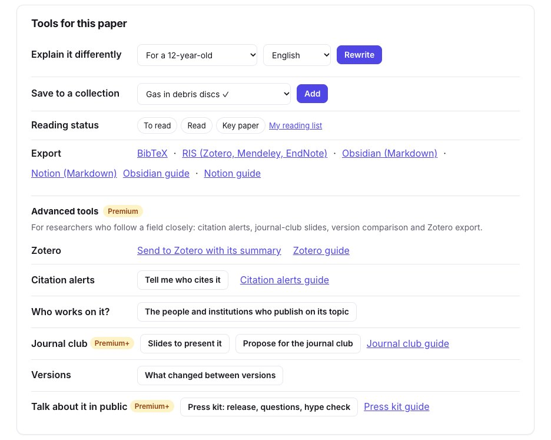
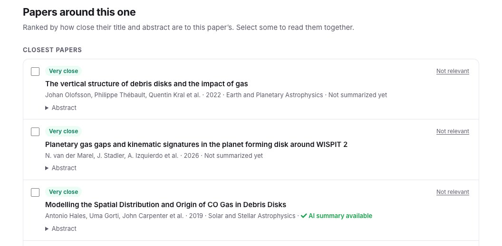
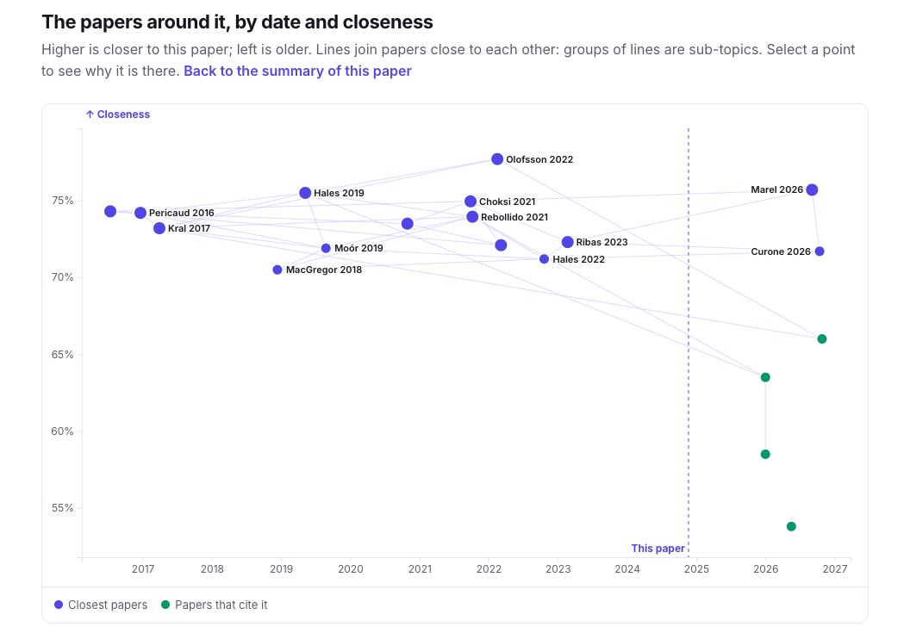
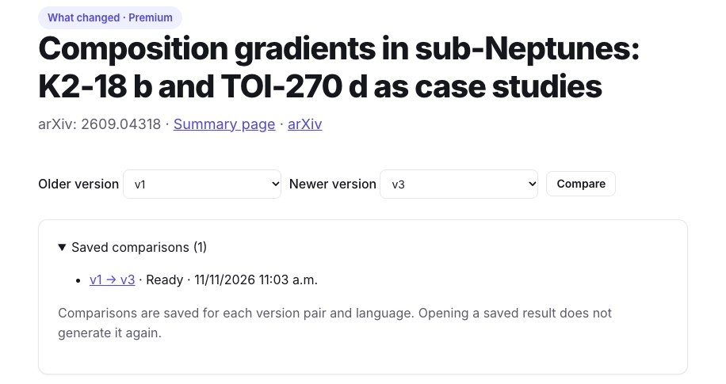
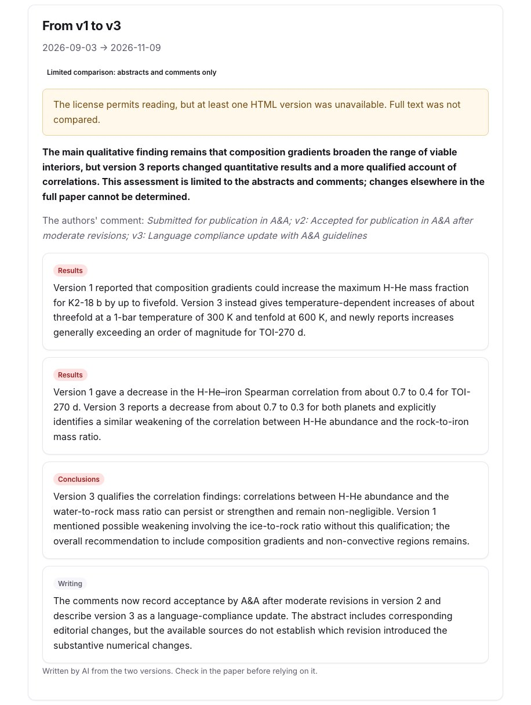

A summary tells you what a paper says. Around it, you also want to know which papers it builds on, which ones came after, which ones are close without citing it, and whether the version you read is the last one. Every paper page on SummarizePaper gathers this. The [summaries guide](/en/guides/how-to-summarize-a-research-paper/) covers the summary itself; this one covers what is around it.

Our examples: the neighbourhood of [Bergez-Casalou & Kral (2024)](/en/paper/2411.14241v1/), on planetary gaps in the gas of debris discs, and the versions of [Morf & Helled (2026)](/en/paper/2609.04318v3/), on the interiors of the sub-Neptunes K2-18 b and TOI-270 d, three versions on arXiv.

## 1. The tools of a paper page

Under the summary, **Tools for this paper** gathers what you can do with it: explain it at another level or in another language, save it to a collection with a reading status, export it (BibTeX, RIS, Obsidian, Notion), and the Premium tools: send it to Zotero, follow its citations, find who works on its topic, prepare a journal club, see what changed between its versions, or prepare its press kit. Each tool links its guide.

<figure class="guide-screenshot">

<figcaption>Everything you can do from a paper page, with the guide of each tool.</figcaption>
</figure>

## 2. The papers around it

Further down, **Papers around this one** lists up to three groups, each paper with its closeness (very close, close, related), its authors, year and journal, its citation count, and whether it is already summarized here:

- the **closest papers**: the closest of our whole index, whatever their category, and those Semantic Scholar recommends;
- the papers it **builds on**: those it cites, the closest first;
- the **papers that cite it**, the closest first.

Closeness compares titles and abstracts, so a close paper that uses other words still comes up. A paper both close and cited stays among the closest, with both facts: for our paper, the close work it cites is all there, so only two groups show.

<figure class="guide-screenshot">

<figcaption>The closest papers of a paper on the gas of debris discs.</figcaption>
</figure>

Tick several papers to [chat with them together](/en/chat/), or put them in a [collection](/en/collections/). **Not relevant** takes a paper out of your list.

## 3. The map, by date and closeness

**A map of these papers by date and closeness**, a link under the list, places them by date (left is older) and closeness (higher is closer); lines join papers close to each other, and groups of lines are sub-topics. The dashed line is the paper itself: on the left, the work it builds on; on the right, in green, the papers that cite it. Select a point to see why that paper is there.

<figure class="guide-screenshot">

<figcaption>The papers around one, by year and closeness; the papers that cite it in green.</figcaption>
</figure>

## 4. What changed between versions (Premium)

An arXiv paper can have several versions: the one accepted by a journal often differs from the first. **Versions → What changed between versions** compares two of them. Choose the older and the newer version, then compare; each comparison is kept, for each pair of versions and language.

<figure class="guide-screenshot">

<figcaption>Two versions to compare, and the comparisons already made.</figcaption>
</figure>

The result gives a verdict, then each change with its kind (results, conclusions, method, data, an error fixed, figures, references, writing) and its importance. For our paper, the authors' comment only says "v2: accepted after moderate revisions; v3: language compliance update", but the comparison finds that **the results changed**: version 1 announced that composition gradients could raise the maximum hydrogen-helium fraction of K2-18 b up to fivefold; version 3 gives about threefold at 300 K and tenfold at 600 K, and adds TOI-270 d.

<figure class="guide-screenshot">

<figcaption>What changed from v1 to v3: two results, one conclusion, and the writing.</figcaption>
</figure>

The page says what was compared. Here arXiv did not have the HTML of every version, so only the abstracts and comments were read: changes elsewhere in the paper cannot be seen, and the verdict says so. When the full text can be read, only the paragraphs that differ are given to the model.

When you follow a paper's citations, or watch a collection, you also get an email when it gets a new version, with what changed ([citation alerts guide](/en/guides/track-research-paper-citations/)).

## Limits

- Closeness reads titles and abstracts, not full texts: two papers that share a method but describe it differently can be far apart.
- A paper not indexed by us, OpenAlex or Semantic Scholar cannot appear.
- A comparison from the abstracts only cannot see a changed figure or table; check the paper before relying on it.
