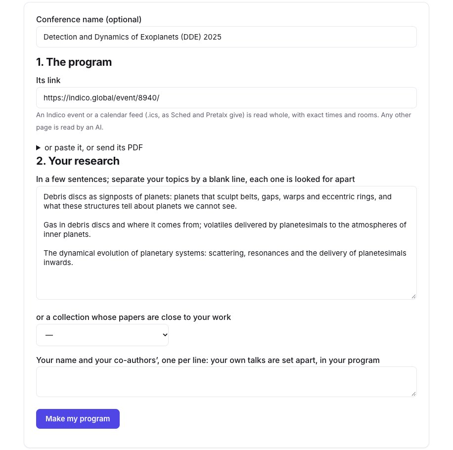
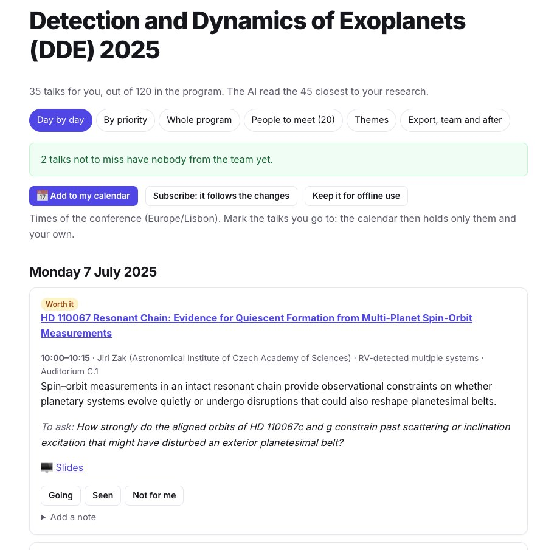
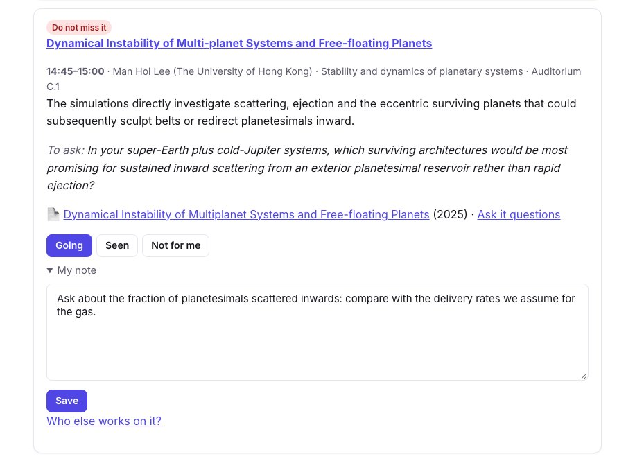
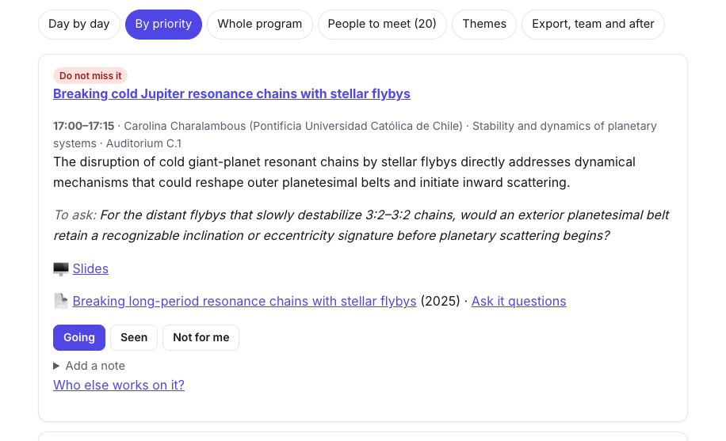
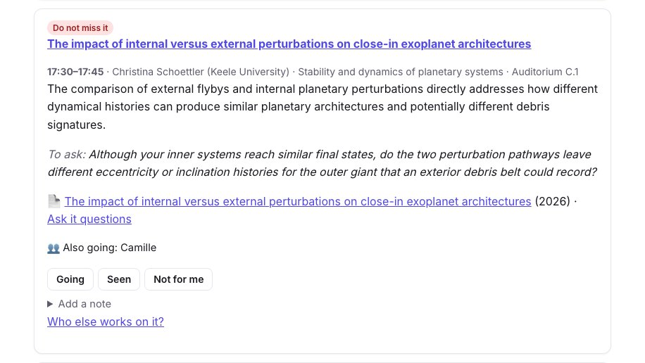
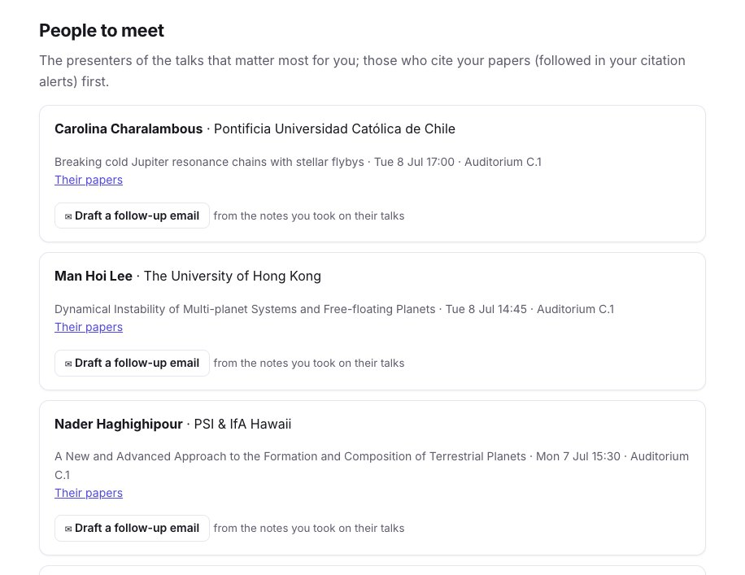
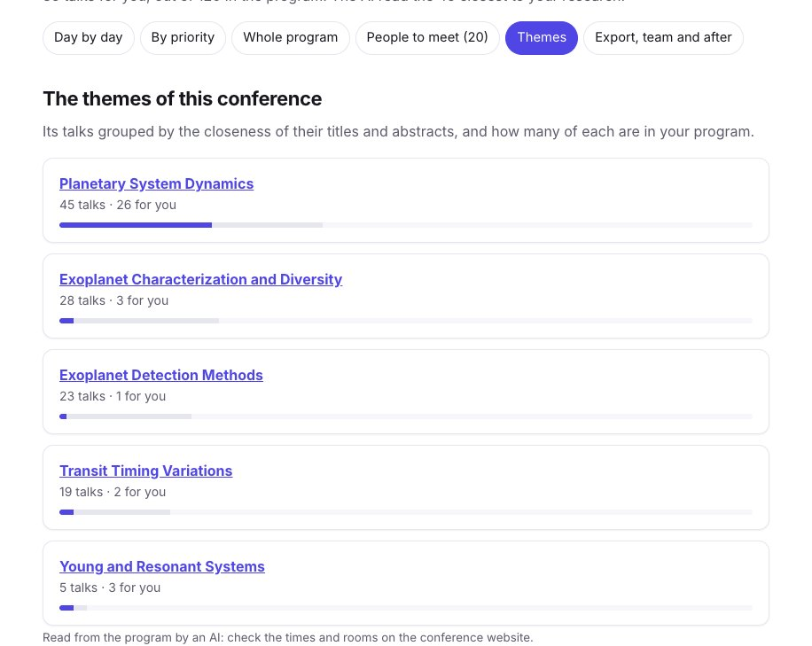
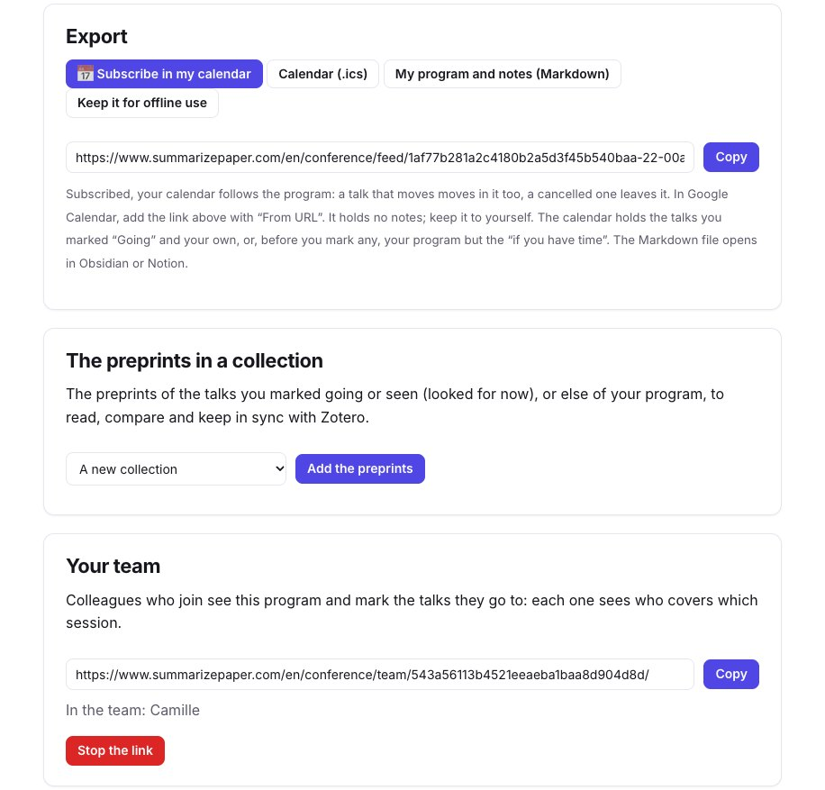
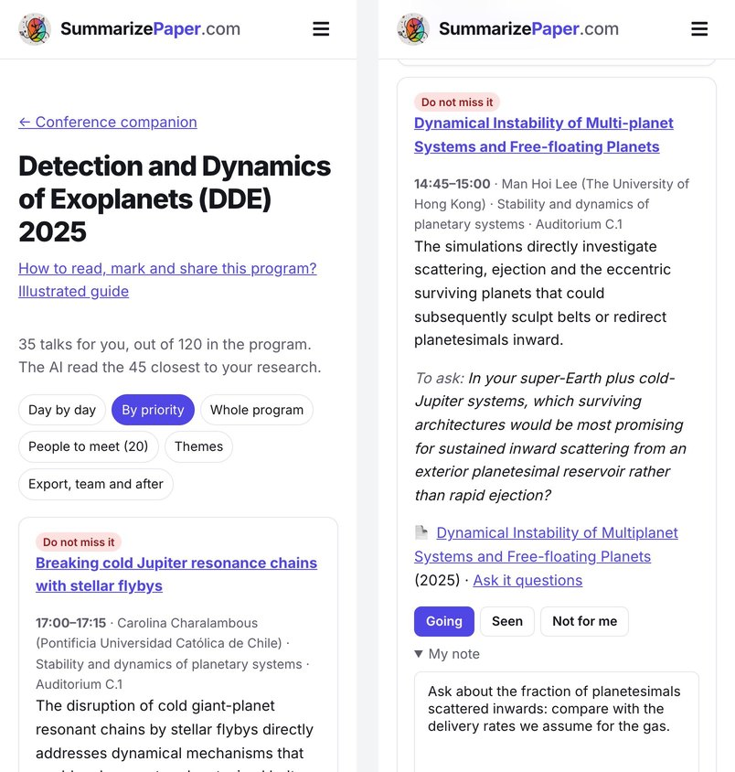

A conference program holds a hundred talks or more, often in parallel sessions. You read the titles the night before, you miss the talk whose title did not say it was about your problem, and after the week you no longer know whom you meant to write to. The **conference companion** (Premium+) reads the whole program, keeps the talks close to your research, says why each one matters and what to ask, and keeps your program, your notes and your team together until the follow-up.

This guide follows a real program: **Detection and Dynamics of Exoplanets** (Coimbra, 7–11 July 2025), 120 talks and posters on Indico. We ranked it for a researcher who works on debris discs, the gas they hold and the planets that shape them. Every screenshot shows the result of that run, made on 10 November 2026.

## 1. Give the program and your research

Open the [conference companion](/en/conference/) and paste the link of the program. An **Indico event** or a **calendar feed** (`.ics`, as Sched and Pretalx give) is read whole, with exact times, rooms and abstracts. Any other page, a PDF of the booklet or a pasted program is read by an AI.

Then describe your research in a few sentences. **Separate your topics by a blank line**: each one is looked for on its own, so a talk close to only one of them is not drowned by the others. You can also start from the profile of your [daily paper alert](/en/digest/), a project of your [scoop watch](/en/scoops/) or a [collection](/en/collections/) of papers close to your work. Give your name and your co-authors' to set your own talks apart.

<figure class="guide-screenshot">

<figcaption>The Indico link and three topics, each looked for apart.</figcaption>
</figure>

Reading and ranking our program took under a minute.

## 2. Read your program day by day

The result says how many talks were kept: here **35 of the 120**, after the AI read the 45 closest to our research. Each one has a level (**Do not miss it**, **Worth it**, **If you have time**), a sentence on why it matters for *your* research, and a question to ask its speaker. When a preprint of the talk is found, it is linked, with "Ask it questions" to [chat with it](/en/chat/) before the session; the slides are linked when Indico has them.

<figure class="guide-screenshot">

<figcaption>35 talks kept out of 120; each with why it matters for you and a question to ask.</figcaption>
</figure>

The reasons are written for the research you described, not as a summary of the abstract: a talk on spin–orbit measurements in a resonant chain is kept because a quiet or disrupted history "could also reshape planetesimal belts". Read them as a reason to look at the abstract, not as a judgement of the talk.

## 3. Mark the talks you go to, and take notes

Under each talk, mark **Going**, **Seen** or **Not for me**, and add a note, saved without leaving the page: it stays private. Once you mark talks as going, the calendar holds only those and your own; before that, it holds your program but the "if you have time".

<figure class="guide-screenshot">

<figcaption>A talk not to miss, marked Going, with a note to prepare the question.</figcaption>
</figure>

When two talks of your program are at the same time, the page says so on each and counts them at the top: choose, or ask a colleague to go. DDE 2025 had a single session, so our program has no clash.

**By priority** lists the same talks from the most important, whatever the day: the view to read the evening before. **Whole program** shows all 120 talks, to look for one the ranking left out.

<figure class="guide-screenshot">

<figcaption>By priority: the talks not to miss first.</figcaption>
</figure>

## 4. Go with your team

Under **Export, team and after**, create a **team link** and send it to your colleagues. Those who join see the program and mark the talks they go to; on each talk you see who else goes, and the top of the program counts the talks not to miss that nobody from the team covers yet.

<figure class="guide-screenshot">

<figcaption>Camille, who joined with the team link, goes to this one.</figcaption>
</figure>

A colleague can also rank the same program for their own research: the program is not read again, and the team still sees who goes where. Your notes and the research you described are never shown to them.

## 5. The people to meet

**People to meet** lists the presenters of the talks that matter most for you (20 at most), with their talks, their times and a link to their papers. Those who cite your papers come first, when you follow your papers in the [citation alerts](/en/citations/).

<figure class="guide-screenshot">

<figcaption>The presenters to meet, each with a follow-up email to draft after their talk.</figcaption>
</figure>

After the talk, **Draft a follow-up email** writes a first message from the notes you took on their talks, to copy and edit; nothing is sent.

## 6. The themes of the conference

**Themes** groups all the talks by the closeness of their titles and abstracts, and shows how many of each are in your program. Here, 26 of the 35 talks kept are in *Planetary System Dynamics*, and only one in *Exoplanet Detection Methods*: the ranking followed the research we described, not the size of the sessions.

<figure class="guide-screenshot">

<figcaption>Each theme with its talks, and those of your program.</figcaption>
</figure>

## 7. Calendar, changes and follow-up

- **Subscribe in my calendar**: a link to add to Google Calendar ("From URL"), Apple Calendar or Outlook. It follows the program: a talk that moves moves in your calendar, a cancelled one leaves it. Or download the `.ics` once.
- **My program and notes (Markdown)**: your talks, marks and notes in a file that opens in Obsidian or Notion.
- **Keep it for offline use**: the program stays readable on your phone without a network in the lecture hall.
- **Changes to the program**: an Indico program is read again every day in the two weeks before the conference and every three hours while it goes on; you get an email when a talk of your program moves or is cancelled, or when a talk as close to your research is added.
- **The preprints in a collection**: the preprints of the talks you marked going or seen go to a [collection](/en/collections/), to read, compare in a table and keep in sync with Zotero.

<figure class="guide-screenshot">

<figcaption>Export, preprints and team, in the last view of the program.</figcaption>
</figure>

On your phone, the program reads the same way, and you mark talks and take notes during the sessions. During the conference, a **Now** view shows the talk going on, the next one and the rest of the day.

<figure class="guide-screenshot">

<figcaption>On a phone: the program by priority, and a talk marked Going with its note.</figcaption>
</figure>

## Limits

- The program is **read by an AI** when it is not on Indico or in a calendar feed: check times and rooms on the conference website, as the page reminds you.
- The ranking compares the titles and abstracts with what you wrote: a talk with a short or vague abstract can be missed. Look at **Whole program** for the sessions you care about.
- The preprints are looked for by title and speaker: a talk without a paper, or with a paper of another title, has none, or a "close paper of the speaker" said as such.
- Our example is a past conference: the **Now** view and the change emails only work before and during a conference.
