Preparing a journal club takes an evening: read the paper again, choose the figures, write the slides, guess the questions. The **journal club** (Premium+) writes the slides for your audience and the length of your talk, **each point with the passage of the paper that supports it**, the earlier work, where the paper stands and the hard questions to prepare. You then edit them, present them and export them.

This guide follows a real deck, written on 10 November 2026, on [Huet, Kral & Manchon (2026)](/en/paper/2607.11677v1/), *Water gas discs in exo-asteroid belts*, a paper under a CC BY license: its full text and its figures could be used.

## 1. Choose a paper and your audience

Open the [journal club](/en/journal-club/) and search for the paper, or open its summary page and choose the journal club in **Tools for this paper**.

<figure class="guide-screenshot">
<a href="/static/summarizer/img/guides/journal-club/start-en.jpg">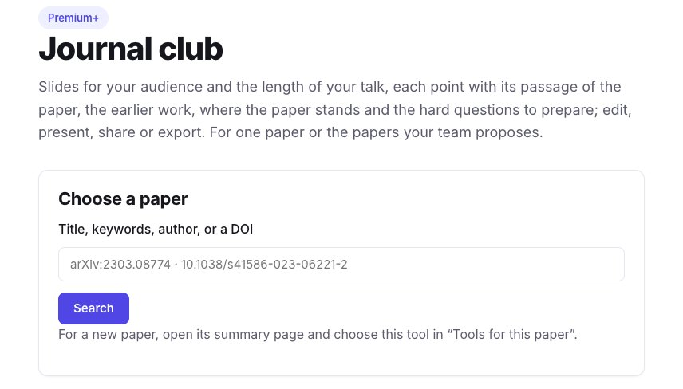</a>
<figcaption>Start from any paper.</figcaption>
</figure>

Choose the **language** of the slides, the **audience** (researchers of the field, students new to the topic, researchers of another field) and the **length** of the talk (10, 20 or 45 minutes): they set the share of context, the level of detail and the number of slides. Each set of settings gives a deck of its own, and the others are kept. Ours, for researchers of the field and 20 minutes, took under a minute and has 15 slides.

<figure class="guide-screenshot">
<a href="/static/summarizer/img/guides/journal-club/toolbar-en.jpg">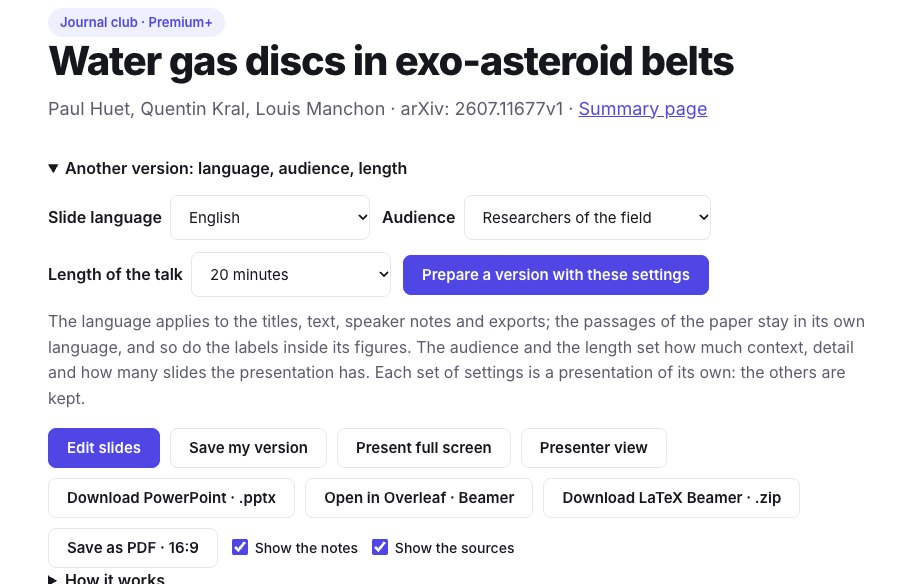</a>
<figcaption>The settings of the deck, and everything you can do with it.</figcaption>
</figure>

## 2. Check each point against the paper

Each slide holds a few points, a figure of the paper when it helps, and the speaker notes. Under it, **Sources** says how many of its points were found in the paper: each one with its kind (result, method, interpretation, context), the passage of the paper, its section, and a link to open it in the paper.

<figure class="guide-screenshot">
<a href="/static/summarizer/img/guides/journal-club/figure-en.jpg">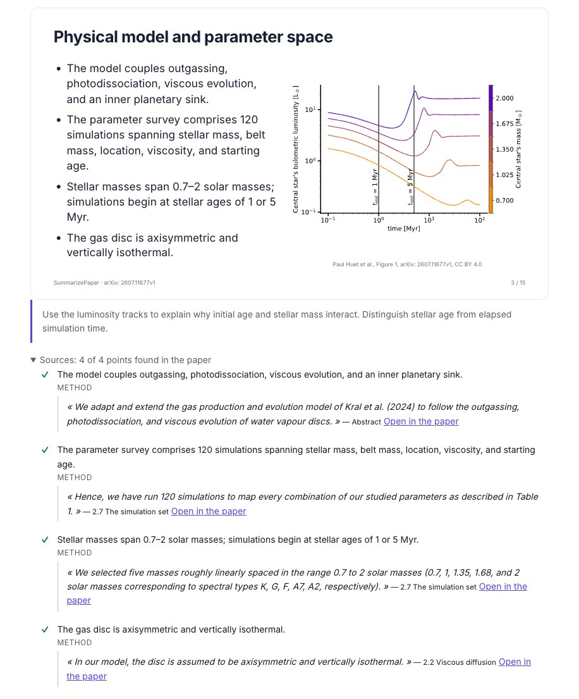</a>
<figcaption>A slide with figure 1 of the paper, its notes, and the passage behind each point.</figcaption>
</figure>

A point whose passage is not in the paper, or that gives a number the paper never states, is **marked for you to check**. In our deck, the slide comparing the paper with earlier research has 0 of its 3 points found in the paper: it is written from the earlier papers, not from this one, and says so.

The last slides are not left to the model alone:

- **Earlier work and what came next** comes from the papers the paper cites and those that cite it, never from the model's memory;
- **Where the paper stands** comes from Crossref and arXiv: here, *published in Astronomy & Astrophysics on 21 September 2026*, with its DOI; a retraction, a correction or a newer arXiv version would be shown there;
- **Strengths and limits** puts the limits the authors state, each with its passage, apart from the points to discuss, which are the model's own reading and say so.

<figure class="guide-screenshot">
<a href="/static/summarizer/img/guides/journal-club/limits-en.jpg">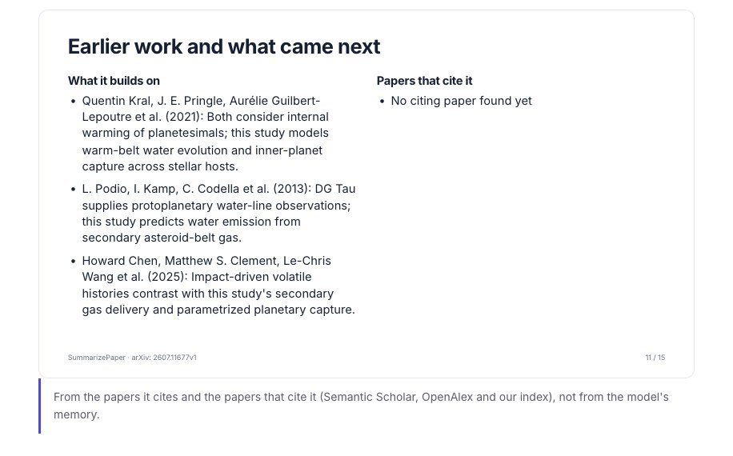</a>
<figcaption>The strengths, and the limits the authors state themselves.</figcaption>
</figure>

<figure class="guide-screenshot">
<a href="/static/summarizer/img/guides/journal-club/discussion-en.jpg">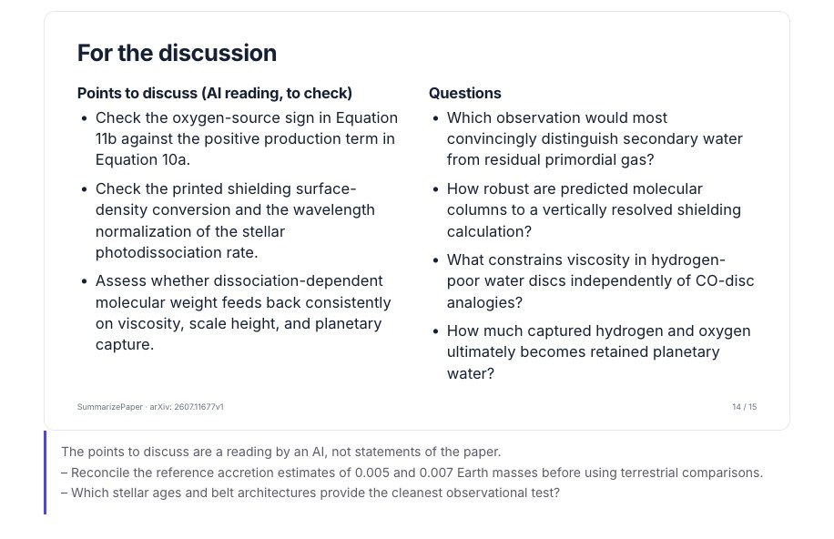</a>
<figcaption>For the discussion: the points to discuss are an AI reading, marked as such.</figcaption>
</figure>

## 3. Prepare the hard questions

Under the slides, **The hard questions to prepare** lists what the audience is likely to ask, with what the paper lets you answer. A passage is shown only when it really is in the paper; otherwise the answer says to check it before giving it. **Ask the paper another question** opens the [chat](/en/chat/) on the paper.

<figure class="guide-screenshot">
<a href="/static/summarizer/img/guides/journal-club/questions-en.jpg">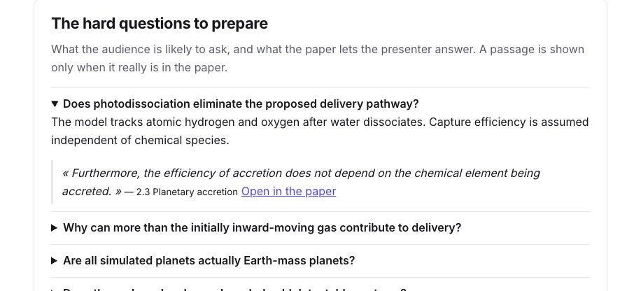</a>
<figcaption>A hard question, and the passage of the paper that answers it.</figcaption>
</figure>

## 4. Edit the slides

Click **Edit slides**. For each slide you can move it, duplicate it, add a slide after it or remove it; change its title, its points and its notes; choose the text size, another figure of the paper, its position and its size; and ask the model to rewrite it **shorter**, **simpler**, **more technical**, or to write its speaker notes. **Save my version**: your edits are private, and the deck everyone else gets stays as it was written.

<figure class="guide-screenshot">
<a href="/static/summarizer/img/guides/journal-club/edit-en.jpg">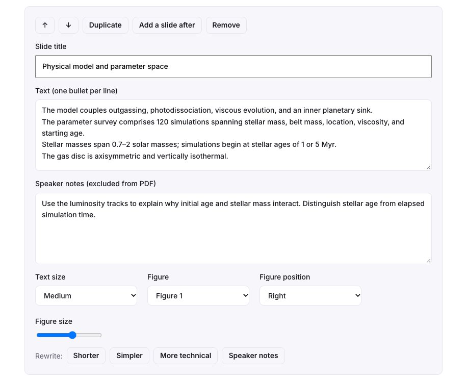</a>
<figcaption>The editor of a slide, with its rewrites.</figcaption>
</figure>

## 5. Present, export, share

- **Present full screen**, or **Presenter view**: your notes, the next slide and a timer on your screen, the slides on the projector.
- **Download PowerPoint**, **Save as PDF** (16:9), or **LaTeX Beamer**, as a `.zip` or as a new Overleaf project with the figures of the paper and your notes; see the [Overleaf guide](/en/guides/overleaf-bibliography-check/#5-your-journal-club-slides-in-beamer).
- **Share with the participants**: a read-only link to your saved version, with the slides, the sources and the hard questions, for 90 days and without an account.

## Present the papers your team proposes

A journal club often discusses several papers. In the tools of a paper page, in your daily paper alert or in a weekly letter, **Propose for the journal club** adds the paper to a collection your team shares: invite your colleagues to the collection so that everyone proposes papers, sorts them and leaves notes.

<figure class="guide-screenshot">
<a href="/static/summarizer/img/guides/journal-club/propose-en.jpg">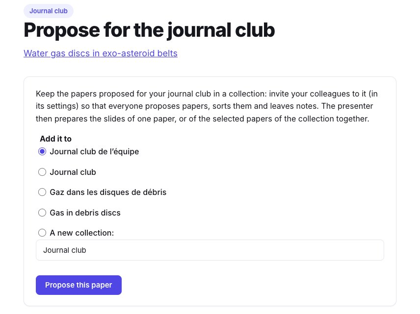</a>
<figcaption>Each colleague proposes papers in the shared collection.</figcaption>
</figure>

The presenter then opens the collection and chooses **Journal club of the selected papers** (6 at most, in the order of the collection).

<figure class="guide-screenshot">
<a href="/static/summarizer/img/guides/journal-club/from-collection-en.jpg">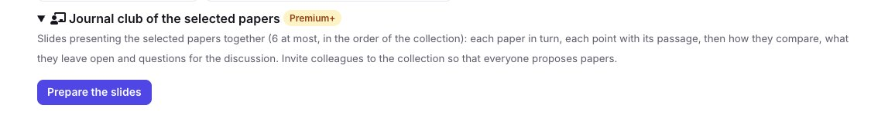</a>
<figcaption>The slides of the selected papers of a collection.</figcaption>
</figure>

We made one with three papers on secondary gas in debris discs: the water gas discs, the planetary gaps in the gas ([Bergez-Casalou & Kral 2024](/en/paper/2411.14241v1/)) and the predictions of CO, C and O ([Kral et al. 2017](/en/paper/1703.10693v1/)). The deck presents each paper in turn, then **how the papers compare**: where they agree and where they differ, each point naming the paper it comes from.

<figure class="guide-screenshot">
<a href="/static/summarizer/img/guides/journal-club/collection-en.jpg">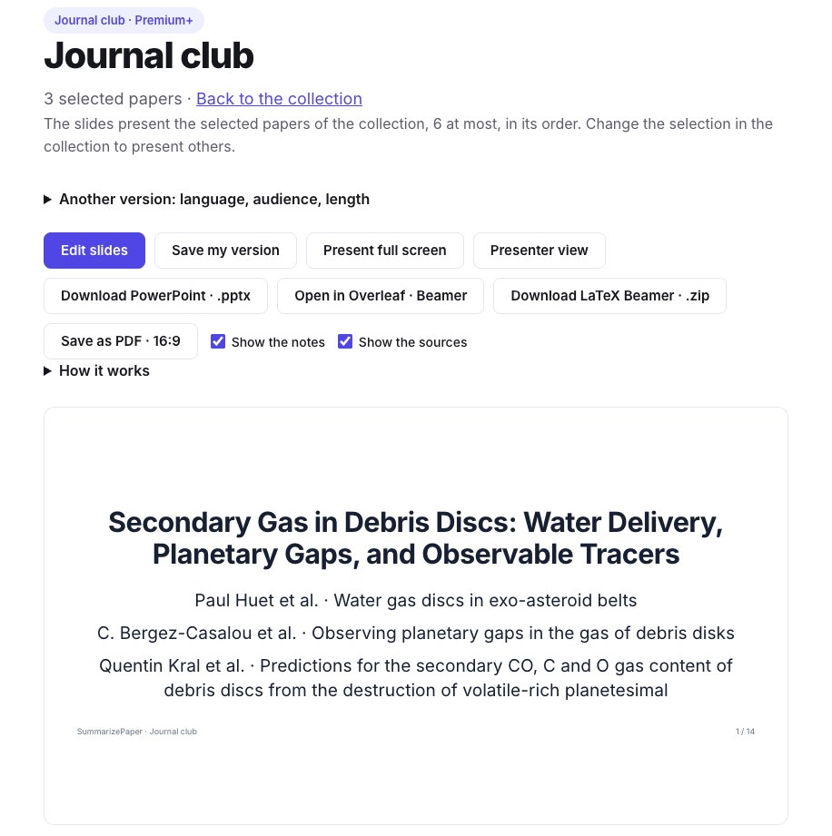</a>
<figcaption>Three papers of a collection in one deck.</figcaption>
</figure>

<figure class="guide-screenshot">
<a href="/static/summarizer/img/guides/journal-club/compare-en.jpg">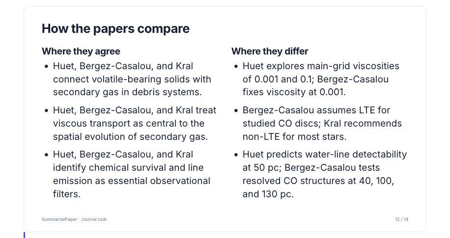</a>
<figcaption>How the three papers compare, each point naming its paper.</figcaption>
</figure>

## Limits

- Under a license that lets us read only the abstract, the deck is short (3 or 4 slides) and says what the abstract does not tell.
- Points without a passage, and the points to discuss, are the model's reading: check them before presenting.
- LaTeX sets the text with other fonts than the page: a long slide is scaled down in Beamer, and Overleaf's log names those reduced by more than a tenth.
