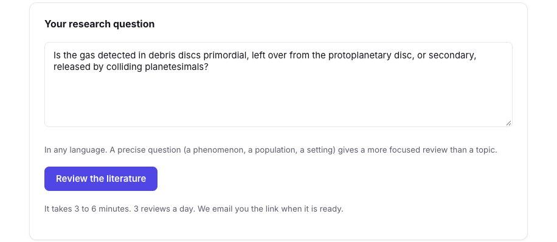
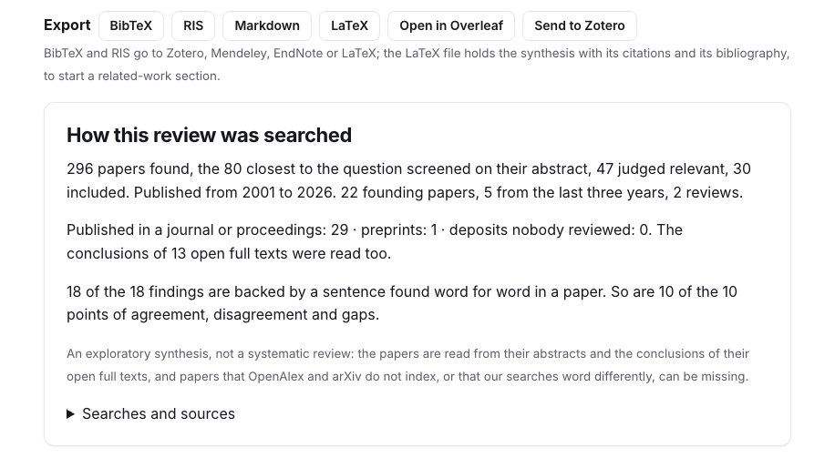
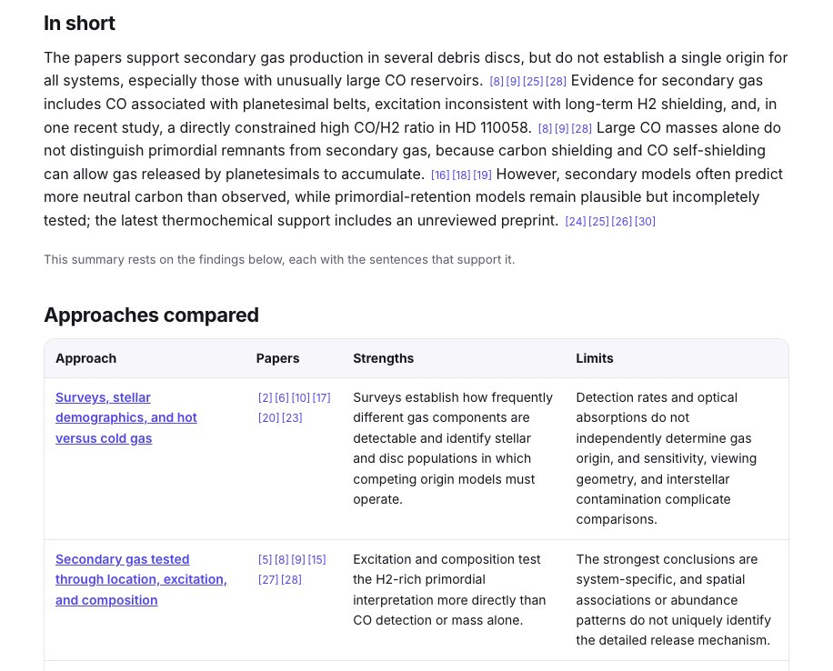
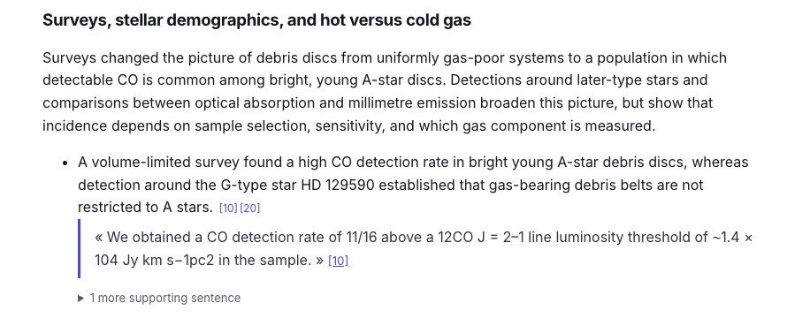
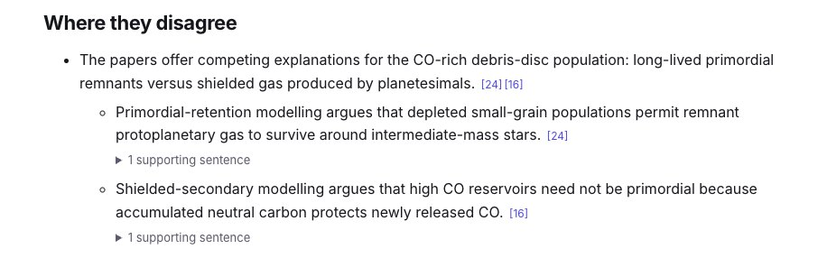
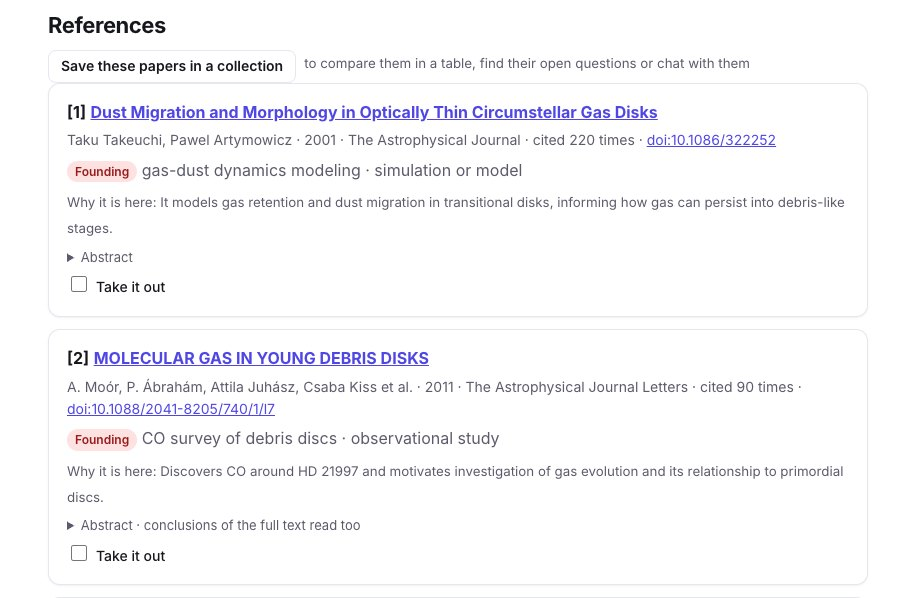
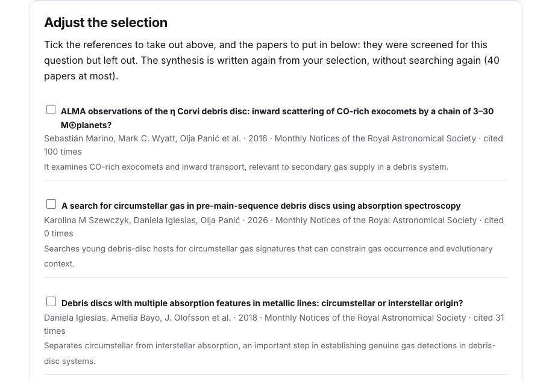
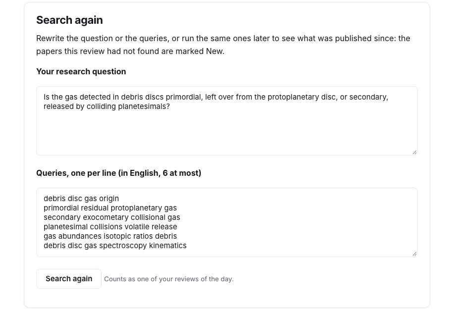
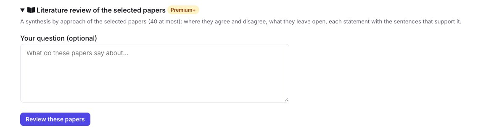

Before a related-work section, a thesis chapter or a new project, you need the papers that matter on a question: the founding ones, the recent ones, and how they disagree. The **literature review** (Premium+) starts from your question, searches journals, preprint servers and arXiv, follows the references of the closest papers, and writes a synthesis grouped by approach in which **every statement comes with the sentence that supports it**.

This guide follows a real review, run on 10 November 2026, on a question still debated in our field: is the gas detected in debris discs left over from the protoplanetary disc, or released by colliding planetesimals?

## 1. Ask a precise question

Open the [literature review](/en/literature-review/) and write your question, in any language. A question that names a phenomenon and the alternatives you want weighed gives a more focused review than a topic.

<figure class="guide-screenshot">

<figcaption>One question, with the two explanations to weigh.</figcaption>
</figure>

A review takes 3 to 6 minutes, and you get an email when it is ready; ours took five. You can run three a day.

## 2. See how it was searched

The page starts with what the review read. For our question: **296 papers found**, the 80 closest screened on their abstract, 47 judged relevant and **30 included**, from 2001 to 2026: 22 founding papers, 5 from the last three years and 2 reviews. 29 are published in a journal and one is a preprint; the conclusions of 13 open full texts were read too. And **18 of the 18 findings** are backed by a sentence found word for word in a paper.

<figure class="guide-screenshot">

<figcaption>What the review read, and how many of its statements are backed by a sentence.</figcaption>
</figure>

**Searches and sources** lists the queries written from your question, and where the candidates came from: the searches, the recent papers, the works cited by the closest papers, the papers that cite the founding ones.

## 3. Read the synthesis

**In short** gives the answer in a few sentences, each with its references. Here: the papers support secondary gas in several discs, but do not establish a single origin for all of them, especially those with unusually large CO reservoirs. Then **Approaches compared** puts the six groups of papers side by side, with their strengths and their limits.

<figure class="guide-screenshot">

<figcaption>The answer in short, then the approaches side by side.</figcaption>
</figure>

Each approach then has its own section: what its papers do, its findings, and under each finding the sentence of the paper that supports it, with its number in the references.

<figure class="guide-screenshot">

<figcaption>A finding, and the sentence of paper [10] that supports it.</figcaption>
</figure>

**Where they disagree** sets the sides of a debate against each other, each with its own papers and sentences. For our question, the review found the debate we expected (long-lived primordial remnants versus shielded secondary gas) and a second one, on the gas clump of β Pictoris.

<figure class="guide-screenshot">

<figcaption>The two sides of the debate, each with its own paper.</figcaption>
</figure>

**What they leave open** lists the gaps, and **Often cited, not read** the works that many of the chosen papers cite but whose abstract no source gave: here Kiefer et al. (2014) on the exocomets of β Pictoris, Wyatt et al. (2015) and Zuckerman et al. (1995). Look them up yourself.

The review also says what each paper is: its 2026 thermochemical paper is marked a **preprint, not peer reviewed**, and the synthesis says so where it relies on it.

## 4. Check the references, and adjust the selection

Under **References**, each paper has its label (founding, recent, review), its approach and kind of study, **why it is here**, and its abstract with the quoted sentences marked.

<figure class="guide-screenshot">

<figcaption>Each reference says why it was kept; tick "Take it out" to remove it.</figcaption>
</figure>

To change the selection, tick **Take it out** on the references you do not want, and put in papers from the 30 that were screened but left out, each with why it was considered. **Write the synthesis again**: the new review is written from your selection without searching again, on its own page.

<figure class="guide-screenshot">

<figcaption>The papers screened but left out, to put in the synthesis.</figcaption>
</figure>

## 5. Export it, and keep it up to date

- **LaTeX** and **Open in Overleaf**: the synthesis with its `\cite` commands and its `.bib`, to start a related-work section; see the [Overleaf guide](/en/guides/overleaf-bibliography-check/).
- **BibTeX**, **RIS** and **Markdown**: the references for any reference manager, or the synthesis as a note.
- **Send to Zotero** (with a connected library): a Zotero collection with a subcollection per approach, each paper with the statements it supports; see the [Zotero guide](/en/guides/zotero-sync-research-papers/).
- **Save these papers in a collection**, to [chat with them](/en/chat/) or compare them in a table.

**Search again** reruns the same queries later, or new ones you write: the papers this review had not found are marked **New**.

<figure class="guide-screenshot">

<figcaption>The question and its queries, to run again in a few months.</figcaption>
</figure>

## From a collection

When you already have the papers, open a [collection](/en/collections/) and choose **Literature review of the selected papers**: the synthesis is written from them (3 to 40), with or without a question, and no search is run.

<figure class="guide-screenshot">

<figcaption>A review of the papers of a collection.</figcaption>
</figure>

## Limits

- It is an **exploratory synthesis**, not a systematic review: papers are read from their abstracts and the conclusions of their open full texts.
- Two runs of the same question can choose slightly different papers: our French run of the same question kept 30 papers too, but not all the same, and grouped them into other approaches.
- A sentence found word for word shows that the paper says it, not that the paper is right: read the papers you cite.
