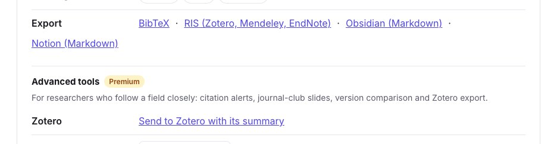
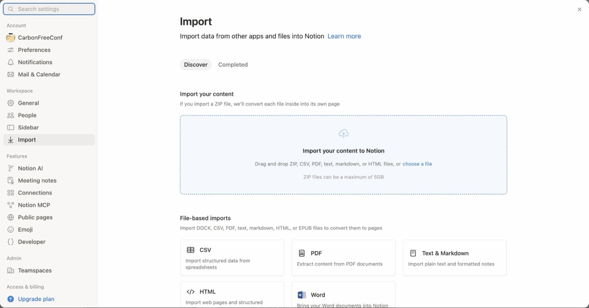
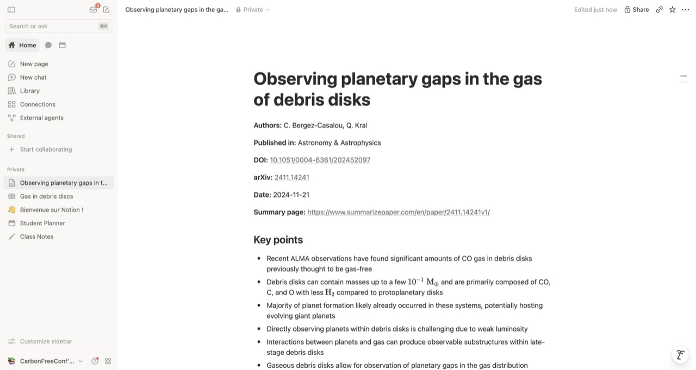
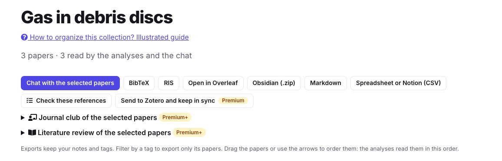
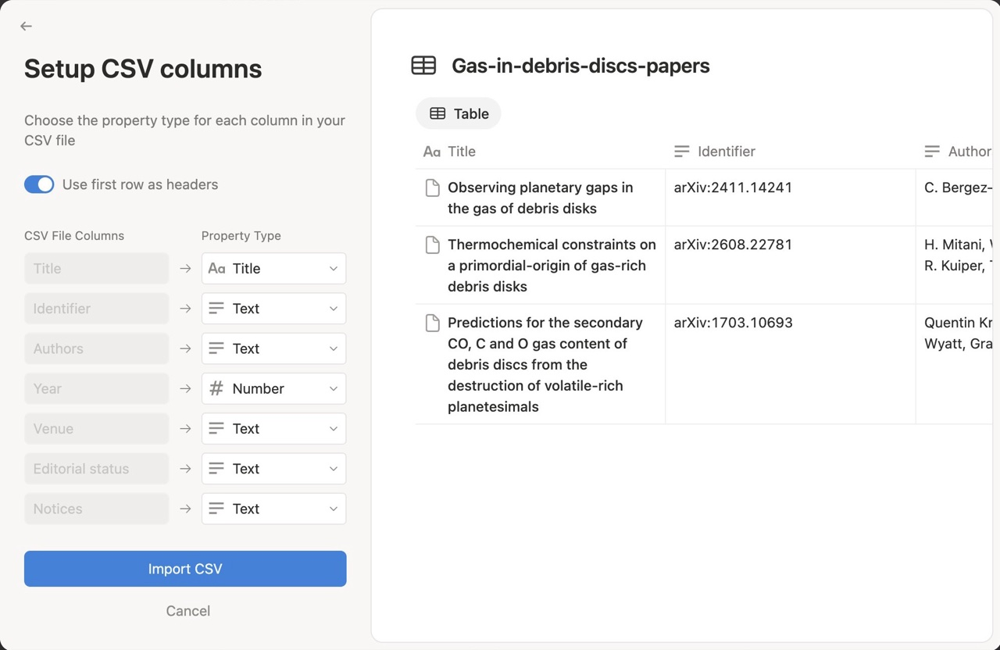
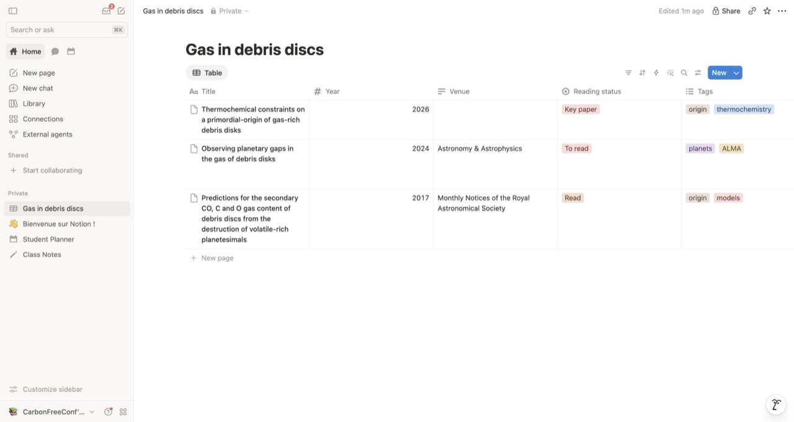

You plan your research in Notion and want your papers there: one page per paper you read, and a table of a reading list with its status, tags and notes. SummarizePaper exports **a paper as Markdown**, which Notion imports as a page, and **a collection as a spreadsheet** (CSV), which Notion imports as a database. It is free, and nothing is written into your workspace: you import the files yourself.

The examples come from the collection *Gas in debris discs* used in our other guides: three papers on the gas of debris discs, each with a note, tags and a reading status.

## 1. A paper as a Notion page

On the summary page of a paper, open **Tools for this paper**, then **Export → Notion (Markdown)**.

<figure class="guide-screenshot">
<a href="/static/summarizer/img/guides/exports/paper-export-en.jpg"></a>
<figcaption>"Notion (Markdown)", in the tools of every paper page.</figcaption>
</figure>

The file is named after the paper's title, here `Observing planetary gaps in the gas of debris disks.md`, and holds its reference, then its key points and its summary:

```markdown
**Authors:** C. Bergez-Casalou, Q. Kral  
**Published in:** Astronomy & Astrophysics  
**DOI:** [10.1051/0004-6361/202452097](https://doi.org/10.1051/0004-6361/202452097)  
**arXiv:** [2411.14241](https://arxiv.org/abs/2411.14241)  
**Date:** 2024-11-21  
**Summary page:** https://www.summarizepaper.com/en/paper/2411.14241v1/

## Key points

- Recent ALMA observations have found significant amounts of CO gas in debris disks previously thought to be gas-free
- …

## Summary
…
```

In Notion, open the menu of your workspace at the bottom of the sidebar, then **Settings → Import**, and choose **Text & Markdown**:

<figure class="guide-screenshot">
<a href="/static/summarizer/img/guides/notion/import-en.jpg"></a>
<figcaption>Notion's import, in its settings: CSV for a collection, Text & Markdown for a paper.</figcaption>
</figure>

The file becomes a page named after the paper, with its bold labels, links, headings and lists. Formulas, written in LaTeX between dollars, are displayed as equations. The summary ends with where it comes from (written by an AI model, from which version of the paper and when).

<figure class="guide-screenshot">
<a href="/static/summarizer/img/guides/notion/page-en.jpg"></a>
<figcaption>A paper imported into Notion: its reference, then its key points, formulas included.</figcaption>
</figure>

## 2. A collection as a Notion database

In a [collection](/en/collections/), click **Spreadsheet or Notion (CSV)**. Set the reading status, tags and notes of the papers in the collection first: they are columns of the spreadsheet.

<figure class="guide-screenshot">
<a href="/static/summarizer/img/guides/exports/collection-export-en.jpg"></a>
<figcaption>"Spreadsheet or Notion (CSV)", among the exports of a collection.</figcaption>
</figure>

The file has one row per paper, with these columns: *Title, Identifier, Authors, Year, Venue, Editorial status, Notices, Citations, Newer version, Reading status, Tags, Note, Selected, Link*. The identifier is written `arXiv:2411.14241`, so that a spreadsheet does not take it for a number. For our collection:

| Title | Year | Venue | Editorial status | Reading status | Tags |
| --- | --- | --- | --- | --- | --- |
| Thermochemical constraints on a primordial-origin of gas-rich debris disks | 2026 | | Submission or review declared on arXiv by the authors | Key paper | origin, thermochemistry |
| Observing planetary gaps in the gas of debris disks | 2024 | Astronomy & Astrophysics | Publication found | To read | planets, ALMA |
| Predictions for the secondary CO, C and O gas content of debris discs… | 2017 | Monthly Notices of the Royal Astronomical Society | Publication found | Read | origin, models |

**Editorial status**, **Notices** and **Newer version** come from the check of where the papers were published, their retraction or correction notices and their new versions: run **Check where they were published, their citations and new versions** in the collection before exporting to fill them.

In Notion, open **Settings → Import → CSV**, choose the file, keep **Create new database** and click **Map CSV headers**. Notion proposes a property type for each column: the *Title* names each row, the *Year* is a number, the *Link* a URL. Change *Reading status* to **Select** and *Tags* to **Multi-select**, to filter and group the papers by status and tag.

<figure class="guide-screenshot">
<a href="/static/summarizer/img/guides/notion/columns-en.jpg"></a>
<figcaption>The type of each column, chosen before the import.</figcaption>
</figure>

The database has one row per paper. Rename it, and hide the columns you do not need (menu of each column → **Hide**):

<figure class="guide-screenshot">
<a href="/static/summarizer/img/guides/notion/database-en.jpg"></a>
<figcaption>The collection in Notion, with its reading statuses and tags.</figcaption>
</figure>

To add the papers you put in the collection later, export it again and, in the CSV import, choose **Import into existing database**: Notion adds rows, it does not update those already there.

## Other files for Notion

- **Markdown** of a whole collection: one file with all its papers, to import as one page.
- A **literature review** exports as Markdown, its synthesis with its numbered references ([literature review guide](/en/guides/literature-review-from-a-research-question/)).
- The **conference companion** exports your program and your notes as Markdown ([conference guide](/en/guides/conference-program-talks-to-attend/)).
- For Obsidian, with properties and links between notes, see the [Obsidian guide](/en/guides/obsidian-research-paper-notes/).
