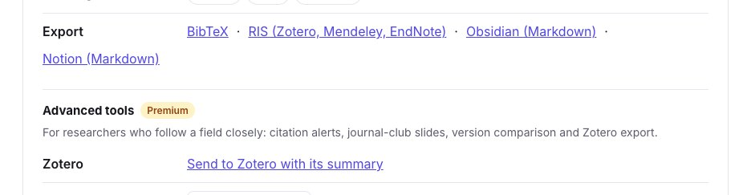
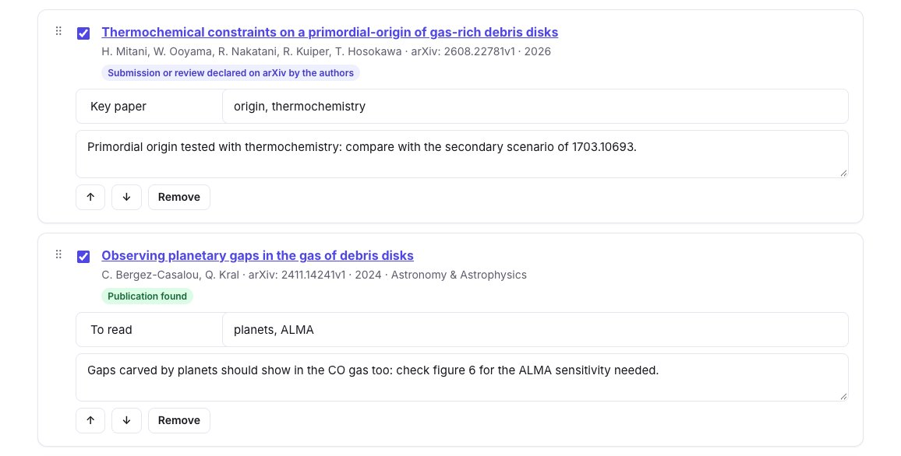
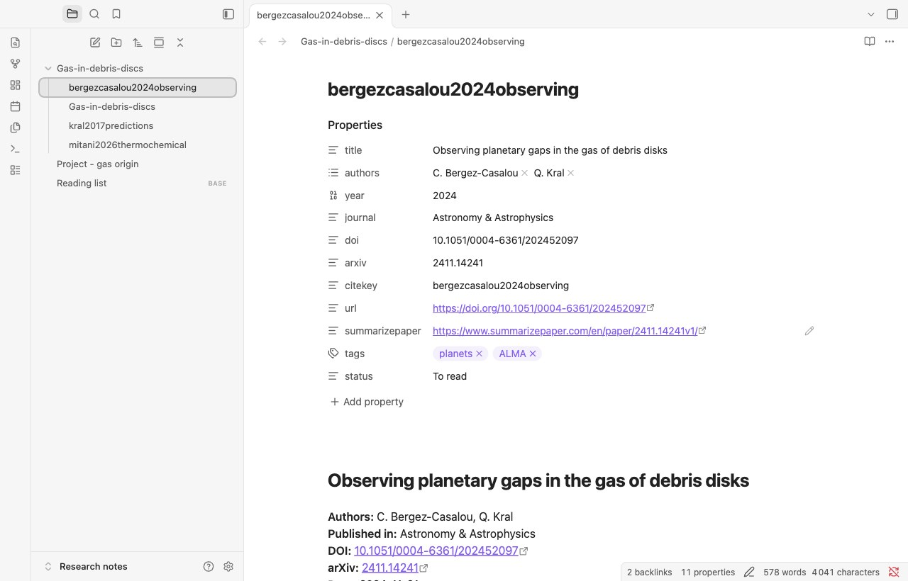
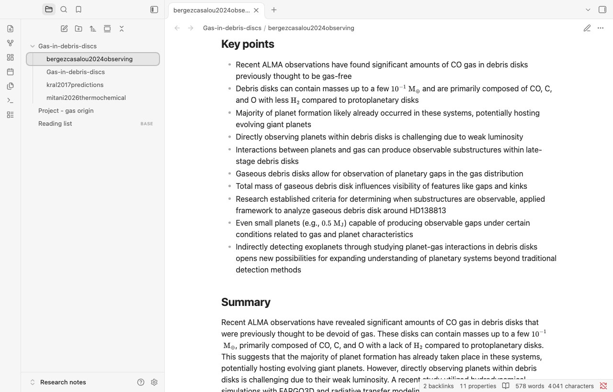
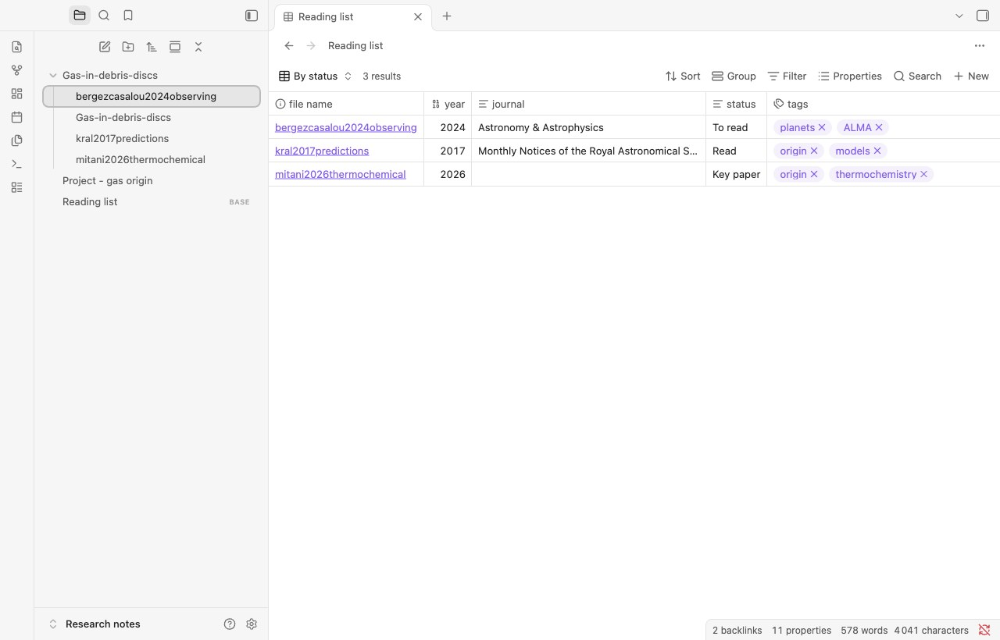
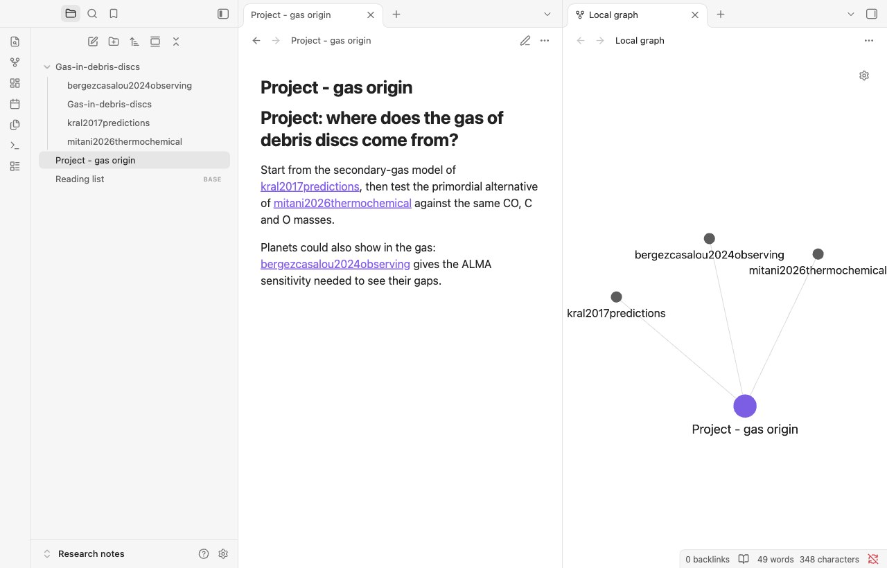

You keep your reading notes in Obsidian, and you want each paper there with its reference, its summary and what you thought of it, linked to the rest of your notes. SummarizePaper exports **a note per paper**, named by its citation key, with its **properties** (title, authors, year, journal, DOI, arXiv, citation key, tags, reading status), its key points and its summary; a **collection** downloads as a folder of such notes, with a note linking them all. It is free.

The examples come from the collection *Gas in debris discs* used in our other guides: three papers on the gas of debris discs, each with a note, tags and a reading status.

## 1. One paper

On the summary page of a paper, open **Tools for this paper**, then **Export → Obsidian (Markdown)**. You get a file named by the paper's citation key, here `bergezcasalou2024observing.md`.

<figure class="guide-screenshot">
<a href="/static/summarizer/img/guides/exports/paper-export-en.jpg"></a>
<figcaption>"Obsidian (Markdown)", in the tools of every paper page.</figcaption>
</figure>

The note starts with its properties, which Obsidian shows as a table above the text:

```markdown
---
title: "Observing planetary gaps in the gas of debris disks"
authors:
  - "C. Bergez-Casalou"
  - "Q. Kral"
year: 2024
journal: "Astronomy & Astrophysics"
doi: "10.1051/0004-6361/202452097"
arxiv: "2411.14241"
citekey: "bergezcasalou2024observing"
url: "https://doi.org/10.1051/0004-6361/202452097"
summarizepaper: "https://www.summarizepaper.com/en/paper/2411.14241v1/"
---
```

Then come the reference (authors, journal, DOI, arXiv, date, the link to its summary page), **Key points** and **Summary**. The summary ends with where it comes from: *"Summary written by an AI model (SummarizePaper) from arXiv:2411.14241v1 on 2024-11-28. Check it against the paper."* A paper published since its preprint is exported as its published version, with its journal and DOI, and its arXiv identifier kept. Formulas stay in LaTeX between dollars, which Obsidian displays.

## 2. A whole collection, as a folder

In a [collection](/en/collections/), click **Obsidian (.zip)**. Your notes, tags and reading status of each paper go with it: tag the papers and set their status in the collection first.

<figure class="guide-screenshot">
<a href="/static/summarizer/img/guides/exports/collection-papers-en.jpg"></a>
<figcaption>The reading status, tags and note of each paper become properties and text of its note.</figcaption>
</figure>

The `.zip` holds a folder named after the collection, with one note per paper and one note for the collection:

```text
Gas-in-debris-discs/
├── Gas-in-debris-discs.md
├── bergezcasalou2024observing.md
├── kral2017predictions.md
└── mitani2026thermochemical.md
```

Each paper's note has, besides the properties above, its **tags** and its **status**, your note under **My note**, and a link back to the collection:

```markdown
tags:
  - "planets"
  - "ALMA"
status: "To read"
---
…
## My note

Gaps carved by planets should show in the CO gas too: check figure 6 for the ALMA sensitivity needed.

Collection: [[Gas-in-debris-discs]]
```

The collection's note links its papers, with their titles and years:

```markdown
# Gas-in-debris-discs

- [[mitani2026thermochemical]] Thermochemical constraints on a primordial-origin of gas-rich debris disks (2026)
- [[bergezcasalou2024observing]] Observing planetary gaps in the gas of debris disks (2024)
- [[kral2017predictions]] Predictions for the secondary CO, C and O gas content of debris discs from the destruction of volatile-rich planetesimals (2017)
```

To export only part of a collection, filter it by a tag first: the export holds only the papers of that tag.

## 3. In Obsidian

Unzip the folder into your vault. Here it is in Obsidian 1.15, in a vault named *Research notes*: the folder of the collection, and each paper's note with its properties as Obsidian shows them.

<figure class="guide-screenshot">
<a href="/static/summarizer/img/guides/obsidian/note-en.jpg"></a>
<figcaption>The note of a paper in Obsidian: its properties, its tags and its status.</figcaption>
</figure>

In reading view, the key points and the summary follow, with their formulas displayed:

<figure class="guide-screenshot">
<a href="/static/summarizer/img/guides/obsidian/summary-en.jpg"></a>
<figcaption>Key points and summary, formulas included.</figcaption>
</figure>

The papers then work like your other notes:

- the **tags** are Obsidian tags, to search and filter;
- the **properties** can be sorted and filtered. With a base (the **Bases** core plugin), the papers of the collection become a table of their year, journal, status and tags. Ours is this file, `Reading list.base`, next to the folder:

```yaml
filters:
  and:
    - file.inFolder("Gas-in-debris-discs")
    - year != null
views:
  - type: table
    name: By status
    order:
      - file.name
      - year
      - journal
      - status
      - tags
```

<figure class="guide-screenshot">
<a href="/static/summarizer/img/guides/obsidian/base-en.jpg"></a>
<figcaption>The papers of the collection in a base, with their status and tags.</figcaption>
</figure>

- the links `[[citation key]]` work from any of your notes: write `[[kral2017predictions]]` in a project note to link the paper; the paper's backlinks show where you cited it, and the graph shows which papers a project relies on;

<figure class="guide-screenshot">
<a href="/static/summarizer/img/guides/obsidian/links-en.jpg"></a>
<figcaption>A project note that cites three papers, and its local graph.</figcaption>
</figure>

- the `citekey` property is the key of our BibTeX exports and of the `.bib` a collection gives Overleaf, so your notes and your manuscript use the same keys.

When the collection changes, export it again and replace the folder: each note keeps its name, the citation key of its paper.

## Other notes for Obsidian

- **Markdown** of a collection: one file with all its papers, without properties.
- A **literature review** exports as Markdown, its synthesis with its numbered references ([literature review guide](/en/guides/literature-review-from-a-research-question/)).
- The **conference companion** exports your program and your notes as Markdown ([conference guide](/en/guides/conference-program-talks-to-attend/)).
- For Notion, see the [Notion guide](/en/guides/notion-research-paper-database/).
