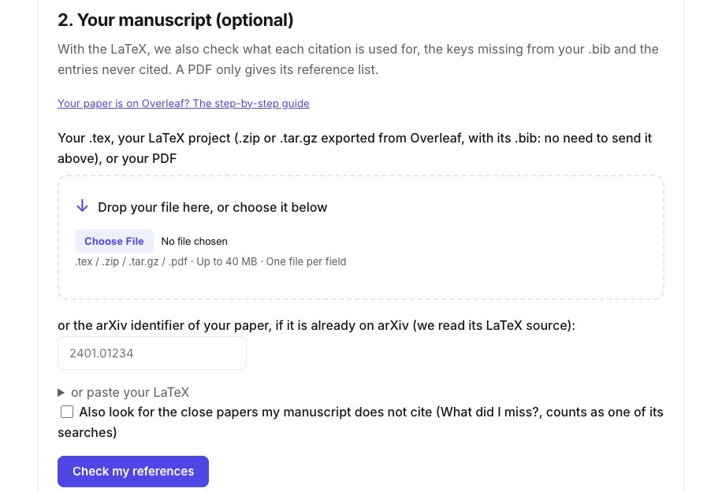
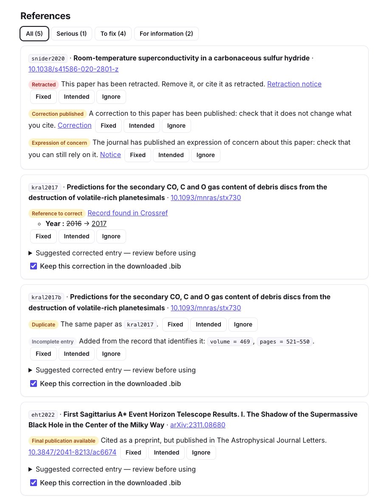
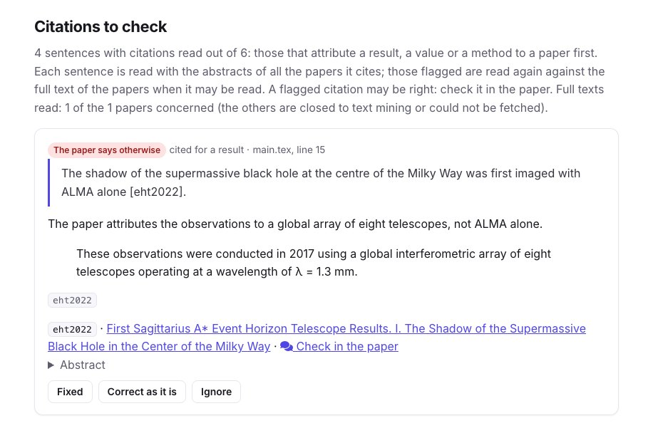
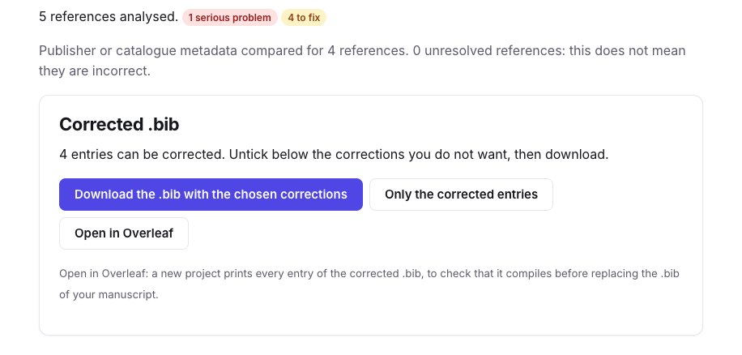
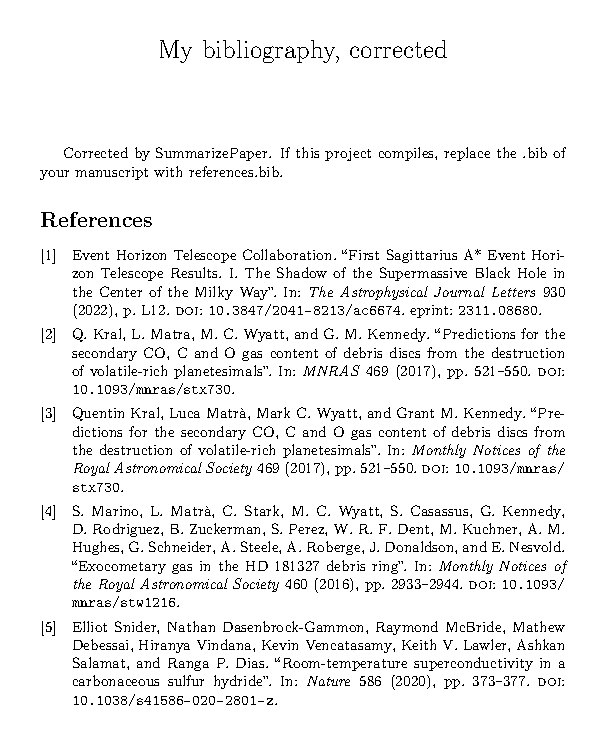
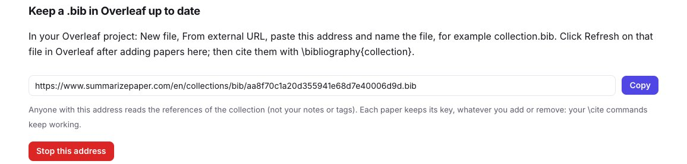
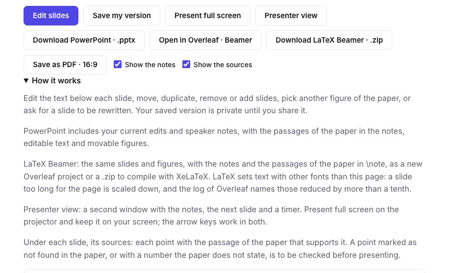
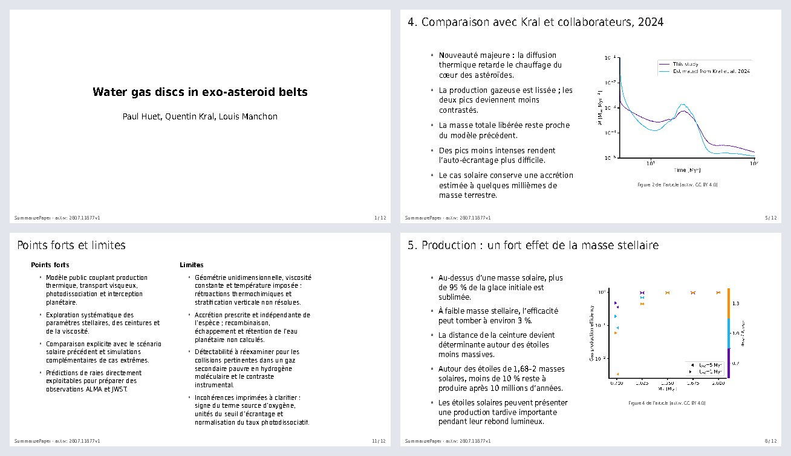

You are about to submit, and your paper was written on Overleaf. Its `.bib` grew over two years: some preprints have since been published, one cited paper may have been retracted, and a few entries were copied with the wrong year, or twice under two keys. **The bibliography check reads your whole Overleaf project and tells you which references to fix**, and what each citation is used for.

This guide follows a short demonstration project: a `main.tex` on gas in debris discs and its `references.bib`, into which we placed, on purpose, a wrong year, a duplicate, a preprint published since, a citation the cited paper contradicts, a key missing from the `.bib` and a paper retracted in 2022. Every screenshot shows the real check of that project, run on 9 November 2026.

## 1. Download your project from Overleaf

In Overleaf, open the menu and download the project's **source** as a `.zip`. Nothing needs to be cleaned up: the check reads only the `.tex`, `.bib` and `.bbl` files it contains, finds the main file (the one with `\begin{document}`) and follows its `\input` and `\include`.

## 2. Run the check

Open the [bibliography check](/en/refcheck/) (Premium) and drop the `.zip` under **Your manuscript**: no need to send the `.bib` separately. You can also give a single `.tex` with its `.bib`, the arXiv identifier of a paper already posted, or a PDF (then only its printed reference list is read).

<figure class="guide-screenshot">

<figcaption>The .zip exported from Overleaf goes in the manuscript field: its .bib is read from the archive.</figcaption>
</figure>

Each entry is identified with Crossref, NASA ADS, OpenAlex, arXiv and Semantic Scholar. In our project, the report found every problem we had placed:

- the **retracted paper** (Snider et al. 2020), with its retraction notice, a correction and an expression of concern, from Retraction Watch and Crossref;
- the **wrong year** of Kral et al. (2016 instead of 2017), checked against the Crossref record;
- the **duplicate**: the same paper under the keys `kral2017` and `kral2017b`;
- the **preprint published since**: the arXiv entry of the Event Horizon Telescope paper, with its journal version in *The Astrophysical Journal Letters*;
- and incomplete entries completed from their record (volume, pages, DOI).

<figure class="guide-screenshot">

<figcaption>Each reference with its problems and the record behind them; mark each one fixed, intended or ignored.</figcaption>
</figure>

With the LaTeX, the check also lists the keys your text cites but your `.bib` lacks: here `smith2021`, which would print as `[?]`. And an AI reads each sentence with citations next to the papers it cites. Our sentence claimed that the shadow of Sagittarius A\* was first imaged "with ALMA alone": the report quotes the passage of the paper that says otherwise. A flagged citation is something to check, not a proof of error.

<figure class="guide-screenshot">

<figcaption>The sentence of main.tex, line 15, next to the passage of the cited paper that contradicts it.</figcaption>
</figure>

## 3. Bring the corrected .bib back into Overleaf

Under **Corrected .bib**, untick the corrections you do not want, then:

- **Download** the `.bib` and upload it in place of the old one in your Overleaf project; or
- **Open in Overleaf**: a new project prints every entry of the corrected `.bib`, so you see that it compiles and how each reference reads before you replace the file of your manuscript.

<figure class="guide-screenshot">

<figcaption>4 entries of the demonstration .bib can be corrected; the retracted paper is left for you to remove or to cite as retracted.</figcaption>
</figure>

The project that "Open in Overleaf" creates prints the entries with biblatex, which keeps titles as they are written (CO, HD 181327, Sagittarius A\*). Here it is compiled: the year of Kral et al. is now 2017, and the Event Horizon Telescope paper has its journal and DOI. The duplicate is still there, because both keys are cited in the text: remove one entry and change its `\cite`.

<figure class="guide-screenshot">

<figcaption>The project "Open in Overleaf" creates, compiled with pdfLaTeX and Biber, as Overleaf does.</figcaption>
</figure>

Mark each problem as fixed or intended, and check again after correcting: what was solved is shown apart. With Premium, the references can be **watched until publication**: you get an email if a cited preprint is published or a cited paper retracted in the meantime.

## 4. Keep a .bib in sync with a collection

While you write, you add papers to a [collection](/en/collections/) on SummarizePaper. Its **Settings** tab gives an address for its `.bib`. In your Overleaf project, choose **From External URL** in the file upload menu, paste the address and name the file, for example `collection.bib`. After adding papers to the collection, click **Refresh** on that file in Overleaf, and cite them with `\bibliography{collection}` (or `\addbibresource{collection.bib}` with biblatex).

<figure class="guide-screenshot">

<figcaption>The address of the collection's .bib, to paste in Overleaf's "From External URL".</figcaption>
</figure>

**Each paper keeps the key it was first given**, whatever you add, remove or correct afterwards, so your `\cite` commands keep working; the `.bib` you download from the collection uses the same keys. The address shows only the references, not your notes or tags, and you can stop it at any time; the page says when Overleaf last read it. Overleaf's own Zotero and Mendeley sync needs a paid Overleaf plan; this link does not.

## 5. Your journal club slides in Beamer

The [journal club](/en/journal-club/) (Premium+) writes slides from a paper, each point with its passage. Besides PowerPoint, your edited slides open in Overleaf as a **LaTeX Beamer** project, or download as a `.zip`.

<figure class="guide-screenshot">

<figcaption>"Open in Overleaf · Beamer" sends your current edits, saved or not.</figcaption>
</figure>

The project holds the figures of the paper when its license allows it, and your speaker notes with the passages of the paper in `\note`. It compiles with XeLaTeX, which Overleaf selects for you, in 13 languages. LaTeX sets text with other fonts than the page: a slide that is too long is scaled down to fit, and Overleaf's log names those reduced by more than a tenth, so you know which to shorten.

<figure class="guide-screenshot">

<figcaption>A deck in French on arXiv:2607.11677 (CC BY 4.0), exported and compiled with XeLaTeX.</figcaption>
</figure>

## 6. Other things that open in Overleaf

- **Literature review** (Premium+): the synthesis with its `\cite` commands and its `.bib`, as a new project ready to compile.
- **What did I miss?** (Premium): the close papers your draft does not cite, as a project that prints them, to copy the entries you want.
- **A collection**: its references as a new project, from its export buttons.

Overleaf lets another site create a project, never write into an existing one: each of these buttons opens a **new** project in your Overleaf account, after you sign in to Overleaf.
