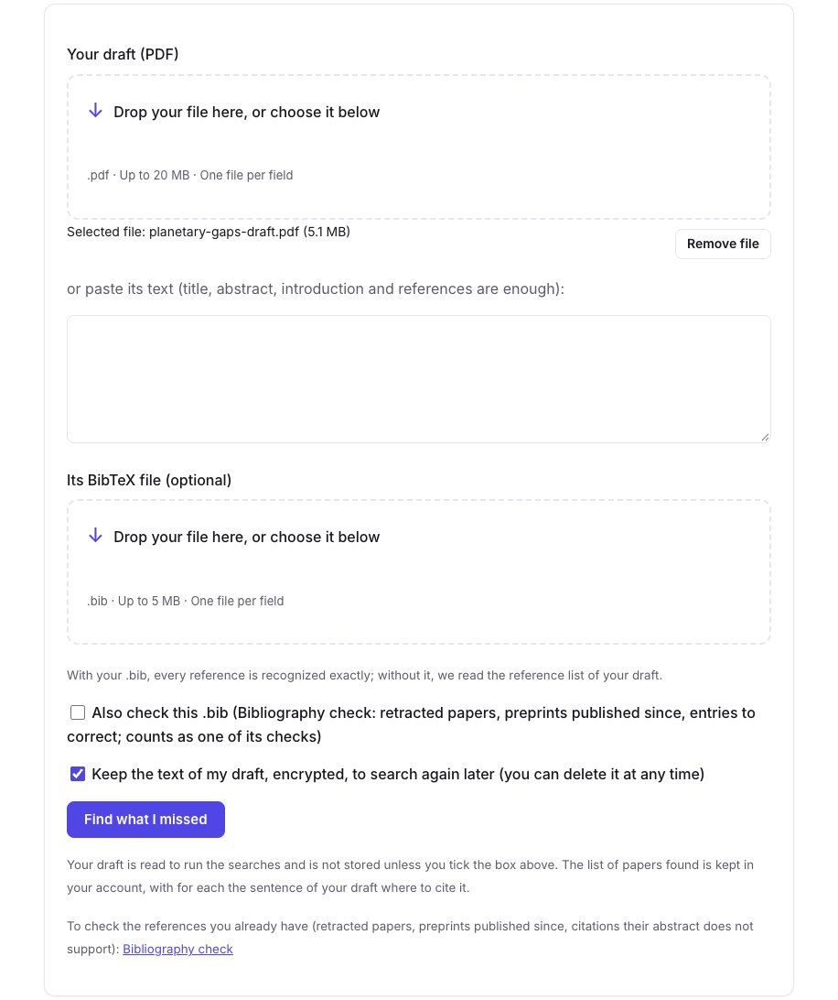
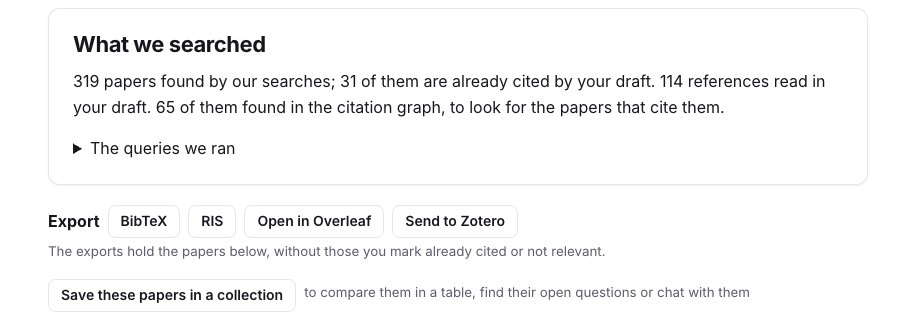
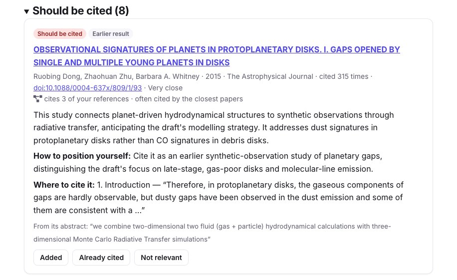
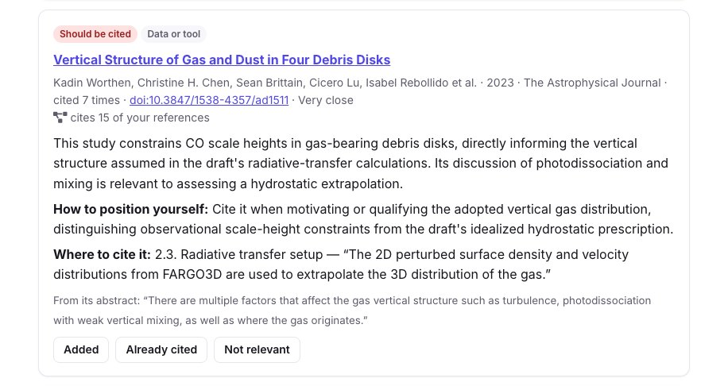
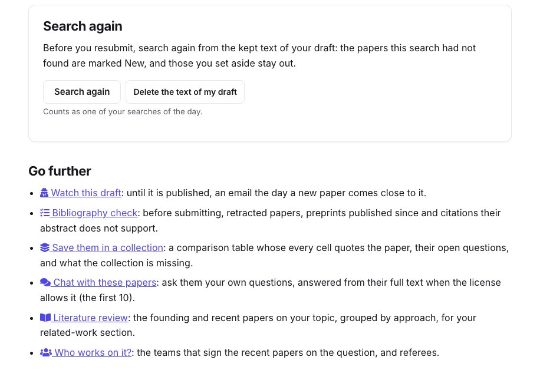

The referee who writes "the authors should discuss the work of…" has usually found a paper close to yours that your draft does not cite, often because it uses other words for the same thing. **What did I miss?** (Premium) reads your draft and its references, searches for the closest papers it does not cite, and says for each one whether a referee would expect it, how to position yourself, and **the sentence of your draft where to cite it**.

To show it on a real case, we gave it a paper as if it were a draft: [Bergez-Casalou & Kral (2024)](/en/paper/2411.14241v1/), on planetary gaps in the gas of debris discs, published in *Astronomy & Astrophysics* under a CC BY license. The screenshots show the search of 10 November 2026.

## 1. Give your draft

Open [What did I miss?](/en/missed/) and drop the PDF of your draft, or paste its text: the title, abstract, introduction and references are enough. Add its `.bib` if you have one: every reference is then recognised exactly. You can also have the same `.bib` checked by the [bibliography check](/en/refcheck/).

<figure class="guide-screenshot">

<figcaption>The PDF of the draft, and the box to keep its text to search again before resubmitting.</figcaption>
</figure>

Tick **Keep the text of my draft** to search again later without sending it again: it is stored encrypted and can be deleted at any time. Otherwise it is read for the searches and not stored. Our search took two minutes.

## 2. What was searched

The result starts with what was searched. For our paper: **114 references read** in the draft, 65 of them found in the citation graph; **319 papers found** by the searches, 31 of which the draft already cites. The queries, written from the question, method and data of the draft, are under **The queries we ran**.

<figure class="guide-screenshot">

<figcaption>What the search read, and the exports of its papers.</figcaption>
</figure>

Besides the searches, the candidates include the papers that **cite several of your references**, which finds work written with other words, and the founding papers the closest candidates cite most often. Retracted papers, the draft itself and the papers it cites are left out. A reference printed without a title is matched by its first author and year: here 19 papers were set apart as **probably cited already**, to check rather than to add.

## 3. The papers to cite

The papers are grouped by how much a referee would expect them: **Should be cited** (8 here), **Worth a look** (20) and **Related** (2). Each one says what kind of relation it has with the draft (an earlier result, a data set or tool, a competing method, the same question, a review), how many of your references it cites, then:

- what it does, read against your draft;
- **How to position yourself** against it;
- **Where to cite it**: the section and the sentence of your draft, kept only when found word for word;
- the sentence of its abstract that supports the relation.

<figure class="guide-screenshot">

<figcaption>The first paper to cite, with the sentence of the introduction where it fits.</figcaption>
</figure>

Many of the papers proposed here study gaps in protoplanetary discs: the draft compares them with debris discs, and the advice is to cite them as earlier work while saying what differs. Others are close in their data: the vertical structure of gas and dust in four debris discs, to cite where the draft sets up its radiative transfer.

<figure class="guide-screenshot">

<figcaption>A paper that cites 15 of the draft's references, to cite where the radiative transfer is set up.</figcaption>
</figure>

We checked a few of them against the reference list of the paper: it cites two papers by Izquierdo et al. (2021 and 2023), but not the 2022 one proposed here, nor Isella et al. (2016) or Hughes et al. (2017). The list is a set of candidates to judge, not a verdict: mark each one **Added**, **Already cited** or **Not relevant**. The exports leave out those marked already cited or not relevant, and a new search of the same draft leaves them out too.

## 4. Export, and search again before resubmitting

- **BibTeX** and **RIS**: the papers kept, for your `.bib` or your reference manager; **Open in Overleaf** creates a project that prints them, to copy the entries you want ([Overleaf guide](/en/guides/overleaf-bibliography-check/)).
- **Send to Zotero**, with a connected library ([Zotero guide](/en/guides/zotero-sync-research-papers/)).
- **Save these papers in a collection**, to compare them in a table or [chat with them](/en/chat/).

With the text kept, **Search again** before resubmitting: the papers this search had not found are marked **New**, and those you set aside stay aside.

<figure class="guide-screenshot">

<figcaption>Search again from the kept text, and the next tools.</figcaption>
</figure>

**Go further** follows the draft until it is published: [Scoop watch](/en/scoops/) emails you the day a new paper comes close to it, and [Who works on it?](/en/teams/) gives the teams on the question, and possible referees.

## Limits

- The search reads the beginning of the draft and its references, not every paragraph: a paper close to a section deep in the draft can be missed.
- Two searches of the same draft can differ a little: our French search proposed 10 papers to cite, not 8, among them some of the same ones.
- A paper absent from OpenAlex and arXiv, or from a field they index poorly, cannot be found.
