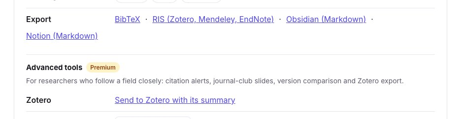
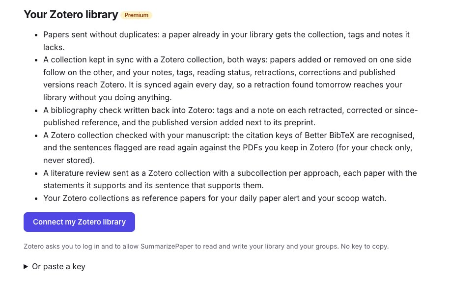
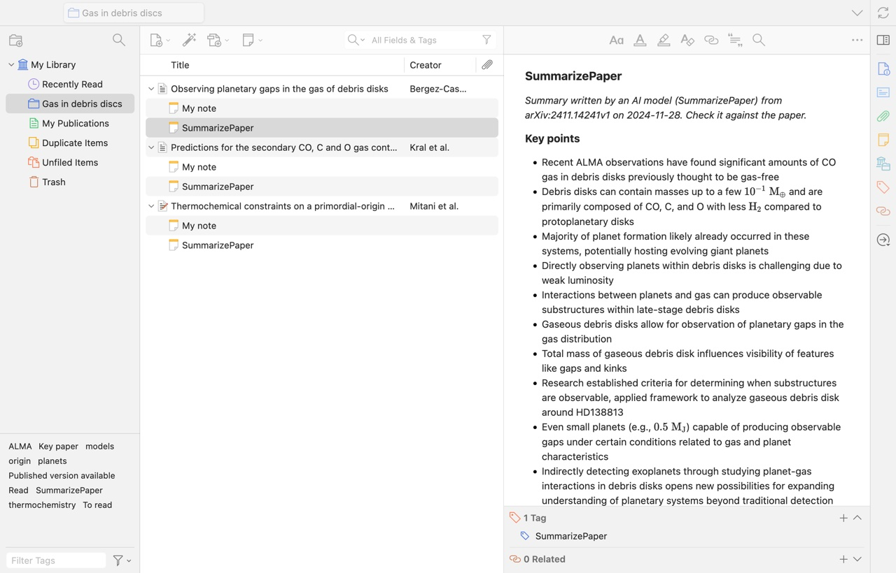
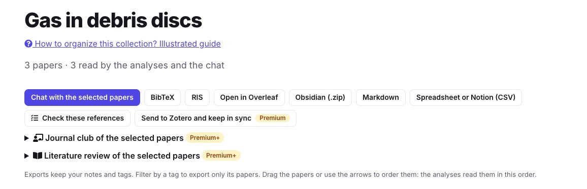
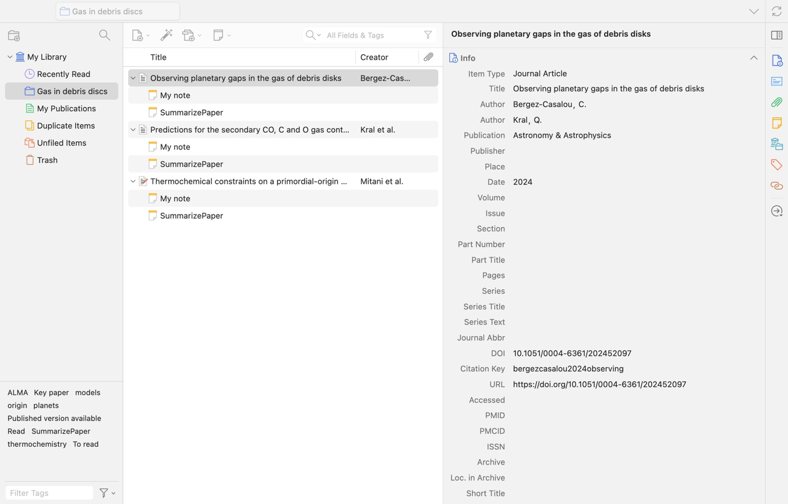
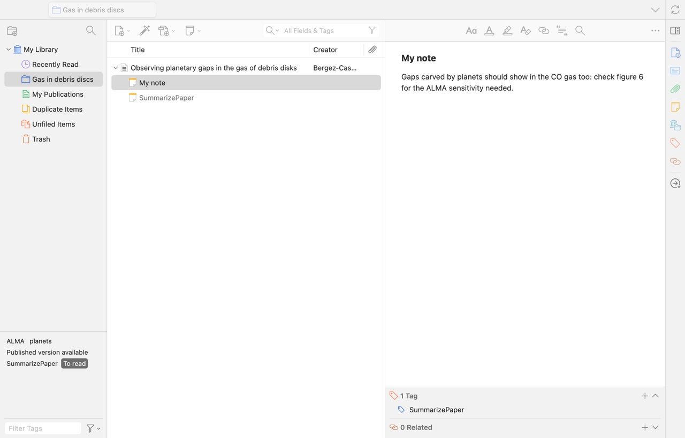
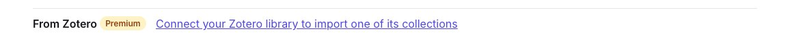
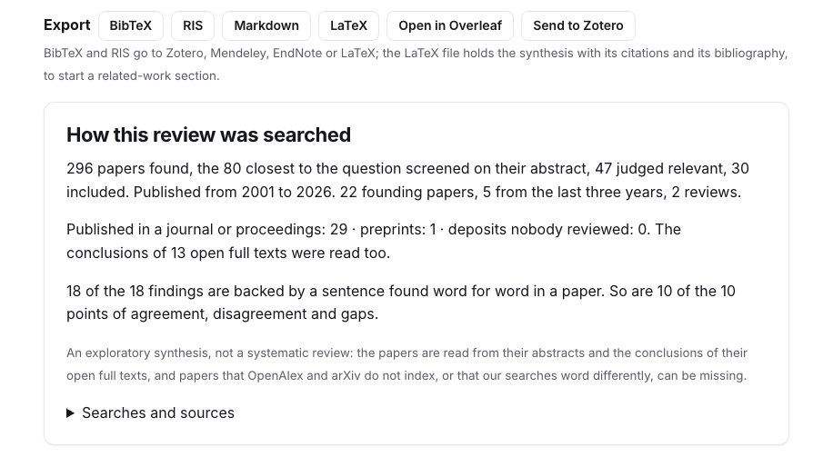

Your references live in Zotero, and you read papers elsewhere. **SummarizePaper writes into your Zotero library**: a paper with its summary, a collection kept in sync both ways, the findings of your bibliography check and your literature review. Saving a paper needs no account at all; the direct connection is Premium.

The examples use the collection *Gas in debris discs* of our other guides: three papers on the gas of debris discs, each with a note, tags and a reading status, sent to a real Zotero library and shown in Zotero 10.

## 1. Save a paper, free

On every paper page, the **Zotero Connector** of your browser recognises the paper and saves it with its metadata. Under **Tools for this paper**, **Export** also gives the **RIS** file, which Zotero, Mendeley and EndNote import; it holds the reference and the original abstract. A paper published since its preprint is exported as its published version, with its journal and DOI, and its arXiv identifier kept.

<figure class="guide-screenshot">

<figcaption>RIS for any reference manager, free; "Send to Zotero with its summary" once your library is connected.</figcaption>
</figure>

## 2. Connect your library

On the [integrations page](/en/integrations/), click **Connect my Zotero library**: Zotero asks you to log in and to allow SummarizePaper to read and write your library and your groups. No key to copy. You can also paste a private key you create on zotero.org, with write access.

<figure class="guide-screenshot">

<figcaption>One click: Zotero asks you to allow the connection.</figcaption>
</figure>

Once connected, choose the library used (yours or a group you may write to) and the Zotero collection single papers go to. The page lists your Zotero collections, to open one as a collection here or to check its references.

## 3. Send a paper with its summary

**Send to Zotero with its summary** creates the item, as its published version when there is one, with **a note holding the AI summary and the key points**. The note says it was written by a model, from which version of the paper and when; your own note is a note apart. A paper already in your library is not duplicated: it gets the collection, tags and notes it lacks. The item carries our citation key, in Zotero's **Citation Key** field and pinned for **Better BibTeX**, so your `\cite` commands match the `.bib` of our exports. Formulas in the summary are displayed by Zotero's note editor.

<figure class="guide-screenshot">

<figcaption>The summary note in Zotero: where it comes from, then the key points, formulas included.</figcaption>
</figure>

## 4. Keep a collection in sync, both ways

In a [collection](/en/collections/), **Send to Zotero and keep in sync** creates a Zotero collection, or links one, and keeps them together:

- papers added on either side reach the other; a paper removed on one side leaves the other (the Zotero item stays in your library);
- your notes, tags and reading status go to Zotero, as notes and tags;
- retractions, corrections and published versions found later reach your library too: the collection is **synced again every day**, without you doing anything.

<figure class="guide-screenshot">

<figcaption>"Send to Zotero and keep in sync", next to the other exports of the collection.</figcaption>
</figure>

In Zotero, the collection has the same name and the same papers, each with its two notes, *SummarizePaper* and *My note*; the item keeps its journal, DOI and citation key:

<figure class="guide-screenshot">

<figcaption>The synced collection in Zotero: the papers, their notes, and the item with its citation key.</figcaption>
</figure>

The reading status becomes a tag (*To read*, *Read*, *Key paper*) next to your own tags: click it in Zotero's tag selector to see what is left to read.

<figure class="guide-screenshot">

<figcaption>The papers to read, with the note written in SummarizePaper.</figcaption>
</figure>

The other way round, a Zotero collection opens here with **From Zotero**, under *Add papers*: you can then chat with its papers, compare them in a table, find the papers it may be missing or write its literature review, and it stays in sync.

<figure class="guide-screenshot">

<figcaption>Import a whole Zotero collection.</figcaption>
</figure>

## 5. Your results, written into Zotero

- **Bibliography check**: on each retracted, corrected or since-published reference, tags and a note in your library, and the published version added next to its preprint. A Zotero collection can also be checked with your manuscript: the citation keys of Better BibTeX are recognised, and the flagged sentences are read again against the PDFs you keep in Zotero, for your check only, never stored. See the [Overleaf and bibliography guide](/en/guides/overleaf-bibliography-check/).
- **Literature review**: a Zotero collection with **a subcollection per approach**, each paper with a note holding the statements it supports and its sentence that supports them. See the [literature review guide](/en/guides/literature-review-from-a-research-question/).
- **What did I miss?**: the close papers your draft does not cite, without those you marked already cited or not relevant. See [its guide](/en/guides/what-did-i-miss-uncited-papers/).

<figure class="guide-screenshot">

<figcaption>"Send to Zotero" on a literature review.</figcaption>
</figure>

Your Zotero collections can also serve as the **reference papers** of your [daily paper alert](/en/digest/) and of your [scoop watch](/en/scoops/): the new papers are ranked by closeness to them.

## Without Premium

The RIS and BibTeX exports are free, on every paper and on every collection, and the Zotero Connector works on every paper page. A collection's `.bib` can also be linked in Overleaf, free; see the [Overleaf guide](/en/guides/overleaf-bibliography-check/#4-keep-a-bib-in-sync-with-a-collection).
