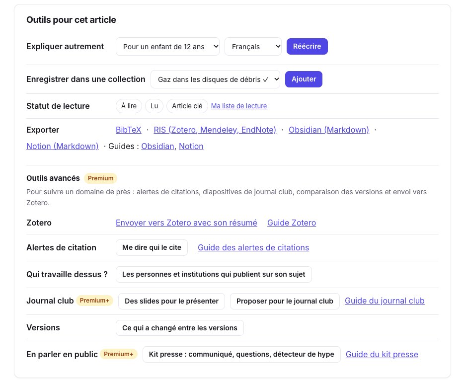
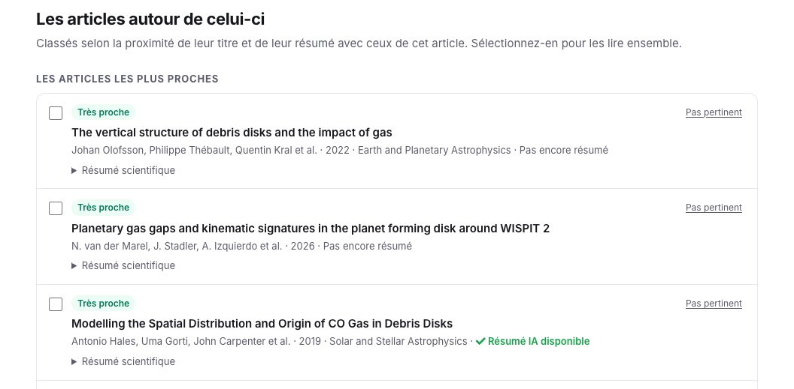
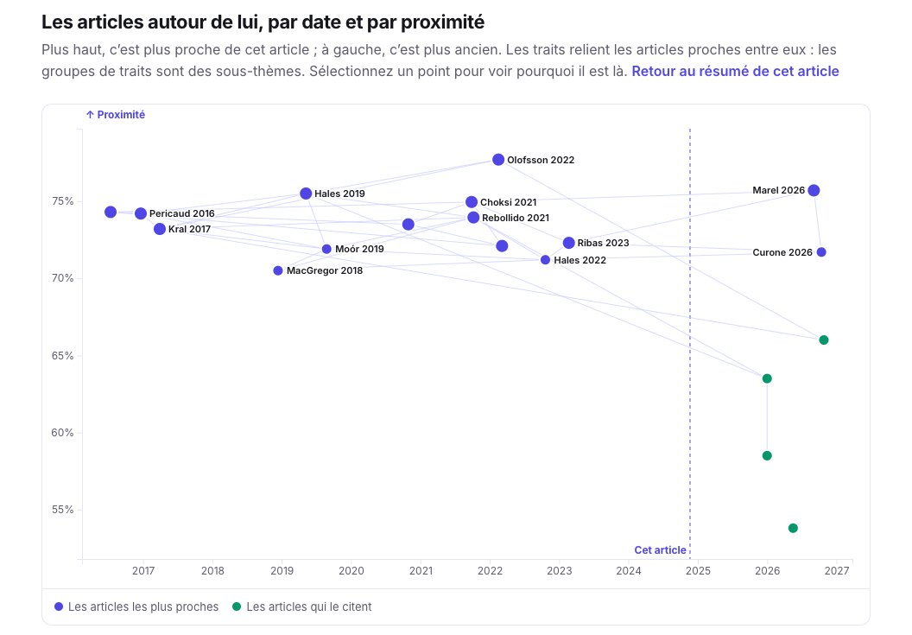
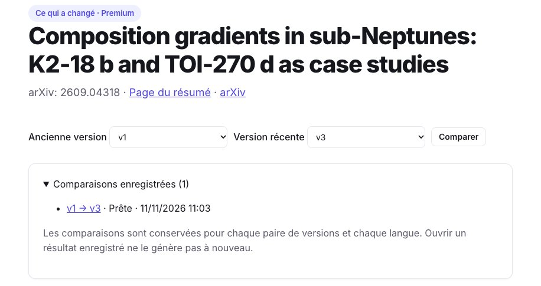
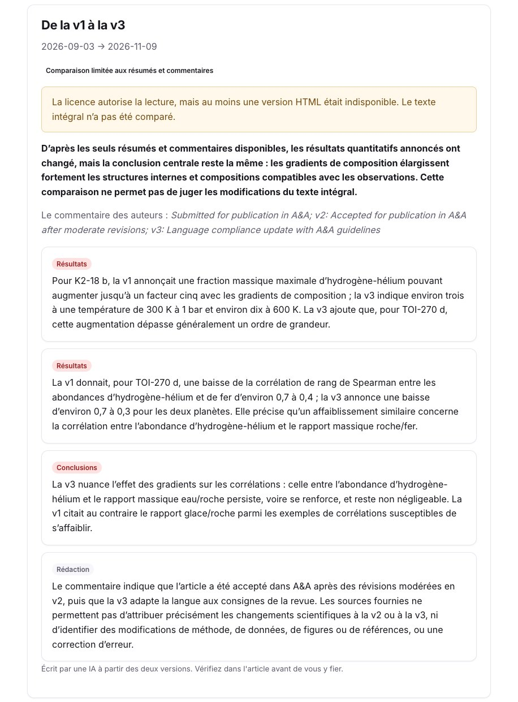

Un résumé vous dit ce que dit un article. Autour, vous voulez aussi savoir sur quels articles il s’appuie, lesquels sont venus après, lesquels sont proches sans le citer, et si la version que vous lisez est la dernière. Chaque page d’article de SummarizePaper rassemble tout cela. Le [guide des résumés](/fr/guides/how-to-summarize-a-research-paper/) couvre le résumé lui-même ; celui-ci couvre ce qui l’entoure.

Nos exemples : le voisinage de [Bergez-Casalou & Kral (2024)](/fr/paper/2411.14241v1/), sur les lacunes planétaires dans le gaz des disques de débris, et les versions de [Morf & Helled (2026)](/fr/paper/2609.04318v3/), sur l’intérieur des sous-Neptunes K2-18 b et TOI-270 d, trois versions sur arXiv.

## 1. Les outils d’une page d’article

Sous le résumé, **Outils pour cet article** rassemble ce que vous pouvez en faire : l’expliquer à un autre niveau ou dans une autre langue, l’enregistrer dans une collection avec un statut de lecture, l’exporter (BibTeX, RIS, Obsidian, Notion), et les outils Premium : l’envoyer vers Zotero, suivre ses citations, trouver qui travaille sur son sujet, préparer un journal club, voir ce qui a changé entre ses versions, ou préparer son kit presse. Chaque outil renvoie à son guide.

<figure class="guide-screenshot">

<figcaption>Tout ce que l’on peut faire depuis une page d’article, avec le guide de chaque outil.</figcaption>
</figure>

## 2. Les articles autour

Plus bas, **Les articles autour de celui-ci** liste jusqu’à trois groupes, chaque article avec sa proximité (très proche, proche, apparenté), ses auteurs, son année et sa revue, son nombre de citations, et s’il est déjà résumé ici :

- les **articles les plus proches** : les plus proches de tout notre index, quelle que soit leur catégorie, et ceux que recommande Semantic Scholar ;
- les articles **sur lesquels il s’appuie** : ceux qu’il cite, les plus proches d’abord ;
- les **articles qui le citent**, les plus proches d’abord.

La proximité compare les titres et les résumés : un article proche écrit avec d’autres mots ressort quand même. Un article à la fois proche et cité reste parmi les plus proches, avec les deux informations : pour notre article, les travaux proches qu’il cite y sont tous, si bien que seuls deux groupes s’affichent.

<figure class="guide-screenshot">

<figcaption>Les articles les plus proches d’un article sur le gaz des disques de débris.</figcaption>
</figure>

Cochez plusieurs articles pour [discuter avec eux ensemble](/fr/chat/), ou mettez-les dans une [collection](/fr/collections/). **Pas pertinent** retire un article de votre liste.

## 3. La carte, par date et par proximité

**Une carte de ces articles par date et par proximité**, un lien sous la liste, les place par date (à gauche, plus ancien) et par proximité (plus haut, plus proche) ; les traits relient les articles proches entre eux, et les groupes de traits sont des sous-thèmes. La ligne pointillée est l’article lui-même : à gauche, les travaux sur lesquels il s’appuie ; à droite, en vert, les articles qui le citent. Sélectionnez un point pour voir pourquoi cet article est là.

<figure class="guide-screenshot">

<figcaption>Les articles autour d’un article, par année et par proximité ; ceux qui le citent en vert.</figcaption>
</figure>

## 4. Ce qui a changé entre les versions (Premium)

Un article arXiv peut avoir plusieurs versions : celle acceptée par une revue diffère souvent de la première. **Versions → Ce qui a changé entre les versions** en compare deux. Choisissez la version la plus ancienne et la plus récente, puis comparez ; chaque comparaison est gardée, pour chaque paire de versions et chaque langue.

<figure class="guide-screenshot">

<figcaption>Deux versions à comparer, et les comparaisons déjà faites.</figcaption>
</figure>

Le résultat donne un verdict, puis chaque changement avec sa nature (résultats, conclusions, méthode, données, une erreur corrigée, figures, références, rédaction) et son importance. Pour notre article, le commentaire des auteurs dit seulement « v2 : acceptée après des révisions modérées ; v3 : mise en conformité de la langue », mais la comparaison trouve que **les résultats ont changé** : la version 1 annonçait que les gradients de composition pouvaient multiplier jusqu’à cinq la fraction maximale d’hydrogène-hélium de K2-18 b ; la version 3 donne environ trois à 300 K et dix à 600 K, et ajoute TOI-270 d.

<figure class="guide-screenshot">

<figcaption>Ce qui a changé de v1 à v3 : deux résultats, une conclusion, et la rédaction.</figcaption>
</figure>

La page dit ce qui a été comparé. Ici, arXiv n’avait pas le HTML de chaque version : seuls les résumés et commentaires ont été lus, les changements ailleurs dans l’article ne peuvent pas être vus, et le verdict le dit. Quand le texte intégral peut être lu, seuls les paragraphes qui diffèrent sont donnés au modèle.

Quand vous suivez les citations d’un article, ou surveillez une collection, vous recevez aussi un email quand il a une nouvelle version, avec ce qui a changé ([guide des alertes de citations](/fr/guides/track-research-paper-citations/)).

## Limites

- La proximité lit les titres et les résumés, pas les textes intégraux : deux articles qui partagent une méthode mais la décrivent autrement peuvent être loin l’un de l’autre.
- Un article que ni nous, ni OpenAlex, ni Semantic Scholar n’indexons ne peut pas apparaître.
- Une comparaison faite sur les seuls résumés ne voit pas une figure ou une table modifiée ; vérifiez dans l’article avant de vous y fier.
