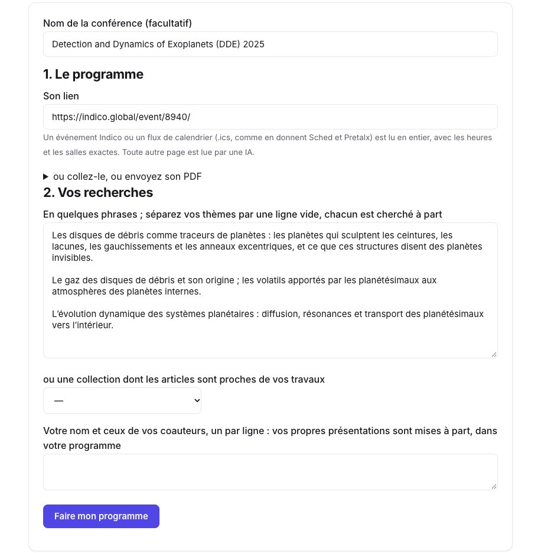
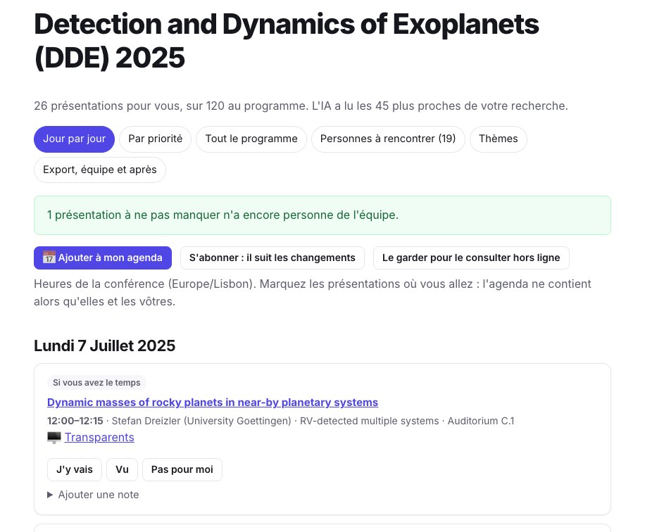
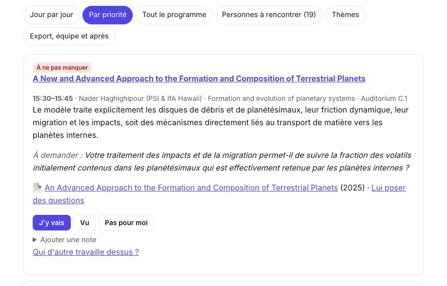
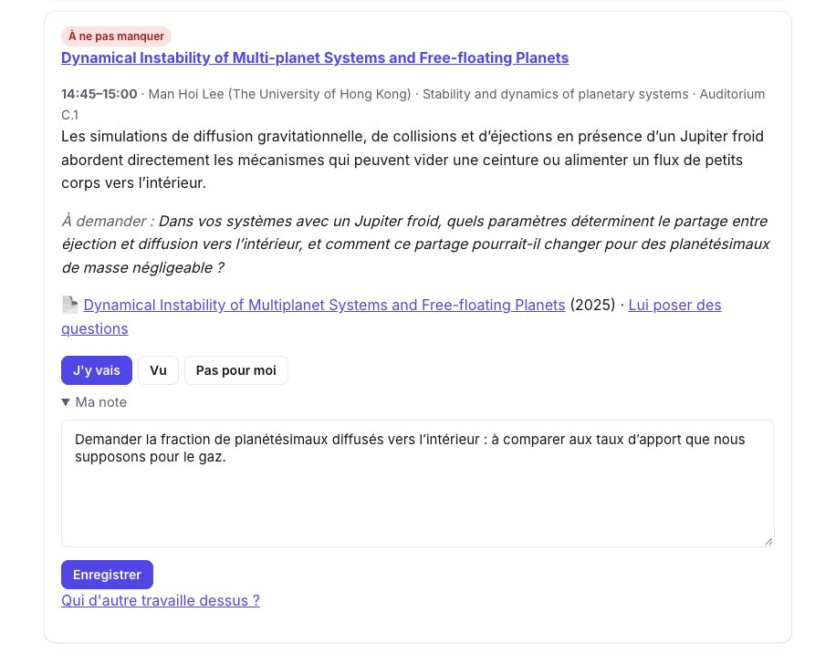
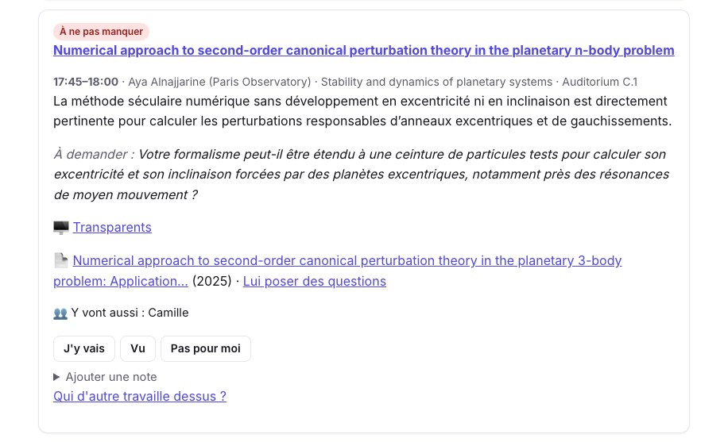
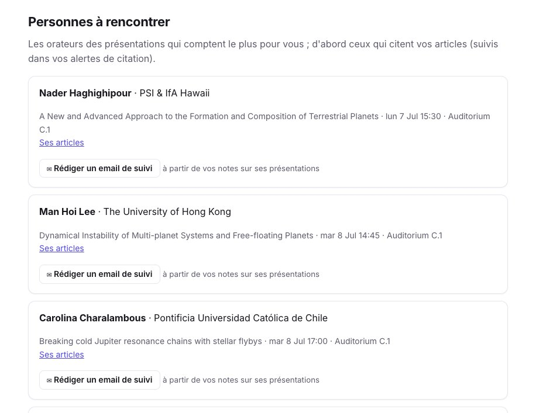
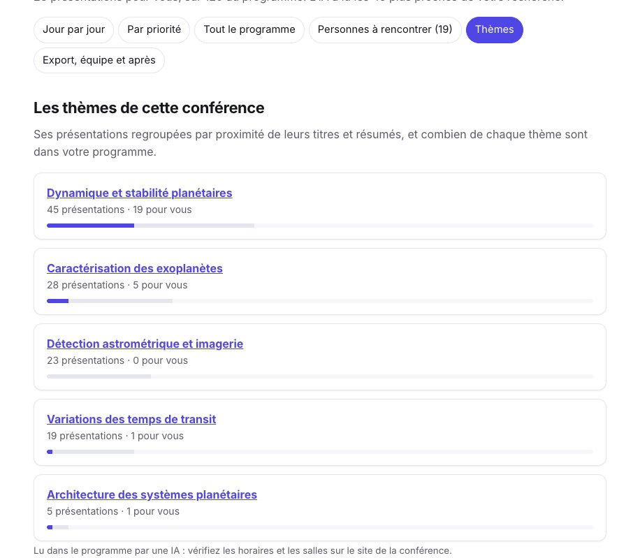
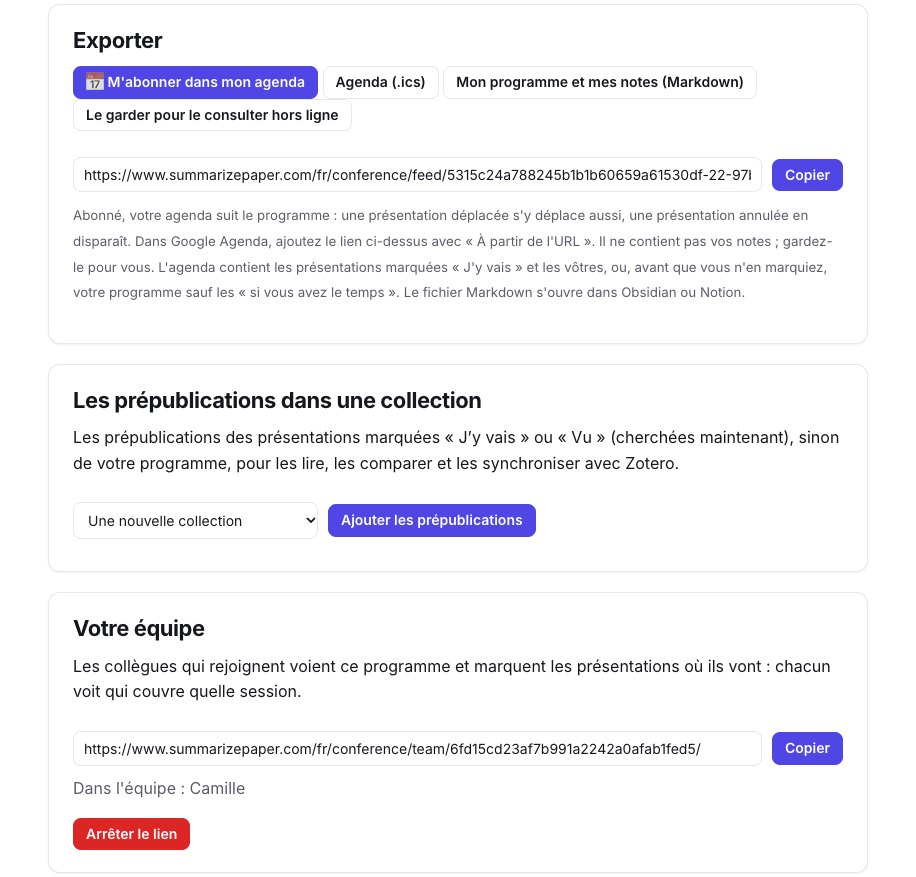
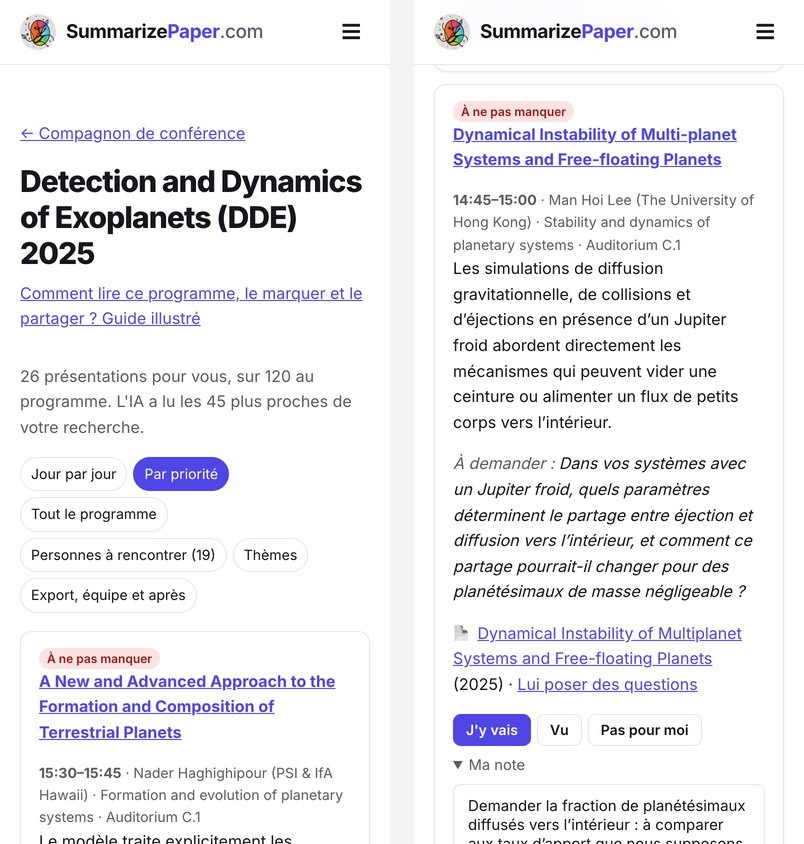

Un programme de conférence compte une centaine de présentations ou plus, souvent en sessions parallèles. On lit les titres la veille, on manque l’exposé dont le titre ne disait pas qu’il touchait à son problème, et après la semaine on ne sait plus à qui on voulait écrire. Le **compagnon de conférence** (Premium+) lit tout le programme, garde les présentations proches de vos recherches, dit pourquoi chacune compte et quoi demander, et garde ensemble votre programme, vos notes et votre équipe jusqu’au suivi.

Ce guide suit un vrai programme : **Detection and Dynamics of Exoplanets** (Coimbra, 7–11 juillet 2025), 120 présentations et posters sur Indico. Nous l’avons classé pour des recherches sur les disques de débris, leur gaz et les planètes qui les façonnent. Chaque capture montre le résultat de cette exécution, faite le 10 novembre 2026.

## 1. Donnez le programme et vos recherches

Ouvrez le [compagnon de conférence](/fr/conference/) et collez le lien du programme. Un **événement Indico** ou un **flux de calendrier** (`.ics`, comme en donnent Sched et Pretalx) est lu en entier, avec les heures, les salles et les résumés exacts. Toute autre page, le PDF du livret ou un programme collé est lu par une IA.

Décrivez ensuite vos recherches en quelques phrases. **Séparez vos thèmes par une ligne vide** : chacun est cherché à part, si bien qu’une présentation proche d’un seul d’entre eux n’est pas noyée par les autres. Vous pouvez aussi partir du profil de votre [sélection du matin](/fr/digest/), d’un projet de votre [veille anti-scoop](/fr/scoops/) ou d’une [collection](/fr/collections/) d’articles proches de vos travaux. Donnez votre nom et ceux de vos coauteurs pour mettre à part vos propres présentations.

<figure class="guide-screenshot">

<figcaption>Le lien Indico et trois thèmes, chacun cherché à part.</figcaption>
</figure>

La lecture et le classement de notre programme ont pris moins d’une minute.

## 2. Lisez votre programme jour par jour

Le résultat dit combien de présentations ont été gardées : ici **26 sur 120**, après que l’IA a lu les 45 plus proches de nos recherches. Chacune a un niveau (**À ne pas manquer**, **Intéressant**, **Si vous avez le temps**), une phrase sur ce qu’elle apporte à *vos* recherches, et une question à poser à l’orateur. Quand une prépublication de la présentation est trouvée, elle est liée, avec « Lui poser des questions » pour [discuter avec elle](/fr/chat/) avant la session ; les transparents sont liés quand Indico les a.

<figure class="guide-screenshot">

<figcaption>26 présentations gardées sur 120, rangées par jour.</figcaption>
</figure>

Les raisons sont écrites pour les recherches que vous avez décrites, pas comme un résumé de l’abstract. Lisez-les comme une raison d’aller voir l’abstract, pas comme un jugement sur l’exposé.

**Par priorité** reprend les mêmes présentations de la plus importante à la moins importante, quel que soit le jour : la vue à lire la veille. Ici, la première est un modèle de formation des planètes telluriques qui traite les disques de débris et de planétésimaux, avec la question de la fraction de volatils retenue par les planètes internes.

<figure class="guide-screenshot">

<figcaption>Par priorité : les présentations à ne pas manquer d’abord.</figcaption>
</figure>

**Tout le programme** montre les 120 présentations, pour retrouver celle que le classement a laissée de côté.

## 3. Marquez les présentations où vous allez, et prenez des notes

Sous chaque présentation, marquez **J’y vais**, **Vu** ou **Pas pour moi**, et ajoutez une note, enregistrée sans quitter la page : elle reste privée. Dès que vous marquez des présentations « J’y vais », l’agenda ne contient plus qu’elles et les vôtres ; avant, il contient votre programme sauf les « si vous avez le temps ».

<figure class="guide-screenshot">

<figcaption>Une présentation à ne pas manquer, marquée « J’y vais », avec une note pour préparer la question.</figcaption>
</figure>

Quand deux présentations de votre programme ont lieu en même temps, la page le signale sur chacune et les compte en haut : choisissez, ou demandez à un collègue d’y aller. DDE 2025 n’avait qu’une session à la fois : notre programme n’a pas de chevauchement.

## 4. Allez-y en équipe

Dans **Export, équipe et après**, créez un **lien d’équipe** et envoyez-le à vos collègues. Ceux qui le rejoignent voient le programme et marquent les présentations où ils vont ; sur chaque présentation, vous voyez qui d’autre y va, et le haut du programme compte les présentations à ne pas manquer que personne de l’équipe ne couvre encore.

<figure class="guide-screenshot">

<figcaption>Camille, qui a rejoint avec le lien d’équipe, va à celle-ci.</figcaption>
</figure>

Un collègue peut aussi classer le même programme pour ses propres recherches : le programme n’est pas relu, et l’équipe voit toujours qui va où. Vos notes et les recherches que vous avez décrites ne lui sont jamais montrées.

## 5. Les personnes à rencontrer

**Personnes à rencontrer** liste les orateurs des présentations qui comptent le plus pour vous (20 au plus), avec leurs présentations, leurs horaires et un lien vers leurs articles. Ceux qui citent vos articles passent en premier, quand vous suivez vos articles dans les [alertes de citations](/fr/citations/).

<figure class="guide-screenshot">

<figcaption>Les orateurs à rencontrer, chacun avec un email de suivi à rédiger après sa présentation.</figcaption>
</figure>

Après l’exposé, **Rédiger un email de suivi** écrit un premier message à partir des notes prises sur ses présentations, à copier et retoucher ; rien n’est envoyé.

## 6. Les thèmes de la conférence

**Thèmes** regroupe toutes les présentations par proximité de leurs titres et résumés, et montre combien de chacun sont dans votre programme. Ici, 19 des 26 présentations gardées relèvent de *Dynamique et stabilité planétaires*, et aucune de *Détection astrométrique et imagerie* : le classement a suivi les recherches décrites, pas la taille des sessions.

<figure class="guide-screenshot">

<figcaption>Chaque thème avec ses présentations, et celles de votre programme.</figcaption>
</figure>

## 7. Agenda, changements et suivi

- **M’abonner dans mon agenda** : un lien à ajouter dans Google Agenda (« À partir de l’URL »), Calendrier d’Apple ou Outlook. Il suit le programme : une présentation déplacée se déplace dans votre agenda, une présentation annulée en disparaît. Ou téléchargez le `.ics` une fois.
- **Mon programme et mes notes (Markdown)** : vos présentations, vos marques et vos notes dans un fichier qui s’ouvre dans Obsidian ou Notion.
- **Le garder pour le consulter hors ligne** : le programme reste lisible sur votre téléphone sans réseau dans l’amphithéâtre.
- **Changements du programme** : un programme Indico est relu chaque jour dans les deux semaines avant la conférence, et toutes les trois heures pendant ; vous recevez un email quand une présentation de votre programme est déplacée ou annulée, ou qu’une présentation aussi proche de vos recherches est ajoutée.
- **Les prépublications dans une collection** : les prépublications des présentations marquées « J’y vais » ou « Vu » vont dans une [collection](/fr/collections/), pour les lire, les comparer dans un tableau et les synchroniser avec Zotero.

<figure class="guide-screenshot">

<figcaption>Export, prépublications et équipe, dans la dernière vue du programme.</figcaption>
</figure>

Sur votre téléphone, le programme se lit de la même façon, et vous marquez les présentations et prenez des notes pendant les sessions. Pendant la conférence, une vue **Maintenant** montre la présentation en cours, la suivante et le reste de la journée.

<figure class="guide-screenshot">

<figcaption>Sur téléphone : le programme par priorité, et une présentation marquée « J’y vais » avec sa note.</figcaption>
</figure>

## Limites

- Le programme est **lu par une IA** quand il n’est ni sur Indico ni dans un flux de calendrier : vérifiez les horaires et les salles sur le site de la conférence, comme la page le rappelle.
- Le classement compare les titres et les résumés à ce que vous avez écrit : une présentation au résumé court ou vague peut être manquée. Regardez **Tout le programme** pour les sessions qui vous tiennent à cœur.
- Les prépublications sont cherchées par titre et orateur : une présentation sans article, ou dont l’article porte un autre titre, n’en a pas, ou un « article proche de l’orateur » présenté comme tel.
- Notre exemple est une conférence passée : la vue **Maintenant** et les emails de changements ne servent qu’avant et pendant une conférence.
