Préparer un journal club prend une soirée : relire l’article, choisir les figures, écrire les slides, deviner les questions. Le **journal club** (Premium+) écrit les slides pour votre public et la durée de votre exposé, **chaque point avec le passage de l’article qui l’appuie**, les travaux antérieurs, où en est l’article et les questions difficiles à préparer. Vous les modifiez ensuite, les présentez et les exportez.

Ce guide suit une vraie présentation, écrite le 10 novembre 2026, sur [Huet, Kral & Manchon (2026)](/fr/paper/2607.11677v1/), *Water gas discs in exo-asteroid belts*, un article sous licence CC BY : son texte intégral et ses figures pouvaient être utilisés.

## 1. Choisissez un article et votre public

Ouvrez le [journal club](/fr/journal-club/) et cherchez l’article, ou ouvrez sa page de résumé et choisissez le journal club dans **Outils pour cet article**.

<figure class="guide-screenshot">
<a href="/static/summarizer/img/guides/journal-club/start-fr.jpg">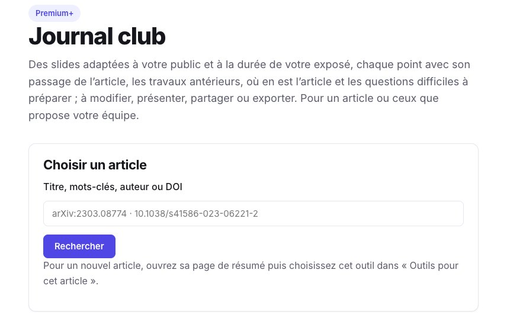</a>
<figcaption>Partez de n’importe quel article.</figcaption>
</figure>

Choisissez la **langue** des slides, le **public** (chercheurs du domaine, étudiants qui découvrent le sujet, chercheurs d’un autre domaine) et la **durée** de l’exposé (10, 20 ou 45 minutes) : ils fixent la part de contexte, le niveau de détail et le nombre de slides. Chaque jeu de réglages donne une présentation à part, et les autres sont conservées. La nôtre, pour des chercheurs du domaine et 20 minutes, a pris moins d’une minute et compte 14 slides. Les passages cités de l’article restent dans sa langue, comme les légendes à l’intérieur de ses figures.

<figure class="guide-screenshot">
<a href="/static/summarizer/img/guides/journal-club/toolbar-fr.jpg">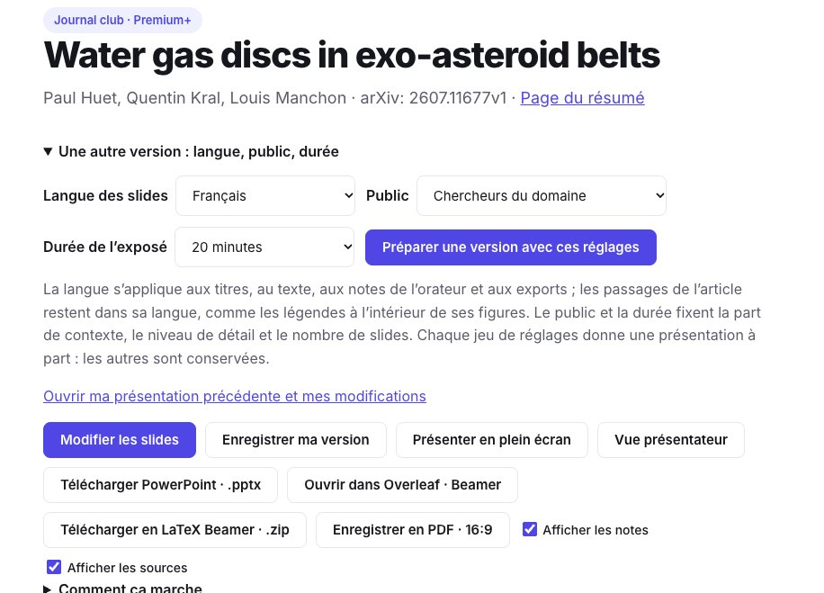</a>
<figcaption>Les réglages de la présentation, et tout ce que vous pouvez en faire.</figcaption>
</figure>

## 2. Vérifiez chaque point dans l’article

Chaque slide porte quelques points, une figure de l’article quand elle aide, et les notes de l’orateur. En dessous, **Sources** dit combien de ses points ont été retrouvés dans l’article : chacun avec sa nature (résultat, méthode, interprétation, contexte), le passage de l’article, sa section, et un lien pour l’ouvrir dans l’article.

<figure class="guide-screenshot">
<a href="/static/summarizer/img/guides/journal-club/figure-fr.jpg">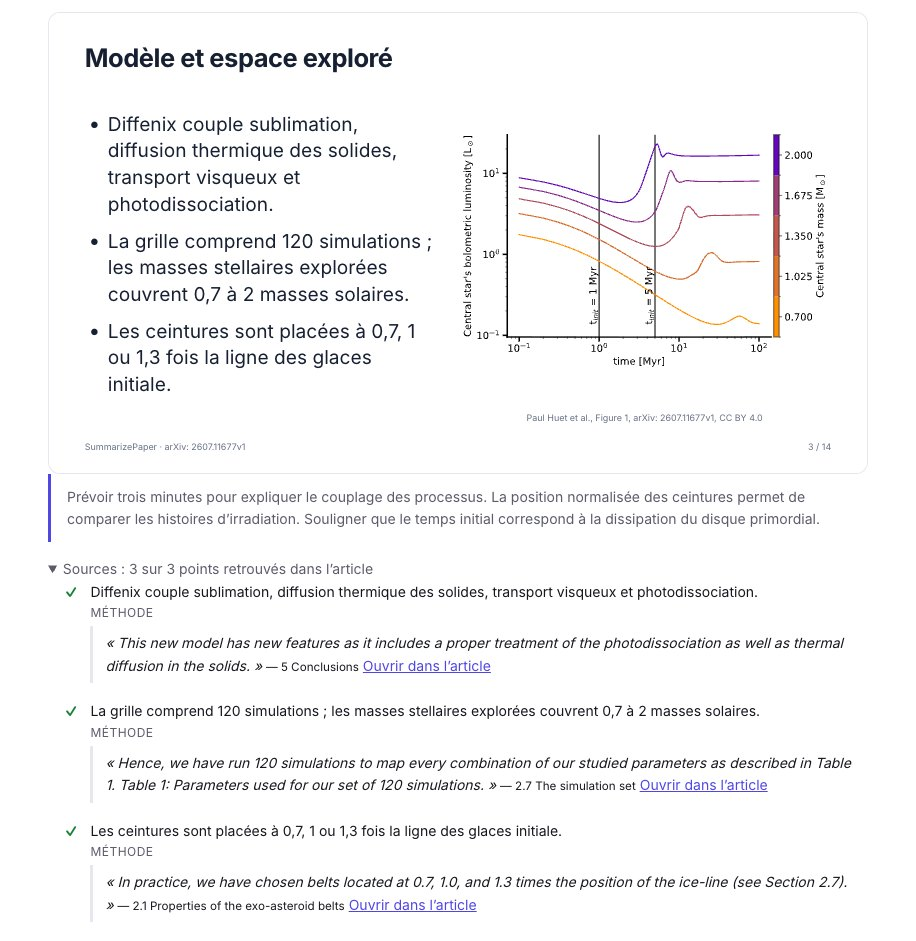</a>
<figcaption>Une slide avec une figure de l’article, ses notes, et le passage derrière chaque point.</figcaption>
</figure>

Un point dont le passage n’est pas dans l’article, ou qui donne un nombre que l’article n’énonce pas, est **signalé, à vérifier**. Dans notre présentation, la slide de comparaison avec les travaux antérieurs n’a qu’un point sur 3 retrouvé dans l’article : elle est écrite à partir des articles antérieurs, pas de celui-ci, et le dit.

Les dernières slides ne sont pas laissées au seul modèle :

- **Travaux antérieurs et suites** vient des articles que l’article cite et de ceux qui le citent, jamais de la mémoire du modèle ;
- **Où en est l’article** vient de Crossref et d’arXiv : ici, *publié dans Astronomy & Astrophysics le 21 septembre 2026*, avec son DOI ; une rétractation, une correction ou une version arXiv plus récente y seraient signalées ;
- **Points forts et limites** sépare les limites énoncées par les auteurs, chacune avec son passage, des points à discuter, qui sont la lecture du modèle et le disent.

<figure class="guide-screenshot">
<a href="/static/summarizer/img/guides/journal-club/limits-fr.jpg">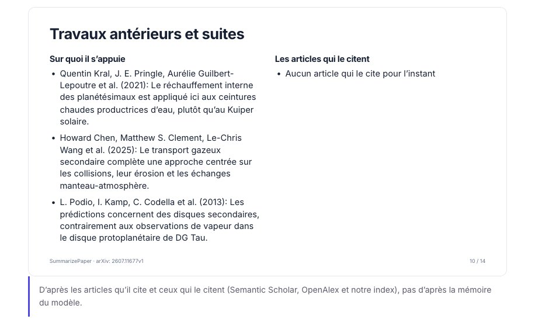</a>
<figcaption>Les points forts, et les limites que les auteurs énoncent eux-mêmes.</figcaption>
</figure>

<figure class="guide-screenshot">
<a href="/static/summarizer/img/guides/journal-club/discussion-fr.jpg">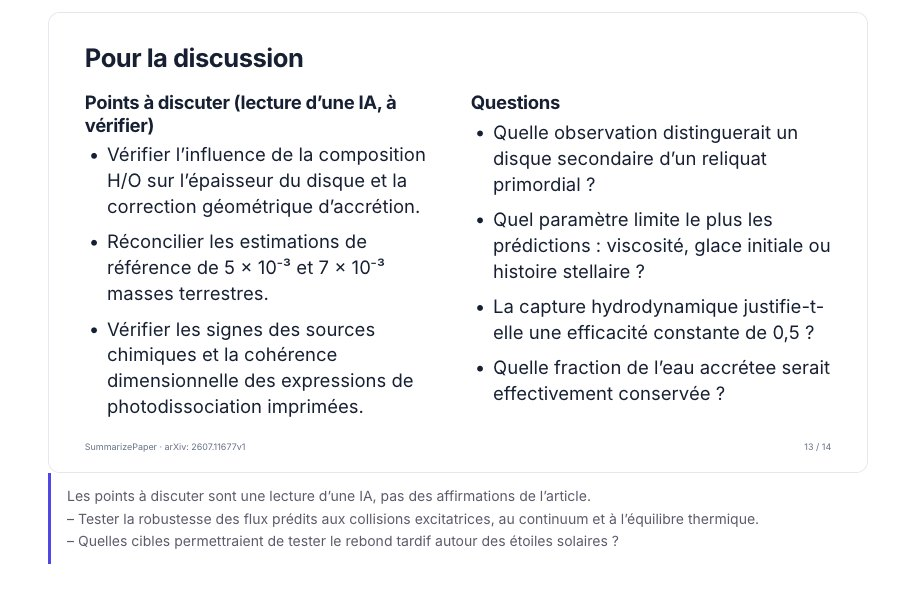</a>
<figcaption>Pour la discussion : les points à discuter sont une lecture d’IA, signalée comme telle.</figcaption>
</figure>

## 3. Préparez les questions difficiles

Sous les slides, **Les questions difficiles à préparer** liste ce que l’auditoire risque de demander, avec ce que l’article permet de répondre. Un passage n’est montré que s’il est vraiment dans l’article ; sinon, la réponse dit de la vérifier avant de la donner. **Poser une autre question à l’article** ouvre la [discussion](/fr/chat/) avec l’article.

<figure class="guide-screenshot">
<a href="/static/summarizer/img/guides/journal-club/questions-fr.jpg">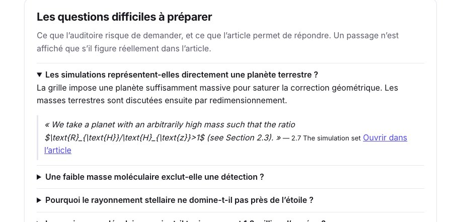</a>
<figcaption>Une question difficile, et le passage de l’article qui y répond.</figcaption>
</figure>

## 4. Modifiez les slides

Cliquez sur **Modifier les slides**. Pour chaque slide, vous pouvez la déplacer, la dupliquer, ajouter une slide après ou la supprimer ; changer son titre, ses points et ses notes ; choisir la taille du texte, une autre figure de l’article, sa position et sa taille ; et demander au modèle de la réécrire **plus courte**, **plus simple**, **plus technique**, ou d’écrire ses notes de l’orateur. **Enregistrer ma version** : vos modifications sont privées, et la présentation que reçoivent les autres reste telle qu’elle a été écrite.

<figure class="guide-screenshot">
<a href="/static/summarizer/img/guides/journal-club/edit-fr.jpg">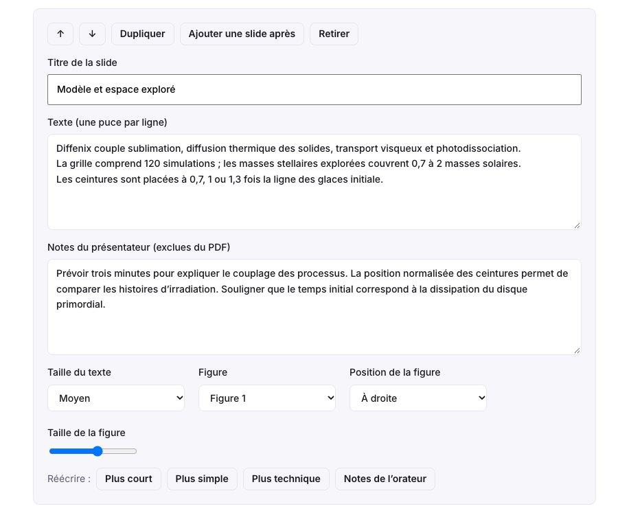</a>
<figcaption>L’éditeur d’une slide, avec ses réécritures.</figcaption>
</figure>

## 5. Présentez, exportez, partagez

- **Présenter en plein écran**, ou **Vue présentateur** : vos notes, la slide suivante et un chronomètre sur votre écran, les slides sur le projecteur.
- **Télécharger PowerPoint**, **Enregistrer en PDF** (16:9), ou **LaTeX Beamer**, en `.zip` ou comme nouveau projet Overleaf avec les figures de l’article et vos notes ; voir le [guide Overleaf](/fr/guides/overleaf-bibliography-check/).
- **Partager avec les participants** : un lien en lecture seule vers votre version enregistrée, avec les slides, les sources et les questions difficiles, pendant 90 jours et sans compte.

## Présentez les articles que votre équipe propose

Un journal club discute souvent plusieurs articles. Dans les outils d’une page d’article, dans votre sélection du matin ou dans une lettre hebdomadaire, **Proposer pour le journal club** ajoute l’article à une collection que votre équipe partage : invitez vos collègues dans la collection pour que chacun propose des articles, les trie et laisse des notes.

<figure class="guide-screenshot">
<a href="/static/summarizer/img/guides/journal-club/propose-fr.jpg">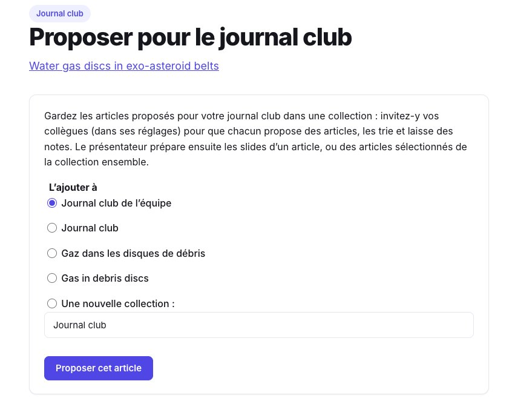</a>
<figcaption>Chaque collègue propose des articles dans la collection partagée.</figcaption>
</figure>

La personne qui présente ouvre ensuite la collection et choisit **Journal club des articles sélectionnés** (6 au plus, dans l’ordre de la collection).

<figure class="guide-screenshot">
<a href="/static/summarizer/img/guides/journal-club/from-collection-fr.jpg">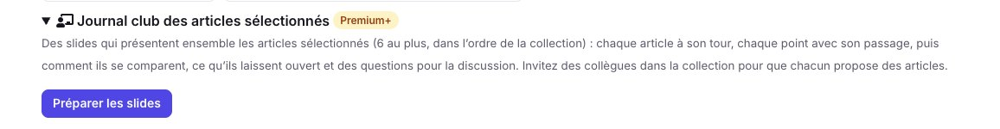</a>
<figcaption>Les slides des articles sélectionnés d’une collection.</figcaption>
</figure>

Nous en avons fait une avec trois articles sur le gaz secondaire des disques de débris : les disques de vapeur d’eau, les lacunes planétaires dans le gaz ([Bergez-Casalou & Kral 2024](/fr/paper/2411.14241v1/)) et les prédictions de CO, C et O ([Kral et al. 2017](/fr/paper/1703.10693v1/)). La présentation passe chaque article en revue, puis **comment les articles se comparent** : où ils s’accordent et où ils diffèrent, chaque point nommant l’article dont il vient.

<figure class="guide-screenshot">
<a href="/static/summarizer/img/guides/journal-club/collection-fr.jpg">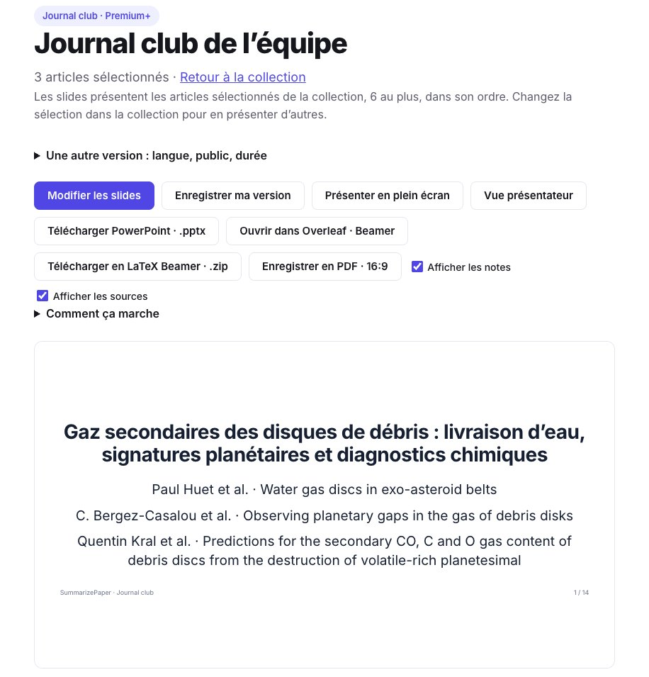</a>
<figcaption>Trois articles d’une collection dans une seule présentation.</figcaption>
</figure>

<figure class="guide-screenshot">
<a href="/static/summarizer/img/guides/journal-club/compare-fr.jpg">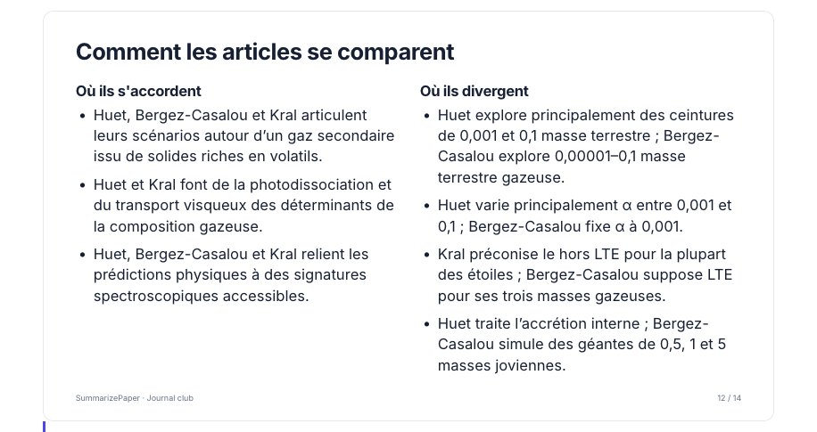</a>
<figcaption>Comment les trois articles se comparent, chaque point nommant son article.</figcaption>
</figure>

## Limites

- Sous une licence qui ne permet de lire que le résumé, la présentation est courte (3 ou 4 slides) et dit ce que le résumé ne dit pas.
- Les points sans passage, et les points à discuter, sont la lecture du modèle : vérifiez-les avant de présenter.
- LaTeX compose le texte avec d’autres polices que la page : une slide trop longue est réduite dans Beamer, et le journal d’Overleaf nomme celles réduites de plus d’un dixième.
