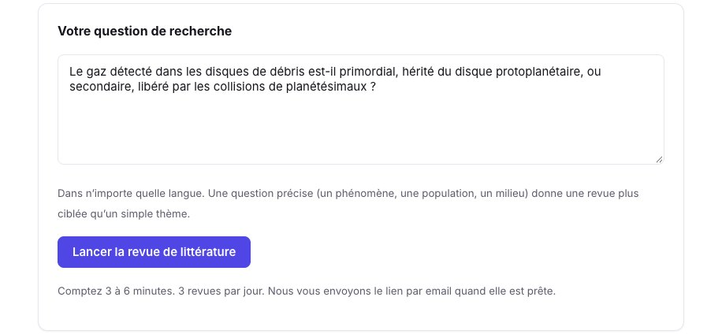
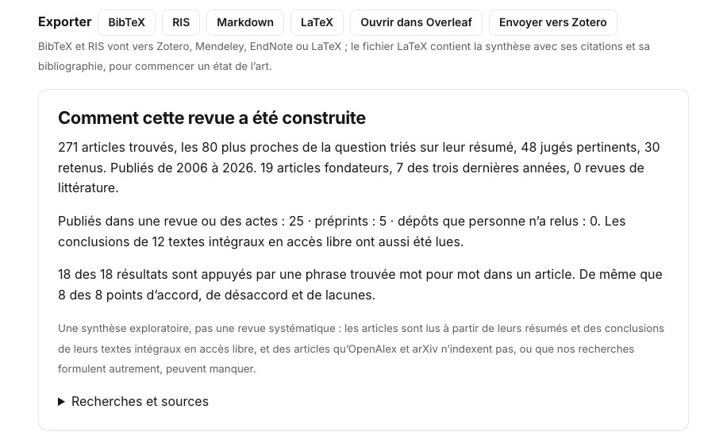
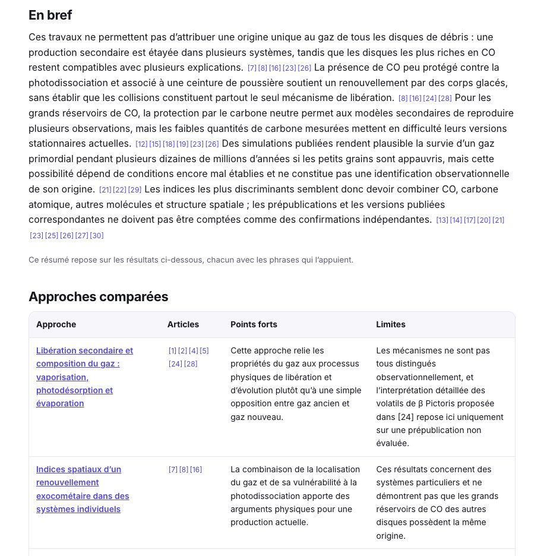
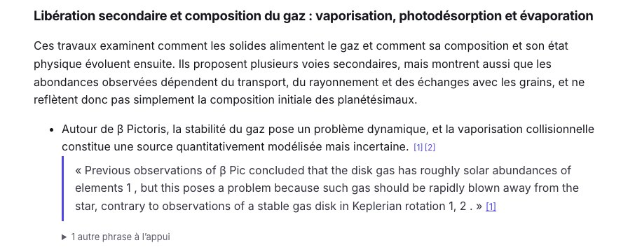
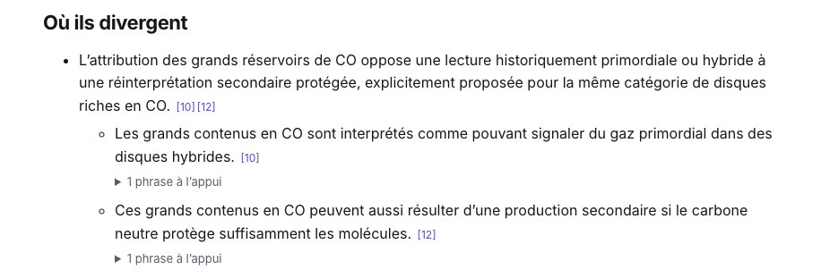
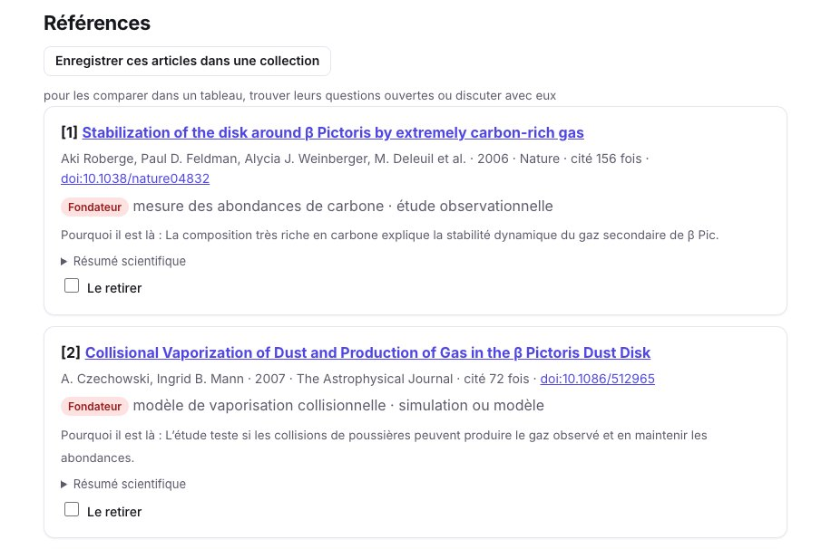
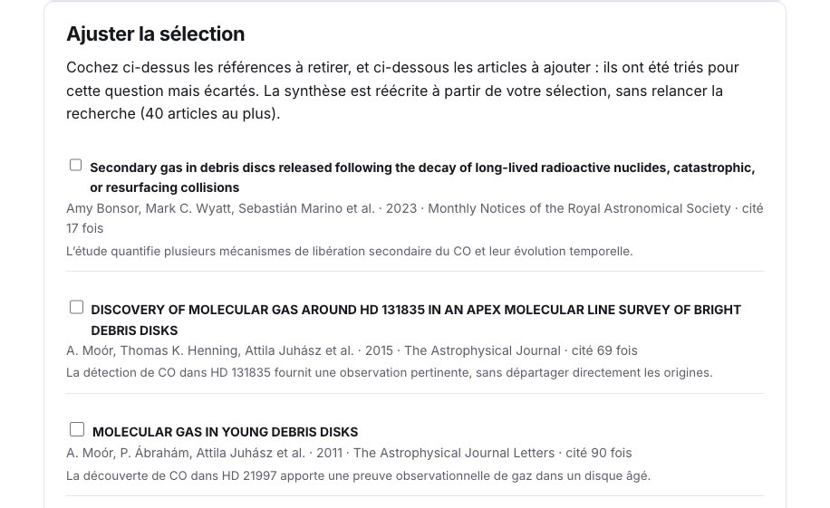
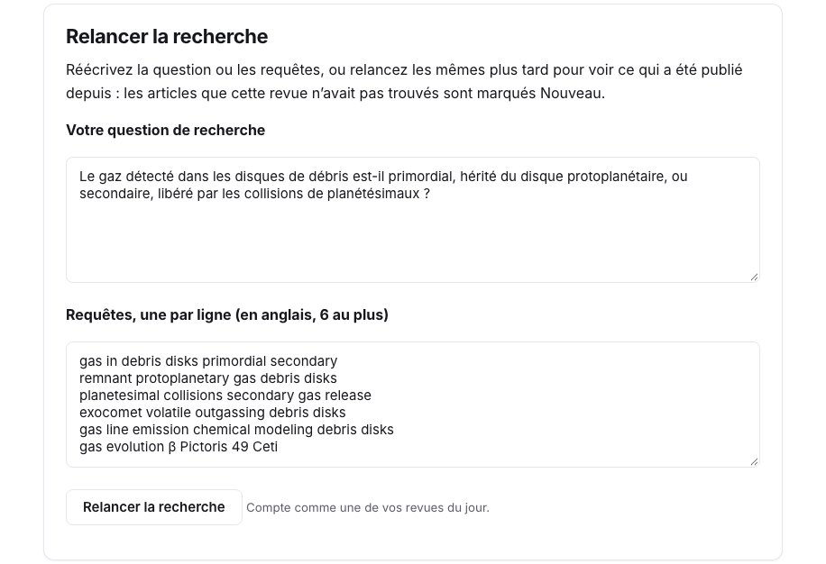
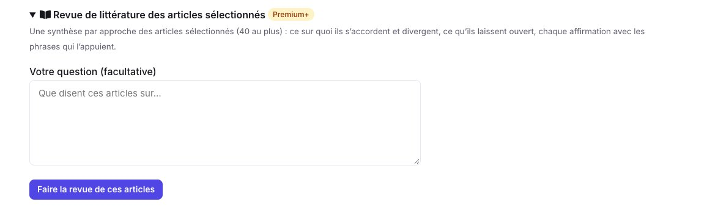

Avant un état de l’art, un chapitre de thèse ou un nouveau projet, il vous faut les articles qui comptent sur une question : les fondateurs, les récents, et ce sur quoi ils divergent. La **revue de littérature** (Premium+) part de votre question, cherche dans les revues, les serveurs de prépublications et arXiv, suit les références des articles les plus proches, et écrit une synthèse groupée par approche où **chaque affirmation vient avec la phrase qui l’appuie**.

Ce guide suit une vraie revue, faite le 10 novembre 2026, sur une question encore débattue dans notre domaine : le gaz détecté dans les disques de débris est-il un reste du disque protoplanétaire, ou est-il libéré par les collisions de planétésimaux ?

## 1. Posez une question précise

Ouvrez la [revue de littérature](/fr/literature-review/) et écrivez votre question, dans n’importe quelle langue. Une question qui nomme un phénomène et les explications à départager donne une revue plus ciblée qu’un simple sujet.

<figure class="guide-screenshot">

<figcaption>Une question, avec les deux explications à départager.</figcaption>
</figure>

Une revue prend 3 à 6 minutes, et vous recevez un email quand elle est prête ; la nôtre en a pris trois. Vous pouvez en lancer trois par jour.

## 2. Voyez comment elle a été construite

La page commence par ce que la revue a lu. Pour notre question : **271 articles trouvés**, les 80 plus proches triés sur leur résumé, 48 jugés pertinents et **30 retenus**, de 2006 à 2026 : 19 fondateurs et 7 des trois dernières années. 25 sont publiés dans une revue et 5 sont des prépublications ; les conclusions de 12 textes intégraux ouverts ont aussi été lues. Et **18 des 18 résultats** sont appuyés par une phrase retrouvée mot pour mot dans un article.

<figure class="guide-screenshot">

<figcaption>Ce que la revue a lu, et combien de ses affirmations sont appuyées par une phrase.</figcaption>
</figure>

**Recherches et sources** liste les requêtes écrites à partir de votre question, et d’où viennent les candidats : les recherches, les articles récents, les travaux cités par les articles les plus proches, les articles qui citent les fondateurs.

## 3. Lisez la synthèse

**En bref** donne la réponse en quelques phrases, chacune avec ses références. Ici : ces travaux ne permettent pas d’attribuer une origine unique au gaz de tous les disques de débris ; une production secondaire est étayée dans plusieurs systèmes, tandis que les disques les plus riches en CO restent compatibles avec plusieurs explications. Puis **Approches comparées** met côte à côte les six groupes d’articles, avec leurs points forts et leurs limites.

<figure class="guide-screenshot">

<figcaption>La réponse en bref, puis les approches côte à côte.</figcaption>
</figure>

Chaque approche a ensuite sa section : ce que font ses articles, ses résultats, et sous chaque résultat la phrase de l’article qui l’appuie, avec son numéro dans les références. Les phrases citées restent dans la langue de l’article.

<figure class="guide-screenshot">

<figcaption>Un résultat, et la phrase de l’article [1] qui l’appuie.</figcaption>
</figure>

**Où ils divergent** oppose les camps d’un débat, chacun avec ses articles et ses phrases. Pour notre question, la revue a trouvé le débat attendu : les grands réservoirs de CO lus comme primordiaux ou hybrides, contre une réinterprétation en gaz secondaire protégé par le carbone.

<figure class="guide-screenshot">

<figcaption>Les deux camps du débat, chacun avec son article.</figcaption>
</figure>

**Ce qu’ils laissent ouvert** liste les lacunes, et **Souvent cités, non lus** les travaux que beaucoup des articles choisis citent mais dont aucune source n’a donné le résumé : ici Zuckerman et al. (1995), *Protostars and Planets IV* et Wyatt et al. (2015). Allez les voir vous-même.

La revue dit aussi ce qu’est chaque article : les prépublications sont signalées comme **non évaluées par les pairs**, et la synthèse le dit là où elle s’appuie sur elles.

## 4. Vérifiez les références, et ajustez la sélection

Sous **Références**, chaque article a son étiquette (fondateur, récent, article de revue), son approche et son type d’étude, **pourquoi il est là**, et son résumé avec les phrases citées surlignées.

<figure class="guide-screenshot">

<figcaption>Chaque référence dit pourquoi elle a été gardée ; cochez « Le retirer » pour l’enlever.</figcaption>
</figure>

Pour changer la sélection, cochez **Le retirer** sur les références dont vous ne voulez pas, et ajoutez des articles parmi les 30 triés mais écartés, chacun avec la raison pour laquelle il a été considéré. **Réécrire la synthèse** : la nouvelle revue est écrite à partir de votre sélection, sans relancer la recherche, sur sa propre page.

<figure class="guide-screenshot">

<figcaption>Les articles triés mais écartés, à ajouter à la synthèse.</figcaption>
</figure>

## 5. Exportez-la, et tenez-la à jour

- **LaTeX** et **Ouvrir dans Overleaf** : la synthèse avec ses `\cite` et son `.bib`, pour démarrer un état de l’art ; voir le [guide Overleaf](/fr/guides/overleaf-bibliography-check/).
- **BibTeX**, **RIS** et **Markdown** : les références pour n’importe quel gestionnaire, ou la synthèse en note.
- **Envoyer vers Zotero** (bibliothèque connectée) : une collection Zotero avec une sous-collection par approche, chaque article avec les affirmations qu’il appuie ; voir le [guide Zotero](/fr/guides/zotero-sync-research-papers/).
- **Enregistrer ces articles dans une collection**, pour [discuter avec eux](/fr/chat/) ou les comparer dans un tableau.

**Relancer la recherche** refait les mêmes requêtes plus tard, ou de nouvelles que vous écrivez : les articles que cette revue n’avait pas trouvés sont marqués **Nouveau**.

<figure class="guide-screenshot">

<figcaption>La question et ses requêtes, à relancer dans quelques mois.</figcaption>
</figure>

## Depuis une collection

Quand vous avez déjà les articles, ouvrez une [collection](/fr/collections/) et choisissez **Revue de littérature des articles sélectionnés** : la synthèse est écrite à partir d’eux (3 à 40), avec ou sans question, sans aucune recherche.

<figure class="guide-screenshot">

<figcaption>Une revue des articles d’une collection.</figcaption>
</figure>

## Limites

- C’est une **synthèse exploratoire**, pas une revue systématique : les articles sont lus à partir de leurs résumés et des conclusions de leurs textes intégraux ouverts.
- Deux exécutions de la même question peuvent choisir des articles un peu différents : notre exécution en anglais de la même question a aussi gardé 30 articles, mais pas tous les mêmes (elle retenait Moór et al. 2011, que celle-ci a écarté), et les a groupés en d’autres approches.
- Une phrase retrouvée mot pour mot montre que l’article le dit, pas qu’il a raison : lisez les articles que vous citez.
