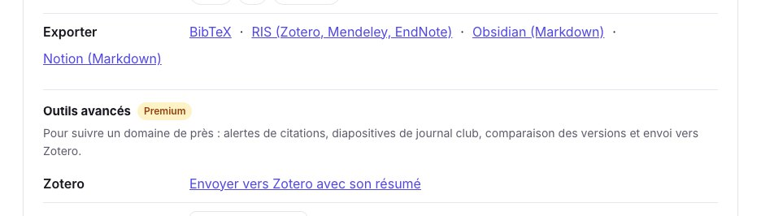
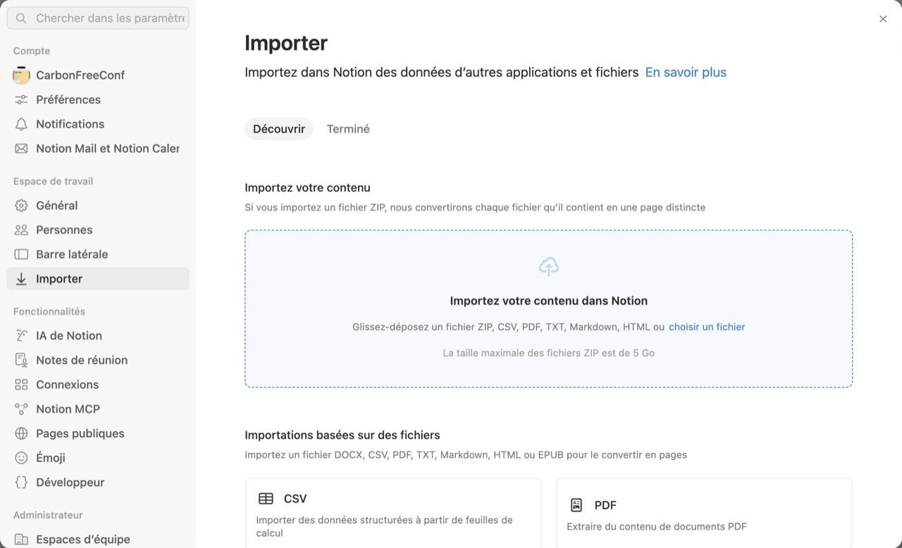
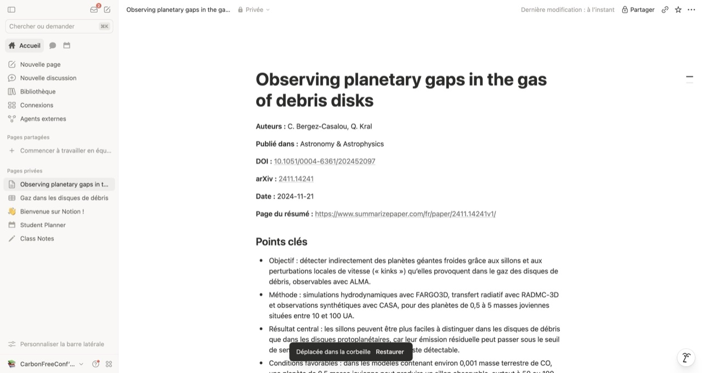
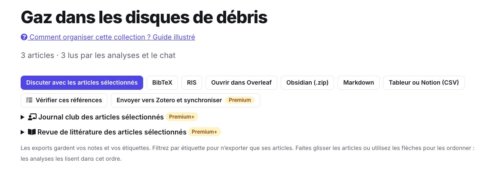
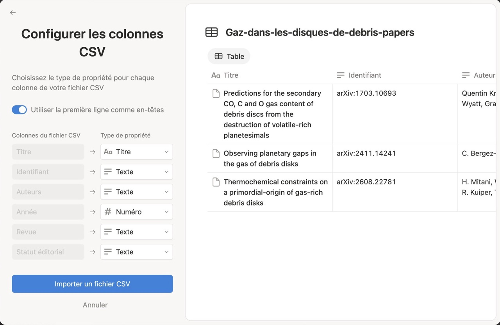
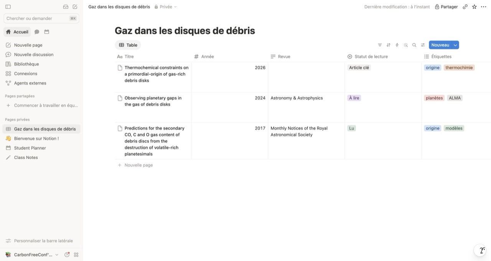

Vous organisez vos recherches dans Notion et voulez y retrouver vos articles : une page par article lu, et le tableau d’une liste de lecture avec ses statuts, étiquettes et notes. SummarizePaper exporte **un article en Markdown**, que Notion importe comme une page, et **une collection en tableur** (CSV), que Notion importe comme une base de données. C’est gratuit, et rien n’est écrit dans votre espace : vous importez les fichiers vous-même.

Les exemples viennent de la collection *Gaz dans les disques de débris* de nos autres guides : trois articles sur le gaz des disques de débris, chacun avec une note, des étiquettes et un statut de lecture.

## 1. Un article comme page Notion

Sur la page de résumé d’un article, ouvrez **Outils pour cet article**, puis **Exporter → Notion (Markdown)**.

<figure class="guide-screenshot">
<a href="/static/summarizer/img/guides/exports/paper-export-fr.jpg"></a>
<figcaption>« Notion (Markdown) », dans les outils de chaque page d’article.</figcaption>
</figure>

Le fichier porte le titre de l’article, ici `Observing planetary gaps in the gas of debris disks.md`, et contient sa référence, puis ses points clés et son résumé, dans la langue du site :

```markdown
**Auteurs :** C. Bergez-Casalou, Q. Kral  
**Publié dans :** Astronomy & Astrophysics  
**DOI :** [10.1051/0004-6361/202452097](https://doi.org/10.1051/0004-6361/202452097)  
**arXiv :** [2411.14241](https://arxiv.org/abs/2411.14241)  
**Date :** 2024-11-21  
**Page du résumé :** https://www.summarizepaper.com/fr/paper/2411.14241v1/

## Points clés

- Objectif : détecter indirectement des planètes géantes froides grâce aux sillons et aux perturbations locales de vitesse (« kinks ») qu’elles provoquent dans le gaz des disques de débris, observables avec ALMA.
- …

## Résumé
…
```

Dans Notion, ouvrez le menu de votre espace de travail en bas de la barre latérale, puis **Paramètres → Importer**, et choisissez **Texte et Markdown** :

<figure class="guide-screenshot">
<a href="/static/summarizer/img/guides/notion/import-fr.jpg"></a>
<figcaption>L’import de Notion, dans ses paramètres : CSV pour une collection, Texte et Markdown pour un article.</figcaption>
</figure>

Le fichier devient une page qui porte le titre de l’article, avec ses libellés en gras, ses liens, ses intertitres et ses listes. Les formules, écrites en LaTeX entre dollars, sont affichées comme des équations. Le résumé se termine par sa provenance (écrit par un modèle d’IA, à partir de quelle version de l’article et quand).

<figure class="guide-screenshot">
<a href="/static/summarizer/img/guides/notion/page-fr.jpg"></a>
<figcaption>Un article importé dans Notion : sa référence, puis ses points clés.</figcaption>
</figure>

## 2. Une collection comme base de données Notion

Dans une [collection](/fr/collections/), cliquez sur **Tableur ou Notion (CSV)**. Réglez d’abord dans la collection le statut de lecture, les étiquettes et les notes des articles : ce sont des colonnes du tableur.

<figure class="guide-screenshot">
<a href="/static/summarizer/img/guides/exports/collection-export-fr.jpg"></a>
<figcaption>« Tableur ou Notion (CSV) », parmi les exports d’une collection.</figcaption>
</figure>

Le fichier a une ligne par article, avec ces colonnes : *Titre, Identifiant, Auteurs, Année, Revue, Statut éditorial, Avis, Citations, Version récente, Statut de lecture, Étiquettes, Note, Sélectionné, Lien*. L’identifiant est écrit `arXiv:2411.14241`, pour qu’un tableur ne le prenne pas pour un nombre. Pour notre collection :

| Titre | Année | Revue | Statut éditorial | Statut de lecture | Étiquettes |
| --- | --- | --- | --- | --- | --- |
| Thermochemical constraints on a primordial-origin of gas-rich debris disks | 2026 | | Soumission ou évaluation annoncée sur arXiv par les auteurs | Article clé | origine, thermochimie |
| Observing planetary gaps in the gas of debris disks | 2024 | Astronomy & Astrophysics | Publication retrouvée | À lire | planètes, ALMA |
| Predictions for the secondary CO, C and O gas content of debris discs… | 2017 | Monthly Notices of the Royal Astronomical Society | Publication retrouvée | Lu | origine, modèles |

**Statut éditorial**, **Avis** et **Version récente** viennent de la vérification de l’endroit où les articles ont été publiés, de leurs avis de rétractation ou de correction et de leurs nouvelles versions : lancez cette vérification dans la collection avant d’exporter pour les remplir.

Dans Notion, ouvrez **Paramètres → Importer → CSV**, choisissez le fichier, gardez **Créer une nouvelle base de données** et cliquez sur **Associer les en-têtes CSV**. Notion propose un type de propriété pour chaque colonne : le *Titre* nomme chaque ligne, l’*Année* est un nombre, le *Lien* une URL. Passez *Statut de lecture* en **Sélectionner** et *Étiquettes* en **Sélection multiple**, pour pouvoir filtrer et grouper les articles par statut et par étiquette.

<figure class="guide-screenshot">
<a href="/static/summarizer/img/guides/notion/columns-fr.jpg"></a>
<figcaption>Le type de chaque colonne, choisi avant l’import.</figcaption>
</figure>

La base a une ligne par article. Renommez-la, et masquez les colonnes dont vous n’avez pas besoin (menu de chaque colonne → **Masquer**) :

<figure class="guide-screenshot">
<a href="/static/summarizer/img/guides/notion/database-fr.jpg"></a>
<figcaption>La collection dans Notion, avec ses statuts de lecture et ses étiquettes.</figcaption>
</figure>

Pour ajouter les articles mis plus tard dans la collection, exportez-la à nouveau et, dans l’import CSV, choisissez **Importer dans une base de données existante** : Notion ajoute des lignes, il ne met pas à jour celles qui y sont déjà.

## Autres fichiers pour Notion

- **Markdown** de toute une collection : un seul fichier avec tous ses articles, à importer comme une page.
- Une **revue de littérature** s’exporte en Markdown, sa synthèse avec ses références numérotées ([guide de la revue de littérature](/fr/guides/literature-review-from-a-research-question/)).
- Le **compagnon de conférence** exporte votre programme et vos notes en Markdown ([guide de la conférence](/fr/guides/conference-program-talks-to-attend/)).
- Pour Obsidian, avec des propriétés et des liens entre les notes, voir le [guide Obsidian](/fr/guides/obsidian-research-paper-notes/).
