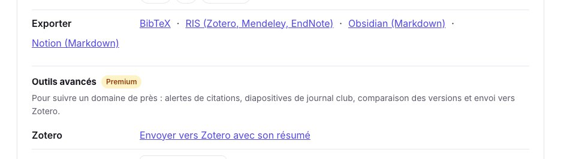
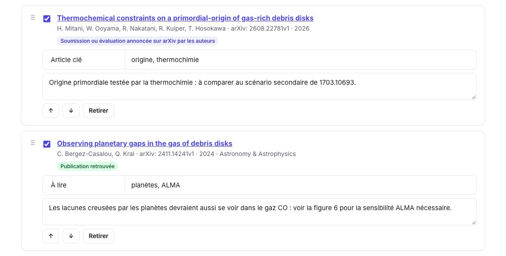

Vous gardez vos notes de lecture dans Obsidian, et vous voulez y retrouver chaque article avec sa référence, son résumé et ce que vous en avez pensé, relié au reste de vos notes. SummarizePaper exporte **une note par article**, nommée par sa clé de citation, avec ses **propriétés** (titre, auteurs, année, revue, DOI, arXiv, clé de citation, étiquettes, statut de lecture), ses points clés et son résumé ; une **collection** se télécharge comme un dossier de ces notes, avec une note qui les relie toutes. C’est gratuit.

Les exemples viennent de la collection *Gaz dans les disques de débris* de nos autres guides : trois articles sur le gaz des disques de débris, chacun avec une note, des étiquettes et un statut de lecture.

## 1. Un article

Sur la page de résumé d’un article, ouvrez **Outils pour cet article**, puis **Exporter → Obsidian (Markdown)**. Vous obtenez un fichier nommé par la clé de citation de l’article, ici `bergezcasalou2024observing.md`.

<figure class="guide-screenshot">
<a href="/static/summarizer/img/guides/exports/paper-export-fr.jpg"></a>
<figcaption>« Obsidian (Markdown) », dans les outils de chaque page d’article.</figcaption>
</figure>

La note commence par ses propriétés, qu’Obsidian affiche en tableau au-dessus du texte :

```markdown
---
title: "Observing planetary gaps in the gas of debris disks"
authors:
  - "C. Bergez-Casalou"
  - "Q. Kral"
year: 2024
journal: "Astronomy & Astrophysics"
doi: "10.1051/0004-6361/202452097"
arxiv: "2411.14241"
citekey: "bergezcasalou2024observing"
url: "https://doi.org/10.1051/0004-6361/202452097"
summarizepaper: "https://www.summarizepaper.com/fr/paper/2411.14241v1/"
---
```

Viennent ensuite la référence (auteurs, revue, DOI, arXiv, date, le lien vers la page du résumé), **Points clés** et **Résumé**, dans la langue du site. Le résumé se termine par sa provenance : *« Résumé écrit par un modèle d’IA (SummarizePaper) à partir de arXiv:2411.14241v1 le 2026-10-28. À vérifier dans l’article. »* Un article publié depuis sa prépublication est exporté dans sa version publiée, avec sa revue et son DOI, et son identifiant arXiv conservé. Les formules restent en LaTeX entre dollars, qu’Obsidian affiche.

## 2. Toute une collection, en dossier

Dans une [collection](/fr/collections/), cliquez sur **Obsidian (.zip)**. Vos notes, étiquettes et statuts de lecture de chaque article l’accompagnent : étiquetez les articles et réglez leur statut dans la collection d’abord.

<figure class="guide-screenshot">
<a href="/static/summarizer/img/guides/exports/collection-papers-fr.jpg"></a>
<figcaption>Le statut de lecture, les étiquettes et la note de chaque article deviennent propriétés et texte de sa note.</figcaption>
</figure>

Le `.zip` contient un dossier au nom de la collection, avec une note par article et une note pour la collection :

```text
Gaz-dans-les-disques-de-debris/
├── Gaz-dans-les-disques-de-debris.md
├── bergezcasalou2024observing.md
├── kral2017predictions.md
└── mitani2026thermochemical.md
```

La note de chaque article a, en plus des propriétés ci-dessus, ses **étiquettes** (`tags`) et son **statut** (`status`), votre note sous **Ma note**, et un lien vers la collection :

```markdown
tags:
  - "planètes"
  - "ALMA"
status: "À lire"
---
…
## Ma note

Les lacunes creusées par les planètes devraient aussi se voir dans le gaz CO : voir la figure 6 pour la sensibilité ALMA nécessaire.

Collection: [[Gaz-dans-les-disques-de-debris]]
```

La note de la collection relie ses articles, avec leurs titres et leurs années :

```markdown
# Gaz-dans-les-disques-de-debris

- [[mitani2026thermochemical]] Thermochemical constraints on a primordial-origin of gas-rich debris disks (2026)
- [[bergezcasalou2024observing]] Observing planetary gaps in the gas of debris disks (2024)
- [[kral2017predictions]] Predictions for the secondary CO, C and O gas content of debris discs from the destruction of volatile-rich planetesimals (2017)
```

Pour n’exporter qu’une partie d’une collection, filtrez-la d’abord par une étiquette : l’export ne contient que les articles de cette étiquette.

## 3. Dans Obsidian

Décompressez le dossier dans votre coffre (*vault*). Les articles se comportent alors comme vos autres notes :

- les **étiquettes** sont des tags Obsidian, à chercher et filtrer ;
- les liens `[[clé de citation]]` marchent depuis n’importe quelle note : écrivez `[[kral2017predictions]]` dans une note de projet pour relier l’article, et ses rétroliens montrent où vous l’avez cité ;
- les **propriétés** se trient et se filtrent, par exemple avec une base (le plugin de base **Bases**) ou Dataview : tous les articles dont le `status` est *À lire*, par année ;
- la propriété `citekey` est la clé de nos exports BibTeX et du `.bib` qu’une collection donne à Overleaf : vos notes et votre manuscrit utilisent les mêmes clés.

Quand la collection change, exportez-la à nouveau et remplacez le dossier : chaque note garde son nom, la clé de citation de son article.

## Autres notes pour Obsidian

- **Markdown** d’une collection : un seul fichier avec tous ses articles, sans propriétés.
- Une **revue de littérature** s’exporte en Markdown, sa synthèse avec ses références numérotées ([guide de la revue de littérature](/fr/guides/literature-review-from-a-research-question/)).
- Le **compagnon de conférence** exporte votre programme et vos notes en Markdown ([guide de la conférence](/fr/guides/conference-program-talks-to-attend/)).
- Pour Notion, voir le [guide Notion](/fr/guides/notion-research-paper-database/).
