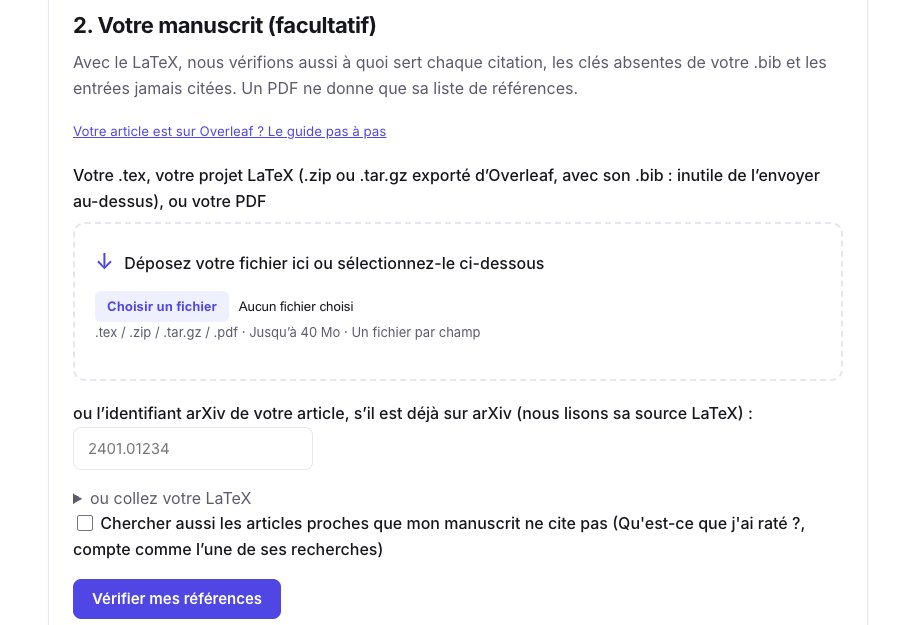
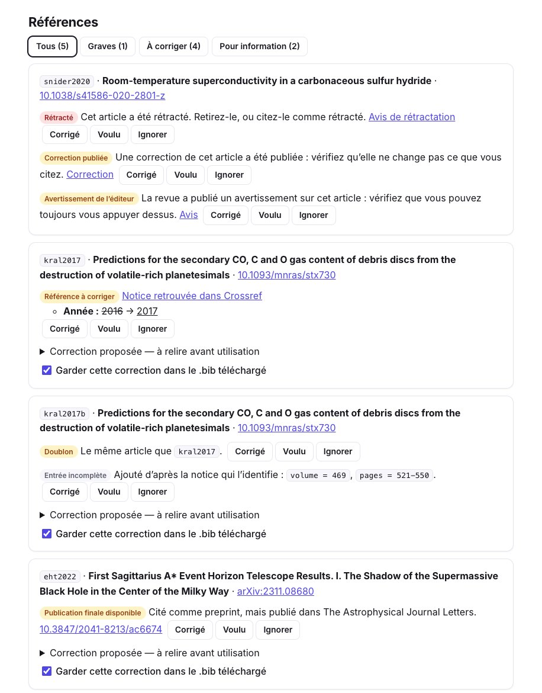
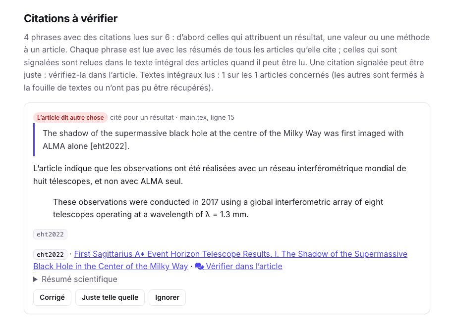
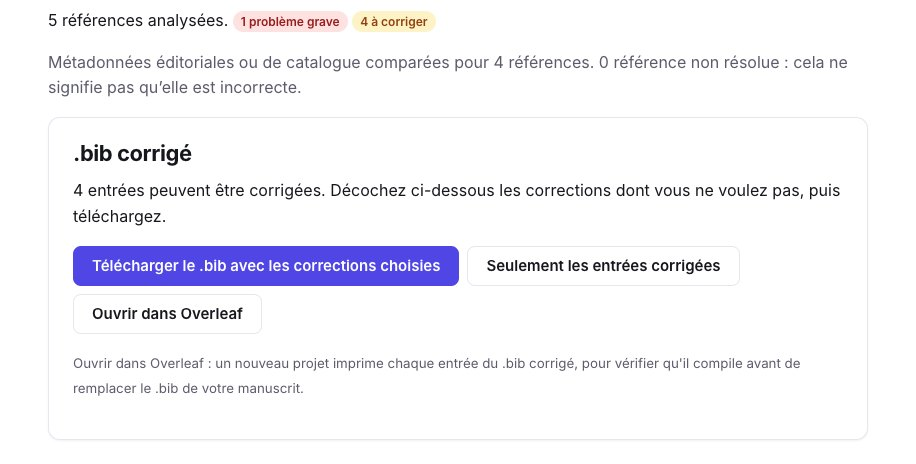
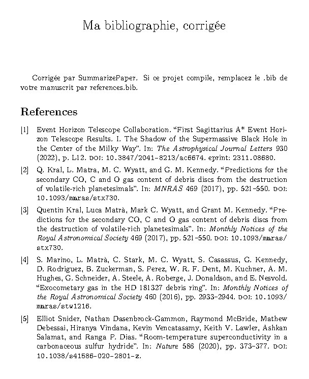
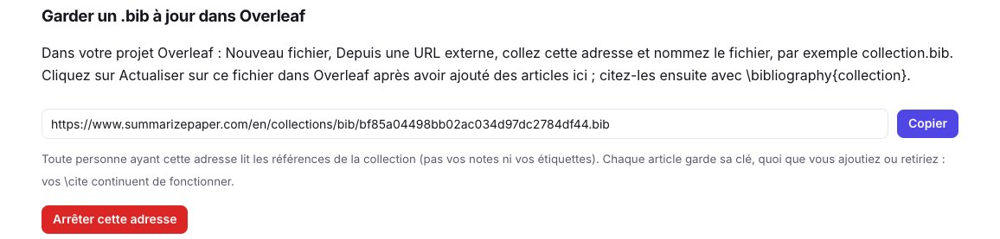
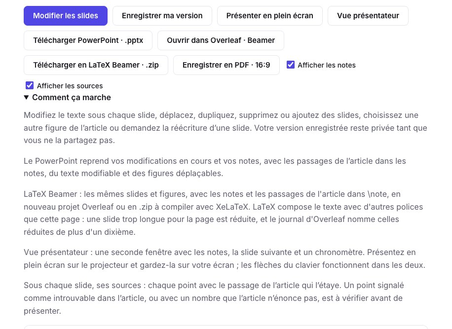
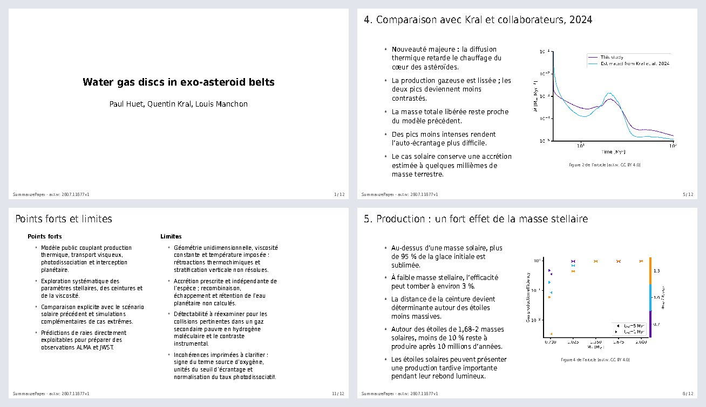

Vous êtes sur le point de soumettre, et votre article a été écrit sur Overleaf. Son `.bib` a grossi pendant deux ans : des prépublications ont été publiées depuis, un article cité a peut-être été rétracté, et quelques entrées ont été copiées avec la mauvaise année, ou deux fois sous deux clés. **La vérification de bibliographie lit tout votre projet Overleaf et vous dit quelles références corriger**, et à quoi sert chaque citation.

Ce guide suit un court projet de démonstration : un `main.tex` sur le gaz dans les disques de débris et son `references.bib`, où nous avons placé exprès une année fausse, un doublon, une prépublication publiée depuis, une citation que l’article cité contredit, une clé absente du `.bib` et un article rétracté en 2022. Chaque capture montre la vraie vérification de ce projet, faite le 9 novembre 2026.

## 1. Téléchargez votre projet depuis Overleaf

Dans Overleaf, ouvrez le menu et téléchargez la **source** du projet en `.zip`. Rien à nettoyer : la vérification ne lit que les fichiers `.tex`, `.bib` et `.bbl` qu’il contient, trouve le fichier principal (celui qui contient `\begin{document}`) et suit ses `\input` et `\include`.

## 2. Lancez la vérification

Ouvrez la [vérification de bibliographie](/fr/refcheck/) (Premium) et déposez le `.zip` sous **Votre manuscrit** : inutile d’envoyer le `.bib` à part. Vous pouvez aussi donner un seul `.tex` avec son `.bib`, l’identifiant arXiv d’un article déjà déposé, ou un PDF (seule sa liste de références imprimée est alors lue).

<figure class="guide-screenshot">

<figcaption>Le .zip exporté d’Overleaf va dans le champ du manuscrit : son .bib est lu dans l’archive.</figcaption>
</figure>

Chaque entrée est identifiée avec Crossref, NASA ADS, OpenAlex, arXiv et Semantic Scholar. Dans notre projet, le rapport a trouvé chaque problème placé :

- l’**article rétracté** (Snider et al. 2020), avec son avis de rétractation, une correction et un avertissement de l’éditeur, venus de Retraction Watch et de Crossref ;
- l’**année fausse** de Kral et al. (2016 au lieu de 2017), vérifiée sur la notice Crossref ;
- le **doublon** : le même article sous les clés `kral2017` et `kral2017b` ;
- la **prépublication publiée depuis** : l’entrée arXiv de l’article de l’Event Horizon Telescope, avec sa version de revue dans *The Astrophysical Journal Letters* ;
- et des entrées incomplètes, complétées d’après leur notice (volume, pages, DOI).

<figure class="guide-screenshot">

<figcaption>Chaque référence avec ses problèmes et la notice qui les fonde ; marquez chacun corrigé, voulu ou ignoré.</figcaption>
</figure>

Avec le LaTeX, la vérification liste aussi les clés que votre texte cite mais que votre `.bib` n’a pas : ici `smith2021`, qui s’imprimerait en `[?]`. Et une IA lit chaque phrase qui cite à côté des articles cités. Notre phrase affirmait que l’ombre de Sagittarius A\* avait d’abord été imagée « avec ALMA seul » : le rapport cite le passage de l’article qui dit le contraire. Une citation signalée est à vérifier, ce n’est pas la preuve d’une erreur.

<figure class="guide-screenshot">

<figcaption>La phrase de main.tex, ligne 15, à côté du passage de l’article cité qui la contredit.</figcaption>
</figure>

## 3. Ramenez le .bib corrigé dans Overleaf

Sous **.bib corrigé**, décochez les corrections que vous ne voulez pas, puis :

- **Téléchargez** le `.bib` et envoyez-le à la place de l’ancien dans votre projet Overleaf ; ou
- **Ouvrir dans Overleaf** : un nouveau projet imprime chaque entrée du `.bib` corrigé, pour voir qu’il compile et comment se lit chaque référence avant de remplacer le fichier de votre manuscrit.

<figure class="guide-screenshot">

<figcaption>4 entrées du .bib de démonstration peuvent être corrigées ; l’article rétracté reste à retirer, ou à citer comme rétracté.</figcaption>
</figure>

Le projet que crée « Ouvrir dans Overleaf » imprime les entrées avec biblatex, qui garde les titres tels qu’ils sont écrits (CO, HD 181327, Sagittarius A\*). Le voici compilé : l’année de Kral et al. est désormais 2017, et l’article de l’Event Horizon Telescope a sa revue et son DOI. Le doublon est toujours là, puisque les deux clés sont citées dans le texte : retirez une entrée et changez son `\cite`.

<figure class="guide-screenshot">

<figcaption>Le projet que crée « Ouvrir dans Overleaf », compilé avec pdfLaTeX et Biber, comme le fait Overleaf.</figcaption>
</figure>

Marquez chaque problème comme corrigé ou voulu, et vérifiez à nouveau après correction : ce qui a été résolu est montré à part. Avec Premium, les références peuvent être **surveillées jusqu’à la publication** : vous recevez un email si une prépublication citée est publiée ou un article cité rétracté entre-temps.

## 4. Gardez un .bib synchronisé avec une collection

Pendant que vous écrivez, vous ajoutez des articles à une [collection](/fr/collections/) sur SummarizePaper. Son onglet **Réglages** donne une adresse pour son `.bib`. Dans votre projet Overleaf, choisissez **Depuis une URL externe** dans le menu d’envoi de fichier, collez l’adresse et nommez le fichier, par exemple `collection.bib`. Après avoir ajouté des articles à la collection, cliquez sur **Actualiser** sur ce fichier dans Overleaf, et citez-les avec `\bibliography{collection}` (ou `\addbibresource{collection.bib}` avec biblatex).

<figure class="guide-screenshot">

<figcaption>L’adresse du .bib de la collection, à coller dans « Depuis une URL externe » d’Overleaf.</figcaption>
</figure>

**Chaque article garde la clé qu’il a reçue la première fois**, quoi que vous ajoutiez, retiriez ou corrigiez ensuite : vos `\cite` continuent de fonctionner, et le `.bib` téléchargé depuis la collection utilise les mêmes clés. L’adresse ne montre que les références, pas vos notes ni vos étiquettes, et vous pouvez l’arrêter à tout moment ; la page indique quand Overleaf l’a lue pour la dernière fois. La synchronisation Zotero et Mendeley d’Overleaf demande un abonnement Overleaf payant ; ce lien, non.

## 5. Vos slides de journal club en Beamer

Le [journal club](/fr/journal-club/) (Premium+) écrit des slides à partir d’un article, chaque point avec son passage. En plus du PowerPoint, vos slides modifiées s’ouvrent dans Overleaf en projet **LaTeX Beamer**, ou se téléchargent en `.zip`.

<figure class="guide-screenshot">

<figcaption>« Ouvrir dans Overleaf · Beamer » envoie vos modifications en cours, enregistrées ou non.</figcaption>
</figure>

Le projet contient les figures de l’article quand sa licence le permet, et vos notes d’orateur avec les passages de l’article dans `\note`. Il compile avec XeLaTeX, qu’Overleaf choisit pour vous, dans 13 langues. LaTeX compose le texte avec d’autres polices que la page : une slide trop longue est réduite pour tenir, et le journal d’Overleaf nomme celles réduites de plus d’un dixième, pour savoir lesquelles raccourcir.

<figure class="guide-screenshot">

<figcaption>Un deck en français sur arXiv:2607.11677 (CC BY 4.0), exporté et compilé avec XeLaTeX.</figcaption>
</figure>

## 6. Ce qui s’ouvre aussi dans Overleaf

- **Revue de littérature** (Premium+) : la synthèse avec ses `\cite` et son `.bib`, en nouveau projet prêt à compiler.
- **Qu’ai-je manqué ?** (Premium) : les articles proches que votre brouillon ne cite pas, en projet qui les imprime, pour copier les entrées voulues.
- **Une collection** : ses références en nouveau projet, depuis ses boutons d’export.

Overleaf permet à un autre site de créer un projet, jamais d’écrire dans un projet existant : chacun de ces boutons ouvre un **nouveau** projet dans votre compte Overleaf, après connexion à Overleaf.
