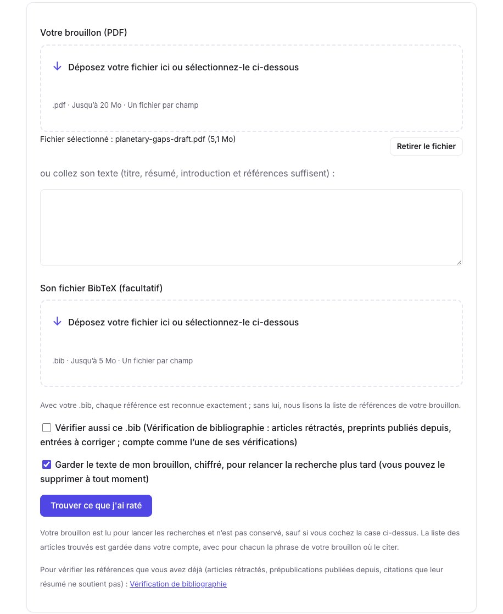
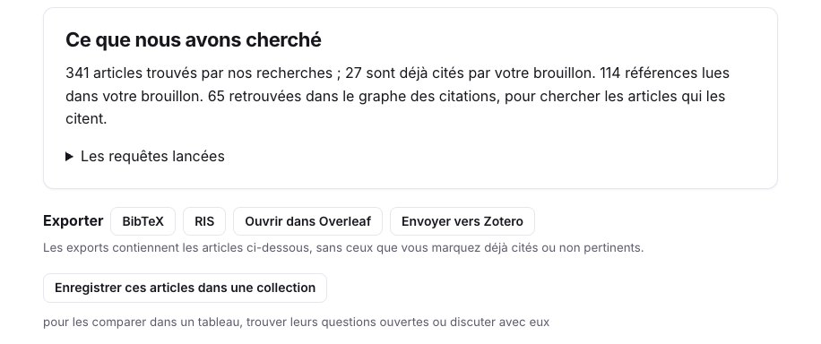
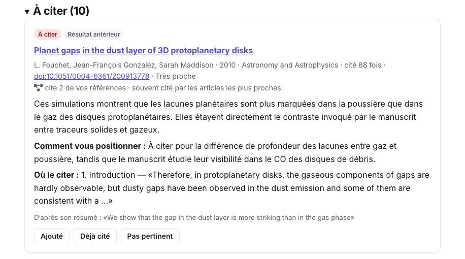
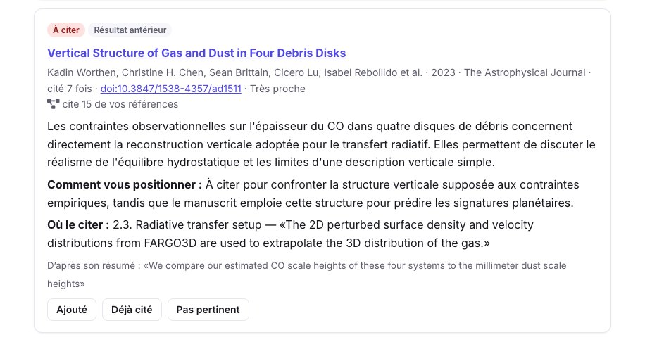
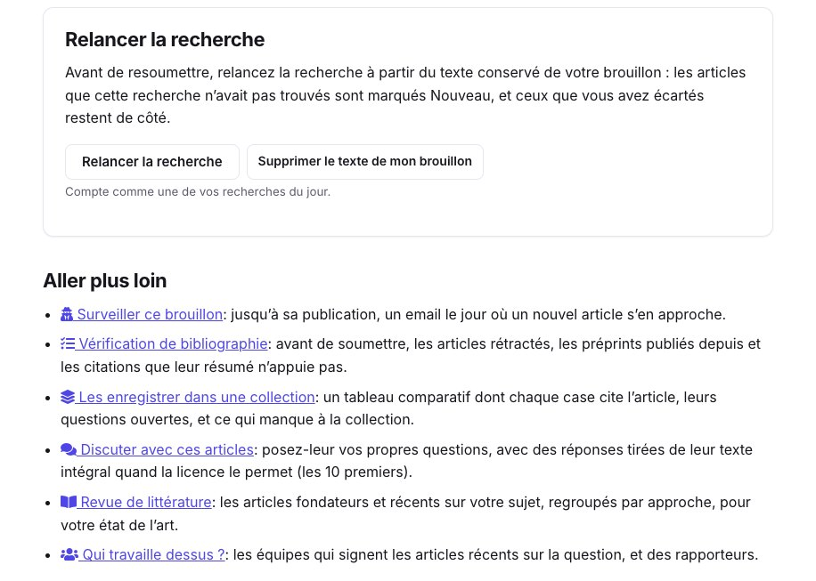

Le rapporteur qui écrit « les auteurs devraient discuter les travaux de… » a le plus souvent trouvé un article proche du vôtre que votre brouillon ne cite pas, souvent parce qu’il emploie d’autres mots pour la même chose. **Qu’est-ce que j’ai raté ?** (Premium) lit votre brouillon et ses références, cherche les articles les plus proches qu’il ne cite pas, et dit pour chacun si un rapporteur l’attendrait, comment vous positionner, et **la phrase de votre brouillon où le citer**.

Pour le montrer sur un cas réel, nous lui avons donné un article comme s’il s’agissait d’un brouillon : [Bergez-Casalou & Kral (2024)](/fr/paper/2411.14241v1/), sur les lacunes planétaires dans le gaz des disques de débris, publié dans *Astronomy & Astrophysics* sous licence CC BY. Les captures montrent la recherche du 10 novembre 2026.

## 1. Donnez votre brouillon

Ouvrez [Qu’est-ce que j’ai raté ?](/fr/missed/) et déposez le PDF de votre brouillon, ou collez son texte : le titre, le résumé, l’introduction et les références suffisent. Ajoutez son `.bib` si vous l’avez : chaque référence est alors reconnue exactement. Vous pouvez aussi faire vérifier ce même `.bib` par la [vérification de bibliographie](/fr/refcheck/).

<figure class="guide-screenshot">

<figcaption>Le PDF du brouillon, et la case pour garder son texte et relancer la recherche avant de resoumettre.</figcaption>
</figure>

Cochez la case qui **conserve le texte de votre brouillon** pour relancer la recherche plus tard sans le renvoyer : il est stocké chiffré et peut être supprimé à tout moment. Sinon, il est lu pour les recherches et n’est pas stocké. Notre recherche a pris deux minutes.

## 2. Ce qui a été cherché

Le résultat commence par ce qui a été cherché. Pour notre article : **114 références lues** dans le brouillon, dont 65 retrouvées dans le graphe des citations ; **341 articles trouvés** par les recherches, dont 27 déjà cités par le brouillon. Les requêtes, écrites à partir de la question, de la méthode et des données du brouillon, sont sous **Les requêtes lancées**.

<figure class="guide-screenshot">

<figcaption>Ce que la recherche a lu, et les exports de ses articles.</figcaption>
</figure>

En plus des recherches, les candidats comprennent les articles qui **citent plusieurs de vos références**, ce qui trouve des travaux écrits avec d’autres mots, et les articles fondateurs que les candidats les plus proches citent le plus. Les articles rétractés, le brouillon lui-même et les articles qu’il cite sont écartés. Une référence imprimée sans titre est reconnue par son premier auteur et son année : ici, 21 articles ont été mis à part comme **probablement déjà cités**, à vérifier plutôt qu’à ajouter.

## 3. Les articles à citer

Les articles sont groupés selon à quel point un rapporteur les attendrait : **À citer** (10 ici), **À regarder** (18) et **Apparenté** (2). Chacun dit quel lien il a avec le brouillon (un résultat antérieur, des données ou un outil, une méthode, une même question, un article de revue), combien de vos références il cite, puis :

- ce qu’il fait, lu au regard de votre brouillon ;
- **Comment vous positionner** par rapport à lui ;
- **Où le citer** : la section et la phrase de votre brouillon, gardée seulement si elle est retrouvée mot pour mot ;
- la phrase de son résumé qui appuie ce lien.

<figure class="guide-screenshot">

<figcaption>Le premier article à citer, avec la phrase de l’introduction où il trouve sa place.</figcaption>
</figure>

Beaucoup des articles proposés ici étudient les lacunes des disques protoplanétaires : le brouillon les compare aux disques de débris, et le conseil est de les citer comme travaux antérieurs en disant ce qui diffère. D’autres sont proches par leurs données : la structure verticale du gaz et de la poussière dans quatre disques de débris, à citer là où le brouillon met en place son transfert de rayonnement.

<figure class="guide-screenshot">

<figcaption>Un article qui cite 15 des références du brouillon, à citer là où le transfert de rayonnement est mis en place.</figcaption>
</figure>

Nous en avons vérifié quelques-uns dans la bibliographie de l’article : il cite deux articles d’Izquierdo et al. (2021 et 2023), mais pas celui de 2022 proposé ici, ni Isella et al. (2016) ni Hughes et al. (2017). La liste est un ensemble de candidats à juger, pas un verdict : marquez chacun **Ajouté**, **Déjà cité** ou **Pas pertinent**. Les exports laissent de côté ceux marqués déjà cités ou pas pertinents, et une nouvelle recherche du même brouillon aussi.

## 4. Exportez, et relancez la recherche avant de resoumettre

- **BibTeX** et **RIS** : les articles gardés, pour votre `.bib` ou votre gestionnaire de références ; **Ouvrir dans Overleaf** crée un projet qui les imprime, pour copier les entrées voulues ([guide Overleaf](/fr/guides/overleaf-bibliography-check/)).
- **Envoyer vers Zotero**, avec une bibliothèque connectée ([guide Zotero](/fr/guides/zotero-sync-research-papers/)).
- **Enregistrer ces articles dans une collection**, pour les comparer dans un tableau ou [discuter avec eux](/fr/chat/).

Avec le texte conservé, **relancez la recherche** avant de resoumettre : les articles que cette recherche n’avait pas trouvés sont marqués **Nouveau**, et ceux que vous avez écartés restent de côté.

<figure class="guide-screenshot">

<figcaption>Relancer la recherche à partir du texte conservé, et les outils suivants.</figcaption>
</figure>

**Aller plus loin** suit le brouillon jusqu’à sa publication : la [veille anti-scoop](/fr/scoops/) vous écrit le jour où un nouvel article s’en approche, et [Qui travaille dessus ?](/fr/teams/) donne les équipes sur la question, et des rapporteurs possibles.

## Limites

- La recherche lit le début du brouillon et ses références, pas chaque paragraphe : un article proche d’une section profonde du brouillon peut être manqué.
- Deux recherches du même brouillon peuvent différer un peu : notre recherche en anglais proposait 8 articles à citer, pas 10, dont certains sont les mêmes.
- Un article absent d’OpenAlex et d’arXiv, ou d’un domaine qu’ils indexent mal, ne peut pas être trouvé.
