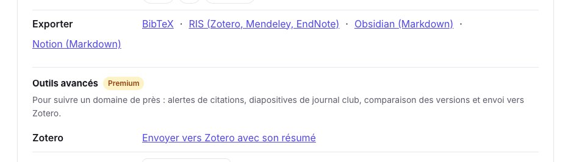
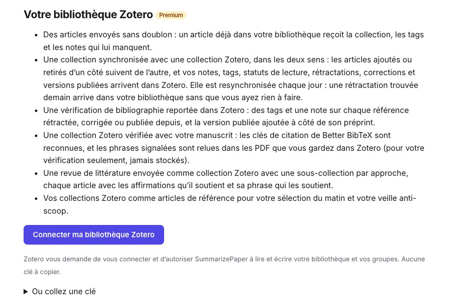
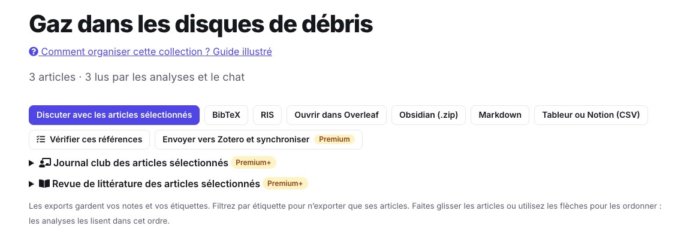
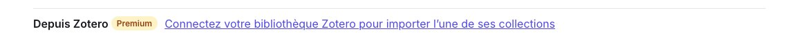
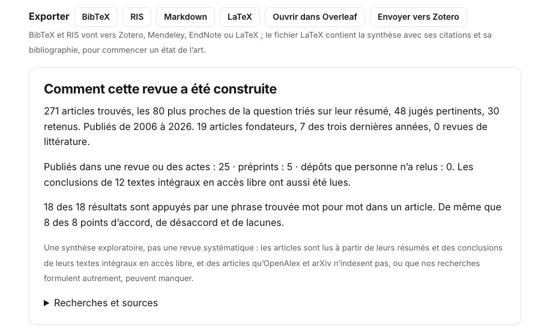

Vos références vivent dans Zotero, et vous lisez les articles ailleurs. **SummarizePaper écrit dans votre bibliothèque Zotero** : un article avec son résumé, une collection synchronisée dans les deux sens, les résultats de votre vérification de bibliographie et votre revue de littérature. Enregistrer un article ne demande aucun compte ; la connexion directe est Premium.

Les captures montrent le côté SummarizePaper, avec la collection *Gaz dans les disques de débris* de nos autres guides : trois articles sur le gaz des disques de débris, chacun avec une note, des étiquettes et un statut de lecture.

## 1. Enregistrer un article, gratuitement

Sur chaque page d’article, le **Zotero Connector** de votre navigateur reconnaît l’article et l’enregistre avec ses métadonnées. Dans **Outils pour cet article**, **Exporter** donne aussi le fichier **RIS**, que Zotero, Mendeley et EndNote importent ; il contient la référence et le résumé original. Un article publié depuis sa prépublication est exporté dans sa version publiée, avec sa revue et son DOI, et son identifiant arXiv conservé.

<figure class="guide-screenshot">

<figcaption>Le RIS pour tout gestionnaire de références, gratuit ; « Envoyer vers Zotero avec son résumé » une fois la bibliothèque connectée.</figcaption>
</figure>

## 2. Connecter votre bibliothèque

Sur la [page des intégrations](/fr/integrations/), cliquez sur **Connecter ma bibliothèque Zotero** : Zotero vous demande de vous connecter et d’autoriser SummarizePaper à lire et écrire votre bibliothèque et vos groupes. Aucune clé à copier. Vous pouvez aussi coller une clé privée créée sur zotero.org, avec l’accès en écriture.

<figure class="guide-screenshot">

<figcaption>Un clic : Zotero vous demande d’autoriser la connexion.</figcaption>
</figure>

Une fois connecté, choisissez la bibliothèque utilisée (la vôtre ou un groupe où vous pouvez écrire) et la collection Zotero où vont les articles seuls. La page liste vos collections Zotero, pour en ouvrir une comme collection ici ou vérifier ses références.

## 3. Envoyer un article avec son résumé

**Envoyer vers Zotero avec son résumé** crée l’élément, dans sa version publiée s’il y en a une, avec **une note qui contient le résumé IA et les points clés**. La note dit qu’elle a été écrite par un modèle, à partir de quelle version de l’article et quand ; votre propre note est une note à part. Un article déjà dans votre bibliothèque n’est pas dupliqué : il reçoit la collection, les étiquettes et les notes qui lui manquent. L’élément porte notre clé de citation, fixée pour **Better BibTeX**, si bien que vos `\cite` correspondent au `.bib` de nos exports.

## 4. Synchroniser une collection, dans les deux sens

Dans une [collection](/fr/collections/), **Envoyer vers Zotero et synchroniser** crée une collection Zotero, ou en relie une, et les garde ensemble :

- les articles ajoutés d’un côté arrivent de l’autre ; un article retiré d’un côté quitte l’autre (l’élément Zotero reste dans votre bibliothèque) ;
- vos notes, étiquettes et statuts de lecture vont dans Zotero, en notes et en étiquettes ;
- les rétractations, corrections et versions publiées trouvées plus tard arrivent aussi dans votre bibliothèque : la collection est **resynchronisée chaque jour**, sans que vous ayez rien à faire.

<figure class="guide-screenshot">

<figcaption>« Envoyer vers Zotero et synchroniser », à côté des autres exports de la collection.</figcaption>
</figure>

Dans l’autre sens, une collection Zotero s’ouvre ici avec **Depuis Zotero**, sous *Ajouter des articles* : vous pouvez alors discuter avec ses articles, les comparer dans un tableau, trouver les articles qui pourraient lui manquer ou écrire sa revue de littérature, et elle reste synchronisée.

<figure class="guide-screenshot">

<figcaption>Importer toute une collection Zotero.</figcaption>
</figure>

## 5. Vos résultats, écrits dans Zotero

- **Vérification de bibliographie** : sur chaque référence rétractée, corrigée ou publiée depuis, des étiquettes et une note dans votre bibliothèque, et la version publiée ajoutée à côté de sa prépublication. Une collection Zotero peut aussi être vérifiée avec votre manuscrit : les clés de citation de Better BibTeX sont reconnues, et les phrases signalées sont relues dans les PDF que vous gardez dans Zotero, pour votre vérification seulement, sans les stocker. Voir le [guide Overleaf et bibliographie](/fr/guides/overleaf-bibliography-check/).
- **Revue de littérature** : une collection Zotero avec **une sous-collection par approche**, chaque article avec une note qui contient les affirmations qu’il appuie et sa phrase qui les appuie. Voir le [guide de la revue de littérature](/fr/guides/literature-review-from-a-research-question/).
- **Qu’est-ce que j’ai raté ?** : les articles proches que votre brouillon ne cite pas, sans ceux que vous avez marqués déjà cités ou pas pertinents. Voir [son guide](/fr/guides/what-did-i-miss-uncited-papers/).

<figure class="guide-screenshot">

<figcaption>« Envoyer vers Zotero » sur une revue de littérature.</figcaption>
</figure>

Vos collections Zotero peuvent aussi servir d’**articles de référence** à votre [sélection du matin](/fr/digest/) et à votre [veille anti-scoop](/fr/scoops/) : les nouveaux articles sont classés selon leur proximité avec eux.

## Sans Premium

Les exports RIS et BibTeX sont gratuits, sur chaque article et chaque collection, et le Zotero Connector fonctionne sur chaque page d’article. Le `.bib` d’une collection peut aussi être relié à Overleaf, gratuitement ; voir le [guide Overleaf](/fr/guides/overleaf-bibliography-check/).
